# Лабораторна робота 1. Робота з СУБД PostgreSQL та основи SQL

## Загальна інформація

**Здобувач освіти:** Якимов Ілля  
**Група:** ІПЗ-32  
**Обраний рівень складності:** 3

## Виконання завдань

### Список таблиць

``` sql
-- Запит для отримання списку таблиць
SELECT table_name
FROM information_schema.tables
WHERE table_schema = 'public'
ORDER BY table_name;
```

**Результат:** У базі даних створено 8 основних таблиць: `categories`, `customers`, `employees`, `order_items`, `orders`, `products`, `regions`, `suppliers`.

**Скріншот:**
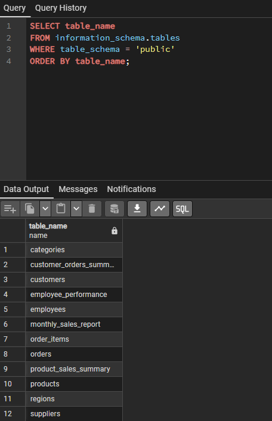

---

# Рівень 1

## 1. Основні SELECT-запити

### 1.1. Отримати всі записи з таблиці customers

``` sql
SELECT *
FROM customers;
```

**Результат:** Отримано 15 записів клієнтів, серед яких є фізичні та юридичні особи з різних міст України.

**Скріншот:**
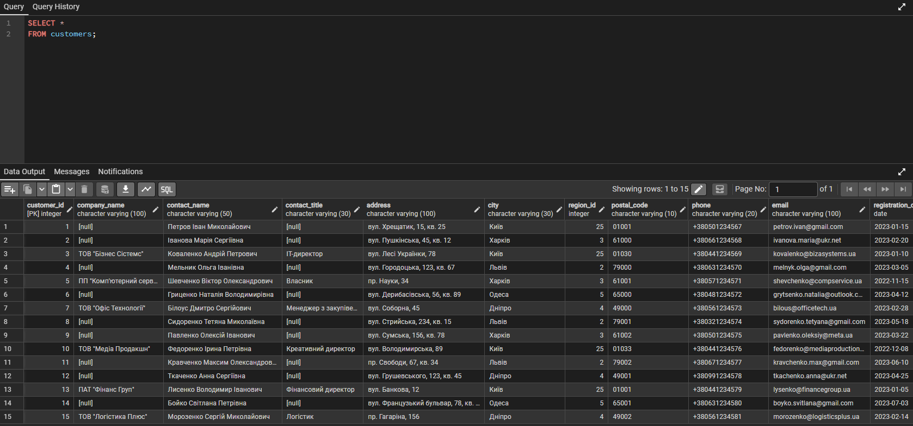

### 1.2. Вивести тільки назви товарів і їхні ціни з таблиці products

``` sql
SELECT product_name, unit_price
FROM products;
```

**Результат:** Отримано назви та ціни всіх 25 товарів, наявних у каталозі.

**Скріншот:**
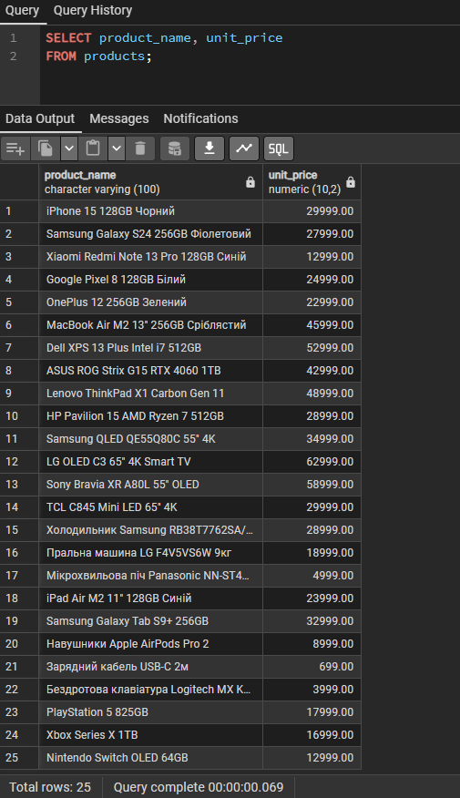

### 1.3. Показати контактні дані всіх співробітників

``` sql
SELECT first_name, last_name, phone, email
FROM employees;
```

**Результат:** Отримано контактні дані 8 співробітників: ім'я, прізвище, телефон та електронну пошту.

**Скріншот:**
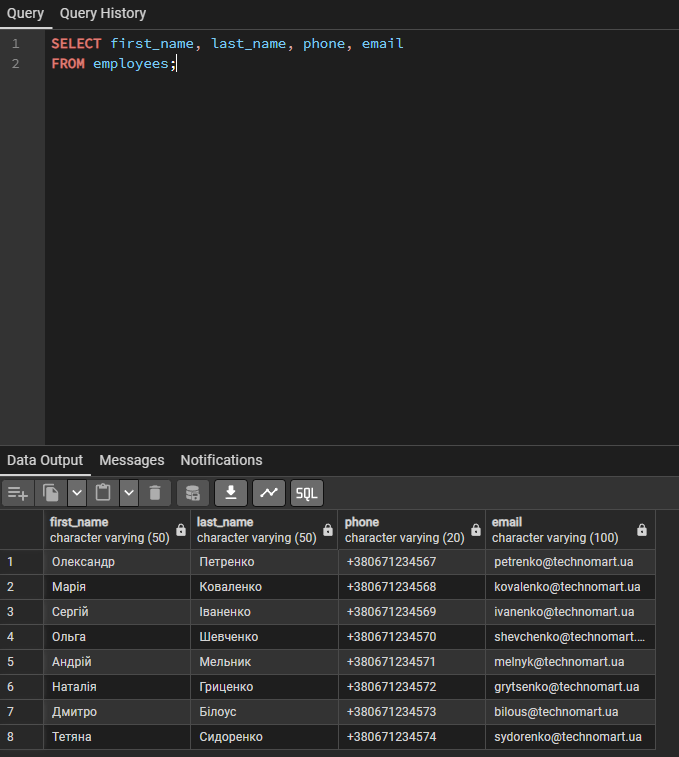

## 2. Прості умови WHERE

### 2.1. Знайти всіх клієнтів з міста Київ

``` sql
SELECT *
FROM customers
WHERE city = 'Київ';
```

**Результат:** Знайдено 4 клієнтів з міста Київ.

**Скріншот:**
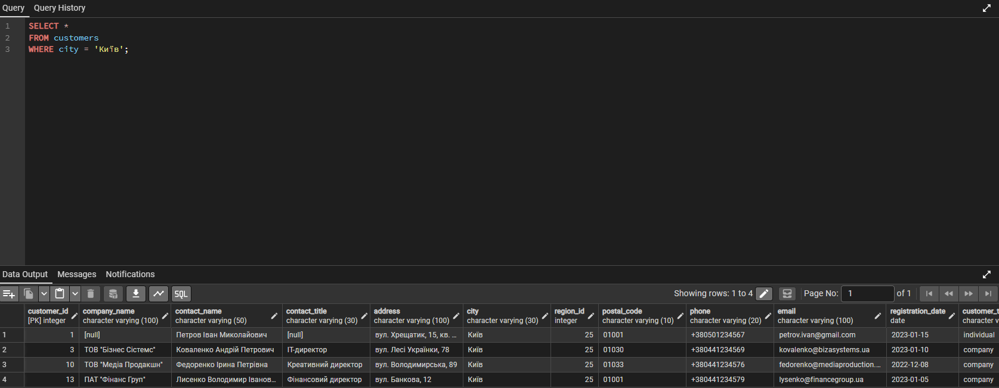

### 2.2. Вивести товари, які коштують більше 25000 грн

``` sql
SELECT product_name, unit_price
FROM products
WHERE unit_price > 25000;
```

**Результат:** Знайдено 13 товарів вартістю понад 25000 грн.

**Скріншот:**
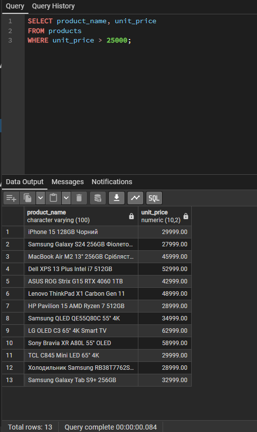

### 2.3. Показати всі замовлення зі статусом delivered

``` sql
SELECT *
FROM orders
WHERE order_status = 'delivered';
```

**Результат:** Знайдено 26 доставлених замовлень.

**Скріншот:**
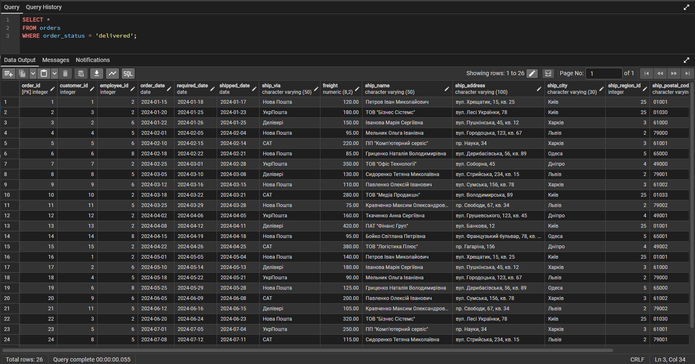

### 2.4. Знайти співробітників, посада яких містить слово «продаж»

``` sql
SELECT *
FROM employees
WHERE title ILIKE '%продаж%';
```

**Результат:** Знайдено 3 співробітників, посада яких пов'язана з продажами.

**Скріншот:**
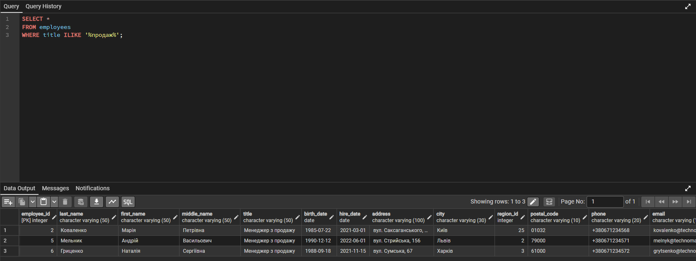

## 3. Базове сортування ORDER BY

### 3.1. Відсортувати товари за зростанням ціни

``` sql
SELECT product_name, unit_price
FROM products
ORDER BY unit_price ASC;
```

**Результат:** Отримано 25 товарів, відсортованих від найдешевшого до найдорожчого.

**Скріншот:**
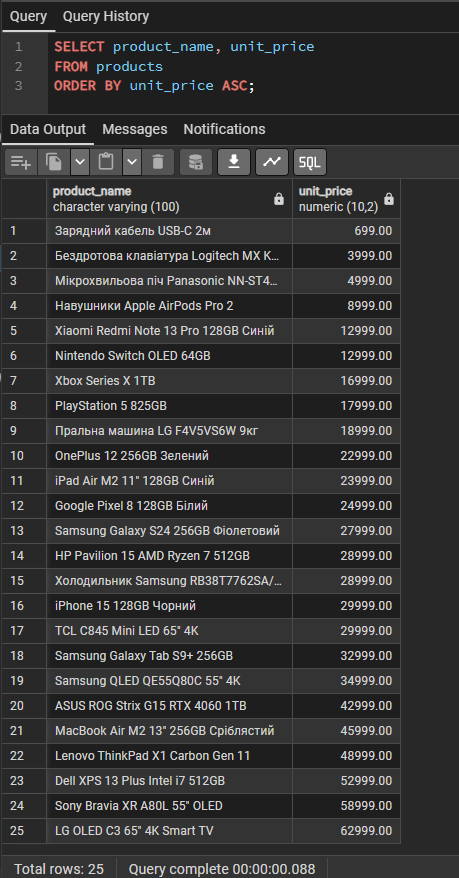

### 3.2. Показати клієнтів в алфавітному порядку за іменем контактної особи

``` sql
SELECT customer_id, contact_name, city
FROM customers
ORDER BY contact_name ASC;
```

**Результат:** Отримано 15 клієнтів, відсортованих за ім'ям контактної особи в алфавітному порядку.

**Скріншот:**
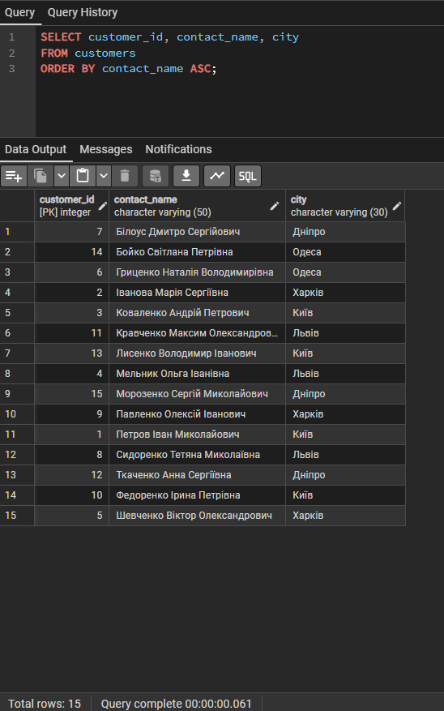

### 3.3. Вивести замовлення від найновіших до найстаріших

``` sql
SELECT order_id, customer_id, order_date, order_status
FROM orders
ORDER BY order_date DESC;
```

**Результат:** Отримано 31 замовлення, відсортоване за датою у порядку від найновішого до найстарішого.

**Скріншот:**
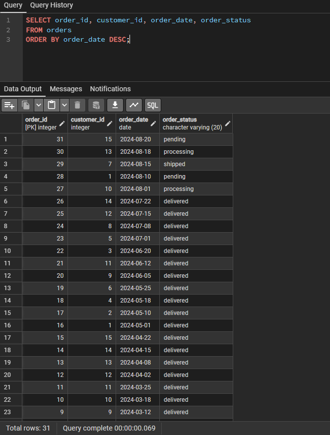

## 4. Обмеження результатів LIMIT

### 4.1. Показати перші 10 найдорожчих товарів

``` sql
SELECT product_name, unit_price
FROM products
ORDER BY unit_price DESC
LIMIT 10;
```

**Результат:** Виведено 10 найдорожчих товарів каталогу.

**Скріншот:**
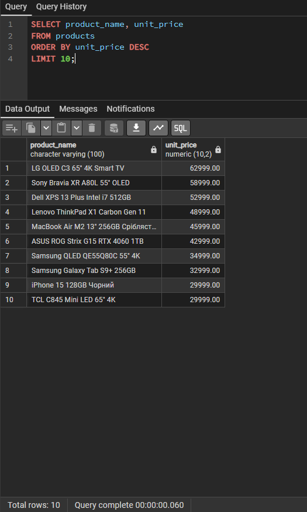

### 4.2. Вивести 5 останніх замовлень

``` sql
SELECT order_id, customer_id, order_date, order_status
FROM orders
ORDER BY order_date DESC
LIMIT 5;
```

**Результат:** Виведено 5 найновіших замовлень за датою оформлення.

**Скріншот:**
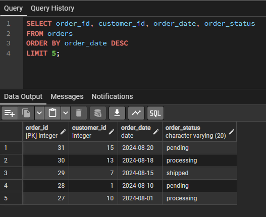

### 4.3. Отримати перших 8 клієнтів в алфавітному порядку

``` sql
SELECT customer_id, contact_name, city
FROM customers
ORDER BY contact_name ASC
LIMIT 8;
```

**Результат:** Виведено перших 8 клієнтів після сортування контактних осіб за алфавітом.

**Скріншот:**
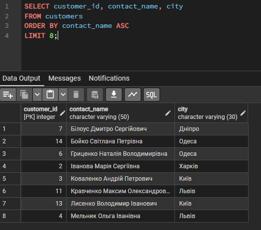

---

# Рівень 2

## 1. Пошук за зразком з LIKE

### 1.1. Знайти всіх клієнтів, чиї імена починаються на «Іван»

``` sql
SELECT *
FROM customers
WHERE contact_name LIKE 'Іван%';
```

**Результат:** Знайдено 1 клієнта, ім'я контактної особи якого починається на «Іван».

**Скріншот:**
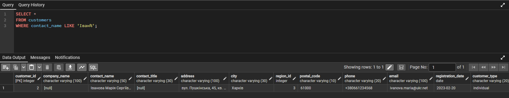

### 1.2. Вивести товари, в назві яких є слово «phone» або «телефон»

``` sql
SELECT product_name, unit_price
FROM products
WHERE product_name ILIKE '%phone%'
   OR product_name ILIKE '%телефон%';
```

**Результат:** Знайдено 1 товар — `iPhone 15 128GB Чорний`, оскільки `ILIKE` виконує пошук без урахування регістру.

**Скріншот:**
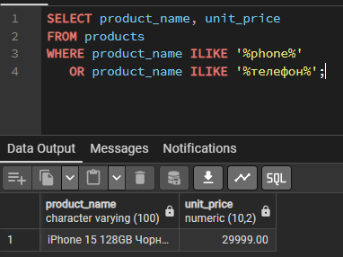

### 1.3. Власний LIKE: адреси електронної пошти Gmail

**Бізнес-логіка:** Запит дозволяє виділити клієнтів, які використовують Gmail, наприклад для аналізу контактної бази або сегментації користувачів за поштовим сервісом.

``` sql
-- Пошук клієнтів, email яких закінчується на @gmail.com
SELECT contact_name, email
FROM customers
WHERE email LIKE '%@gmail.com';
```

**Результат:** Знайдено 5 клієнтів з адресами електронної пошти Gmail.

**Скріншот:**
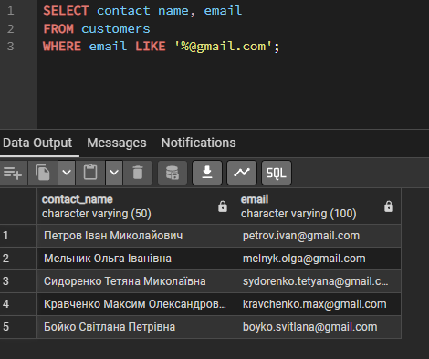

### 1.4. Власний LIKE: прізвища співробітників, що закінчуються на «енко»

**Бізнес-логіка:** Запит демонструє пошук текстових значень за заданим закінченням та може використовуватися для фільтрації персоналу за частиною прізвища.

``` sql
-- Пошук прізвищ із закінченням "енко"
SELECT first_name, last_name
FROM employees
WHERE last_name LIKE '%енко';
```

**Результат:** Знайдено 5 співробітників, прізвища яких закінчуються на «енко».

**Скріншот:**
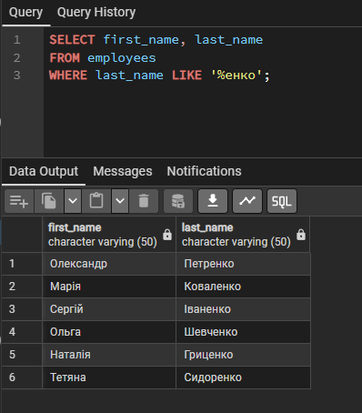

### 1.5. Власний LIKE: товари Samsung

**Бізнес-логіка:** Запит дозволяє швидко отримати всі товари конкретного бренду без окремого поля для зберігання бренду.

``` sql
-- Пошук товарів, назва яких містить Samsung
SELECT product_name, unit_price
FROM products
WHERE product_name LIKE '%Samsung%';
```

**Результат:** Знайдено 4 товари бренду Samsung.

**Скріншот:**
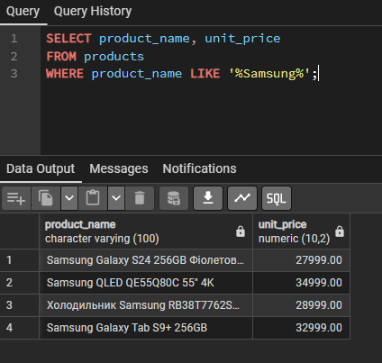

## 2. Логічні оператори AND, OR, NOT

### 2.1. Знайти товари дорожчі за 15000 грн і дешевші за 50000 грн

``` sql
SELECT product_name, unit_price
FROM products
WHERE unit_price > 15000
  AND unit_price < 50000;
```

**Результат:** Знайдено 16 товарів у заданому ціновому інтервалі без включення граничних значень.

**Скріншот:**
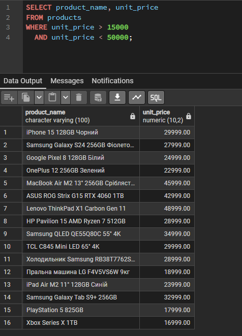

### 2.2. Вивести клієнтів з Києва або Львова, які є юридичними особами

``` sql
SELECT contact_name, company_name, city
FROM customers
WHERE (city = 'Київ' OR city = 'Львів')
  AND customer_type = 'company';
```

**Результат:** Знайдено 3 юридичні особи з Києва або Львова.

**Скріншот:**
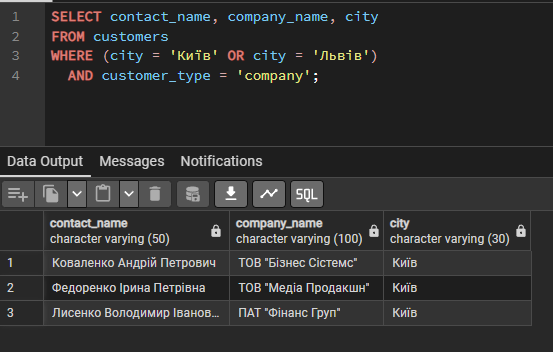

### 2.3. Власний AND: дорогі товари з достатнім запасом

**Бізнес-логіка:** Запит допомагає знайти дорогі товари, яких на складі достатньо для активного продажу.

``` sql
-- Дорогі товари із запасом не менше 10 одиниць
SELECT product_name, unit_price, units_in_stock
FROM products
WHERE unit_price > 30000
  AND units_in_stock >= 10;
```

**Результат:** Знайдено 3 дорогі товари, яких на складі не менше 10 одиниць.

**Скріншот:**
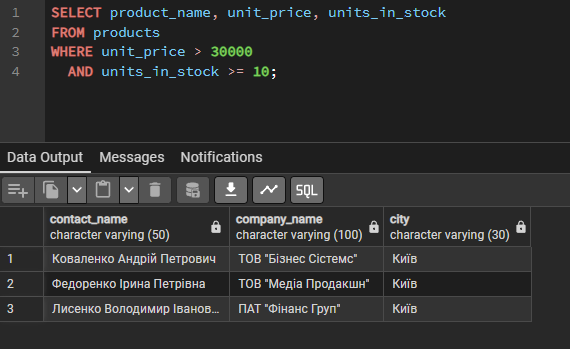

### 2.4. Власний AND: доставлені замовлення Новою Поштою

**Бізнес-логіка:** Запит дозволяє проаналізувати завершені доставки, виконані конкретною службою доставки.

``` sql
-- Доставлені замовлення через Нову Пошту
SELECT order_id, order_date, ship_via, order_status
FROM orders
WHERE ship_via = 'Нова Пошта'
  AND order_status = 'delivered';
```

**Результат:** Знайдено 8 доставлених замовлень, відправлених Новою Поштою.

**Скріншот:**
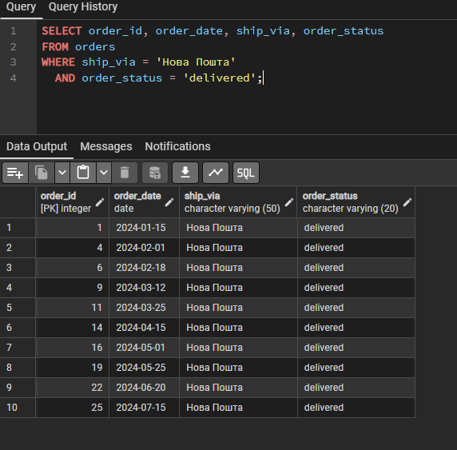

### 2.5. Власний OR: клієнти з трьох великих міст

**Бізнес-логіка:** Запит дозволяє сформувати вибірку клієнтів із трьох важливих для магазину міст.

``` sql
-- Клієнти з Києва, Львова або Харкова
SELECT contact_name, city
FROM customers
WHERE city = 'Київ'
   OR city = 'Львів'
   OR city = 'Харків';
```

**Результат:** Знайдено 10 клієнтів з Києва, Львова або Харкова.

**Скріншот:**
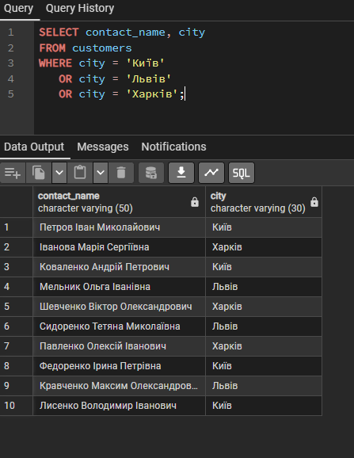

### 2.6. Власний NOT: активні товари

**Бізнес-логіка:** Запит відбирає товари, які не зняті з продажу та можуть використовуватися в актуальному каталозі магазину.

``` sql
-- Тільки товари, які не зняті з продажу
SELECT product_name
FROM products
WHERE NOT discontinued;
```

**Результат:** Знайдено 25 активних товарів.

**Скріншот:**
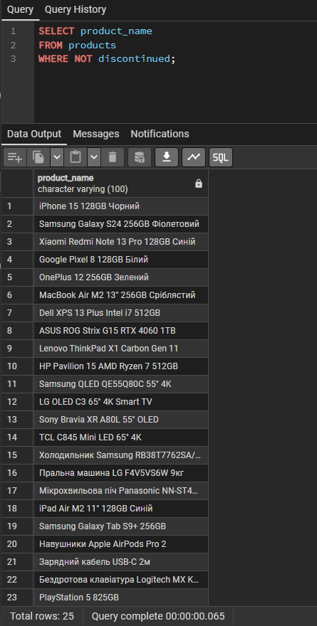

## 3. Оператори IN, BETWEEN, IS NULL

### 3.1. Вивести клієнтів з міст Київ, Харків, Одеса, Дніпро

``` sql
SELECT contact_name, city
FROM customers
WHERE city IN ('Київ', 'Харків', 'Одеса', 'Дніпро');
```

**Результат:** Знайдено 12 клієнтів із зазначених міст.

**Скріншот:**
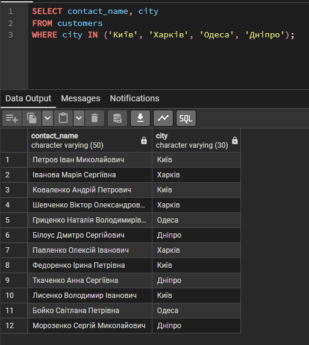

### 3.2. Знайти товари в ціновому діапазоні від 10000 до 30000 грн

``` sql
SELECT product_name, unit_price
FROM products
WHERE unit_price BETWEEN 10000 AND 30000;
```

**Результат:** Знайдено 13 товарів у діапазоні від 10000 до 30000 грн включно.

**Скріншот:**
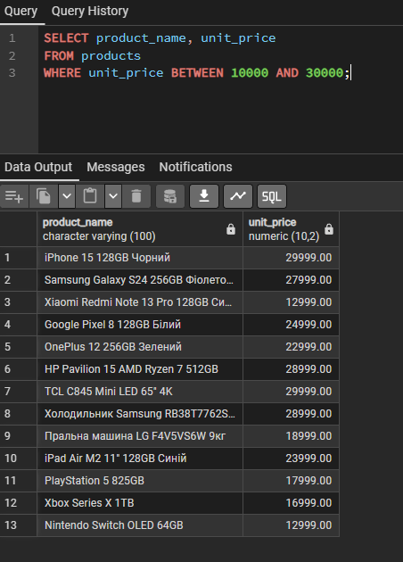

### 3.3. Власний IN №1: активні статуси замовлень

**Бізнес-логіка:** Запит дозволяє отримати всі замовлення, робота над якими ще не завершена.

``` sql
-- Замовлення, які ще перебувають у роботі
SELECT order_id, order_date, order_status
FROM orders
WHERE order_status IN ('pending', 'processing', 'shipped');
```

**Результат:** Знайдено 5 поточних замовлень.

**Скріншот:**
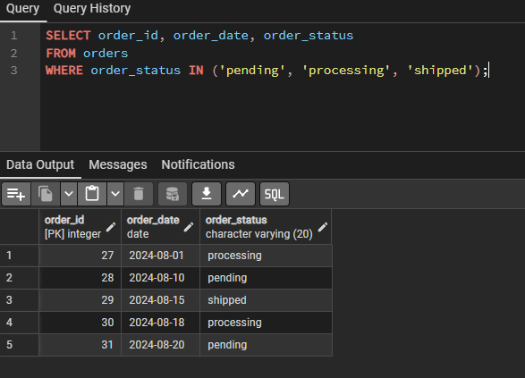

### 3.4. Власний IN №2: товари ключових категорій

**Бізнес-логіка:** Запит формує вибірку товарів із категорій смартфонів, ноутбуків та ігрових консолей.

``` sql
-- Категорії: смартфони, ноутбуки та ігрові консолі
SELECT product_name, category_id
FROM products
WHERE category_id IN (1, 2, 6);
```

**Результат:** Знайдено 13 товарів із трьох вибраних категорій.

**Скріншот:**
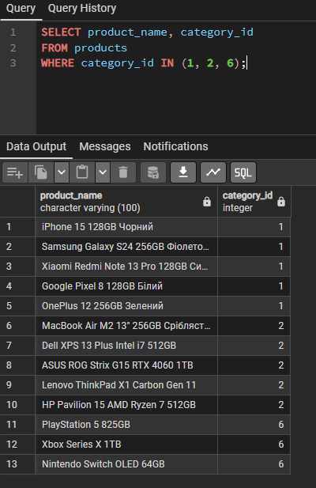

### 3.5. Власний BETWEEN №1: реєстрації у першій половині 2023 року

**Бізнес-логіка:** Запит дозволяє дослідити клієнтів, які зареєструвалися протягом першого півріччя 2023 року.

``` sql
-- Реєстрації клієнтів у першій половині 2023 року
SELECT contact_name, registration_date
FROM customers
WHERE registration_date BETWEEN '2023-01-01' AND '2023-06-30';
```

**Результат:** Знайдено 11 клієнтів, зареєстрованих у першій половині 2023 року.

**Скріншот:**
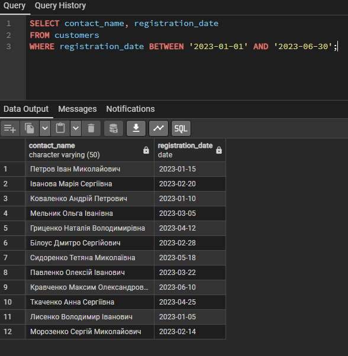

### 3.6. Власний BETWEEN №2: співробітники із зарплатою 22000–30000 грн

**Бізнес-логіка:** Запит дозволяє виділити працівників із зарплатою у визначеному діапазоні для аналізу структури оплати праці.

``` sql
-- Співробітники із зарплатою від 22000 до 30000 грн
SELECT first_name, last_name, salary
FROM employees
WHERE salary BETWEEN 22000 AND 30000;
```

**Результат:** Знайдено 4 співробітників із зарплатою в заданому діапазоні.

**Скріншот:**
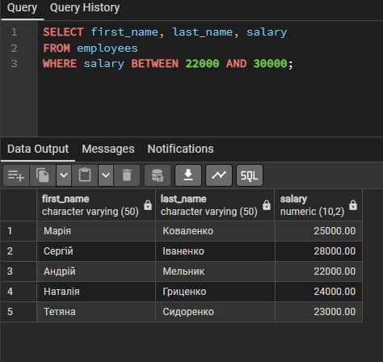

### 3.7. Власний IS NULL: замовлення, які ще не відправлені

**Бізнес-логіка:** Відсутність дати відправлення дозволяє визначити замовлення, які ще не були передані службі доставки.

``` sql
-- Замовлення без дати відправлення
SELECT order_id, order_date, order_status
FROM orders
WHERE shipped_date IS NULL;
```

**Результат:** Знайдено 4 замовлення без дати відправлення.

**Скріншот:**
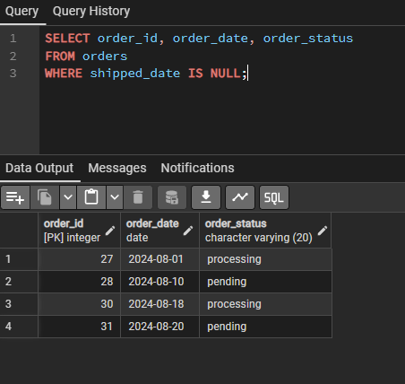

### 3.8. Власний IS NULL: фізичні особи без назви компанії

**Бізнес-логіка:** Запит дозволяє визначити клієнтів, які не представляють компанію.

``` sql
-- Клієнти, для яких компанія не вказана
SELECT contact_name, email
FROM customers
WHERE company_name IS NULL;
```

**Результат:** Знайдено 9 клієнтів без зазначеної компанії.

**Скріншот:**
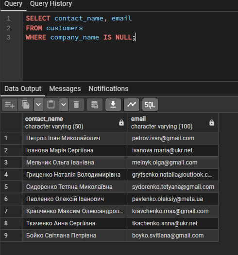

## 4. Комбінування умов

### 4.1. Смартфони популярних брендів у заданому ціновому діапазоні

**Бізнес-логіка:** Запит допомагає сформувати вибірку популярних смартфонів середнього та високого цінового сегмента.

``` sql
-- Популярні бренди смартфонів у діапазоні 20000–40000 грн
SELECT product_name, unit_price
FROM products
WHERE (product_name ILIKE '%Samsung%'
       OR product_name ILIKE '%iPhone%')
  AND unit_price BETWEEN 20000 AND 40000;
```

**Результат:** Знайдено 3 товари, які відповідають заданим умовам.

**Скріншот:**
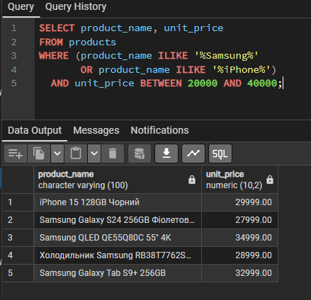

### 4.2. Корпоративні клієнти з основних міст

**Бізнес-логіка:** Запит дозволяє визначити корпоративних клієнтів у містах, важливих для B2B-продажів.

``` sql
-- Компанії з Києва, Харкова та Дніпра
SELECT contact_name, company_name, city
FROM customers
WHERE customer_type = 'company'
  AND city IN ('Київ', 'Харків', 'Дніпро');
```

**Результат:** Знайдено 6 корпоративних клієнтів із вибраних міст.

**Скріншот:**
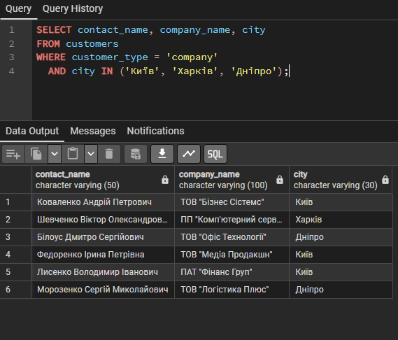

### 4.3. Активні товари з невеликим залишком

**Бізнес-логіка:** Запит допомагає контролювати дорогі активні товари з невеликим залишком на складі.

``` sql
-- Активні товари дорожчі 10000 грн із залишком до 10 одиниць
SELECT product_name, unit_price, units_in_stock
FROM products
WHERE NOT discontinued
  AND units_in_stock <= 10
  AND unit_price > 10000;
```

**Результат:** Знайдено 10 товарів, які потребують підвищеної уваги до складських запасів.

**Скріншот:**
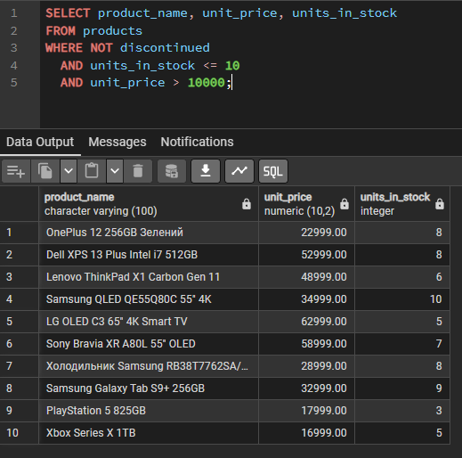

### 4.4. Поточні замовлення за серпень 2024 року

**Бізнес-логіка:** Запит виділяє серпневі замовлення, які на момент формування навчальних даних ще не були доставлені.

``` sql
-- Недоставлені замовлення за серпень 2024 року
SELECT order_id, order_date, order_status
FROM orders
WHERE order_date BETWEEN '2024-08-01' AND '2024-08-31'
  AND order_status IN ('pending', 'processing', 'shipped');
```

**Результат:** Знайдено 5 поточних замовлень за серпень 2024 року.

**Скріншот:**
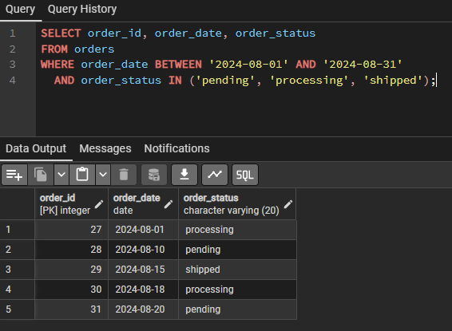

### 4.5. Фізичні особи з Gmail у вибраних містах

**Бізнес-логіка:** Запит сегментує приватних клієнтів за типом, містом та поштовим сервісом.

``` sql
-- Фізичні особи з Gmail у Києві, Львові або Одесі
SELECT contact_name, city, email
FROM customers
WHERE email ILIKE '%@gmail.com'
  AND city IN ('Київ', 'Львів', 'Одеса')
  AND customer_type = 'individual';
```

**Результат:** Знайдено 5 клієнтів, які відповідають усім заданим критеріям.

**Скріншот:**
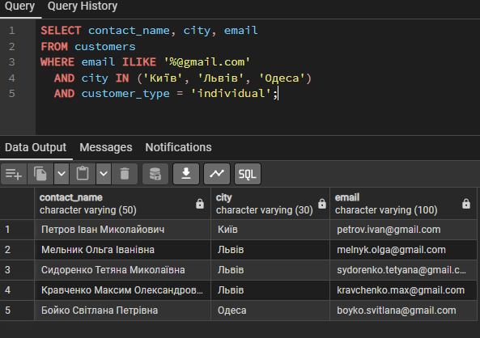

## 5. Складне сортування та пагінація

### 5.1. Сортування товарів за категорією та ціною

**Бізнес-логіка:** Товари групуються за категоріями, а всередині кожної категорії дорожчі позиції відображаються першими.

``` sql
-- Категорія за зростанням, ціна всередині категорії за спаданням
SELECT product_name, category_id, unit_price
FROM products
ORDER BY category_id ASC, unit_price DESC;
```

**Результат:** Отримано 25 товарів, впорядкованих за двома критеріями.

**Скріншот:**
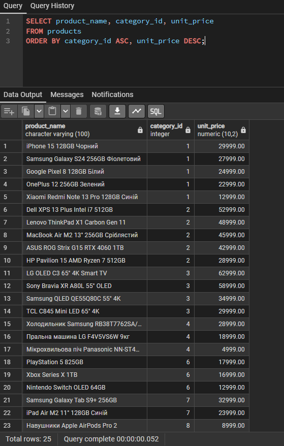

### 5.2. Сортування клієнтів за типом, містом та ім'ям

**Бізнес-логіка:** Такий порядок зручний для структурованого перегляду клієнтської бази.

``` sql
-- Багаторівневе сортування клієнтів
SELECT contact_name, city, customer_type
FROM customers
ORDER BY customer_type ASC, city ASC, contact_name ASC;
```

**Результат:** Отримано 15 клієнтів, послідовно відсортованих за типом, містом та ім'ям.

**Скріншот:**
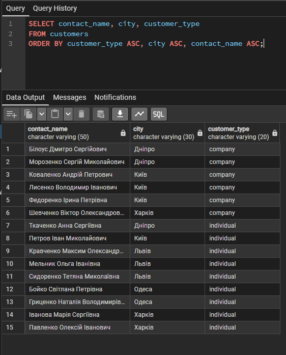

### 5.3. Сортування замовлень за статусом та датою

**Бізнес-логіка:** Замовлення групуються за статусом, а всередині кожного статусу новіші відображаються першими.

``` sql
-- Статус за алфавітом, дата всередині статусу за спаданням
SELECT order_id, order_status, order_date
FROM orders
ORDER BY order_status ASC, order_date DESC;
```

**Результат:** Отримано 31 замовлення з багаторівневим сортуванням.

**Скріншот:**
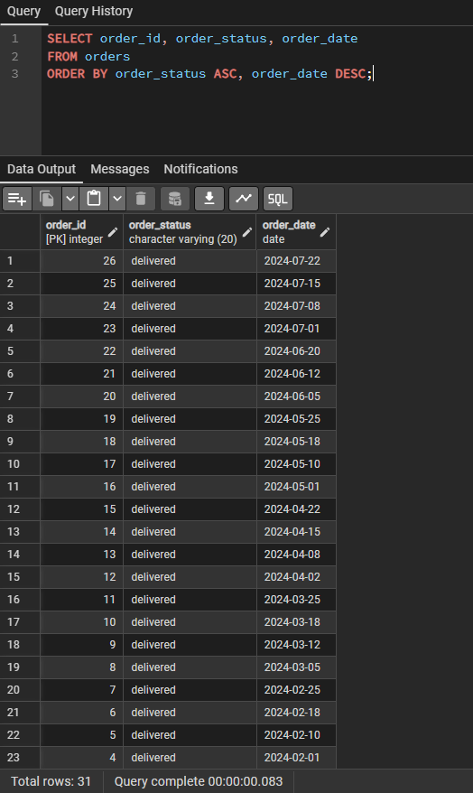

### 5.4. Пагінація товарів — друга сторінка

**Бізнес-логіка:** `OFFSET` дозволяє реалізувати сторінковий перегляд каталогу без отримання всіх записів одночасно.

``` sql
-- Друга сторінка каталогу, по 5 товарів на сторінці
SELECT product_name, unit_price
FROM products
ORDER BY product_name
LIMIT 5 OFFSET 5;
```

**Результат:** Пропущено перші 5 товарів і отримано наступні 5 записів.

**Скріншот:**
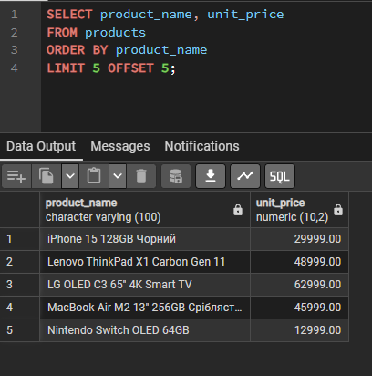

### 5.5. Пагінація клієнтів — третя сторінка

**Бізнес-логіка:** Запит демонструє отримання третьої сторінки списку клієнтів при розмірі сторінки 5 записів.

``` sql
-- Третя сторінка клієнтів, по 5 записів на сторінці
SELECT contact_name, city
FROM customers
ORDER BY contact_name
LIMIT 5 OFFSET 10;
```

**Результат:** Пропущено перші 10 клієнтів і отримано останні 5 записів третьої сторінки.

**Скріншот:**
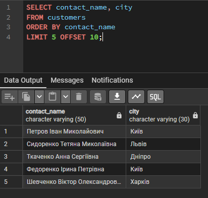

---

# Рівень 3

## 1. Складні комбінації LIKE з логічними операторами

### 1.1. Товари Samsung або Apple без слова «чохол»

``` sql
SELECT product_name, unit_price
FROM products
WHERE (product_name ILIKE '%Samsung%'
       OR product_name ILIKE '%Apple%')
  AND product_name NOT ILIKE '%чохол%';
```

**Результат:** Знайдено 5 товарів Samsung або Apple; товарів зі словом «чохол» у цій вибірці немає.

**Скріншот:**
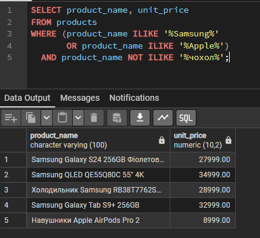

### 1.2. Власний запит: ноутбуки вибраних брендів без аксесуарів

**Бізнес-логіка:** Запит відбирає ноутбуки Apple, Dell або ASUS і додатково виключає назви з кабелями, щоб у вибірку не потрапляли аксесуари.

``` sql
-- Ноутбуки Apple, Dell або ASUS без кабелів
SELECT product_name, unit_price
FROM products
WHERE (product_name ILIKE '%MacBook%'
       OR product_name ILIKE '%Dell%'
       OR product_name ILIKE '%ASUS%')
  AND product_name NOT ILIKE '%кабель%';
```

**Результат:** Знайдено 3 товари, які відповідають заданому шаблону.

**Скріншот:**
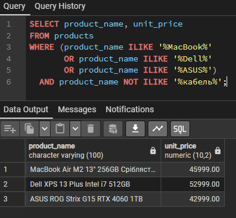

### 1.3. Власний запит: Gmail або Ukr.net поза Києвом

**Бізнес-логіка:** Запит дозволяє сегментувати клієнтів за поштовим сервісом та одночасно виключити столичний регіон.

``` sql
-- Клієнти Gmail або Ukr.net, які живуть не в Києві
SELECT contact_name, email, city
FROM customers
WHERE (email ILIKE '%@gmail.com'
       OR email ILIKE '%@ukr.net')
  AND city NOT ILIKE 'Київ';
```

**Результат:** Знайдено 6 клієнтів, які використовують Gmail або Ukr.net та проживають поза Києвом.

**Скріншот:**
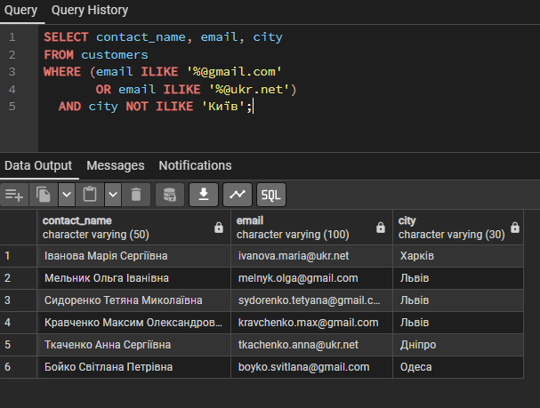

### 1.4. Власний запит: менеджери, крім менеджера складу

**Бізнес-логіка:** Запит знаходить співробітників з менеджерськими посадами, але виключає складський напрям.

``` sql
-- Менеджерські посади, крім менеджера складу
SELECT first_name, last_name, title
FROM employees
WHERE title ILIKE '%менеджер%'
  AND title NOT ILIKE '%складу%';
```

**Результат:** Знайдено 4 співробітників з менеджерськими посадами після виключення менеджера складу.

**Скріншот:**
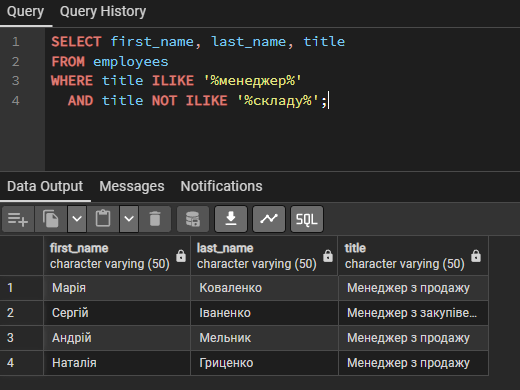

### 1.5. Власний запит: дорогі товари Samsung або LG

**Бізнес-логіка:** Запит дозволяє проаналізувати дорогий сегмент продукції двох популярних брендів.

``` sql
-- Samsung або LG дорожче 20000 грн
SELECT product_name, unit_price
FROM products
WHERE (product_name ILIKE '%Samsung%'
       OR product_name ILIKE '%LG%')
  AND unit_price > 20000;
```

**Результат:** Знайдено 5 товарів Samsung або LG вартістю понад 20000 грн.

**Скріншот:**
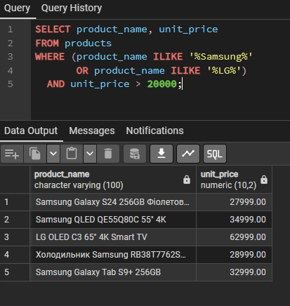

## 2. Вкладені логічні умови

### 2.1. Товари дорожчі 20000 грн категорій 1 або 2 АБО товари дешевші 5000 грн

``` sql
SELECT product_name, category_id, unit_price
FROM products
WHERE (unit_price > 20000 AND category_id IN (1, 2))
   OR unit_price < 5000;
```

**Результат:** Знайдено 12 товарів, які відповідають хоча б одній із двох логічних груп умов.

**Скріншот:**
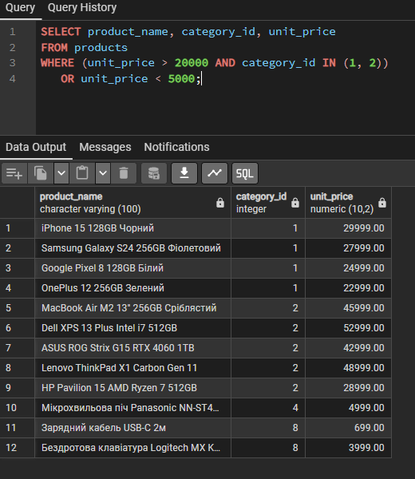

### 2.2. Власний запит: дорогі товари з малим запасом або дешеві з великим запасом

**Бізнес-логіка:** Запит одночасно виявляє дорогі позиції з ризиком дефіциту та дешеві позиції з великим складським запасом.

``` sql
-- Дві незалежні групи умов для аналізу запасів
SELECT product_name, unit_price, units_in_stock
FROM products
WHERE (unit_price > 30000 AND units_in_stock < 10)
   OR (unit_price < 10000 AND units_in_stock > 20);
```

**Результат:** Знайдено 8 товарів, які відповідають одній із двох груп умов.

**Скріншот:**
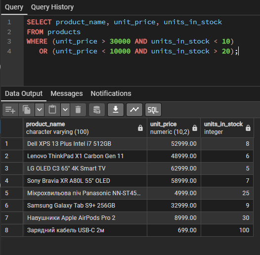

### 2.3. Власний запит: компанії з Києва/Дніпра або фізичні особи з Одеси

**Бізнес-логіка:** Запит формує два різні клієнтські сегменти в одній вибірці з чітким групуванням логічних умов.

``` sql
-- Корпоративний та приватний сегменти клієнтів
SELECT contact_name, customer_type, city
FROM customers
WHERE (customer_type = 'company'
       AND city IN ('Київ', 'Дніпро'))
   OR (customer_type = 'individual'
       AND city = 'Одеса');
```

**Результат:** Знайдено 7 клієнтів: компанії з Києва/Дніпра та фізичні особи з Одеси.

**Скріншот:**


### 2.4. Власний запит: невідправлені або дорогі активні замовлення

**Бізнес-логіка:** Запит допомагає визначити замовлення, що потребують уваги: невідправлені pending/processing або вже відправлені замовлення з високою вартістю доставки.

``` sql
-- Замовлення, які можуть потребувати додаткового контролю
SELECT order_id, order_status, freight, shipped_date
FROM orders
WHERE (order_status IN ('pending', 'processing')
       AND shipped_date IS NULL)
   OR (order_status = 'shipped'
       AND freight > 300);
```

**Результат:** Знайдено 5 активних замовлень, які відповідають заданим критеріям контролю.

**Скріншот:**


## 3. Комплексні аналітичні запити

### 3.1. Звіт товарів з 5+ умовами фільтрації

**Бізнес-логіка:** Запит формує список актуальних товарів середнього та високого цінового сегмента з ключових категорій, які є в наявності, уже замовляються у постачальників та не є кабелями.

``` sql
-- Комплексний відбір перспективних товарів
SELECT
    product_name,
    category_id,
    unit_price,
    units_in_stock,
    units_on_order,
    discontinued
FROM products
WHERE unit_price BETWEEN 15000 AND 50000      -- ціновий сегмент
  AND category_id IN (1, 2, 3, 7)            -- ключові категорії
  AND units_in_stock > 5                      -- є достатній запас
  AND units_on_order > 0                      -- є поповнення
  AND discontinued = false                    -- товар активний
  AND product_name NOT ILIKE '%кабель%'       -- виключаємо кабелі
ORDER BY unit_price DESC;
```

**Результат:** Отримано 11 товарів, які одночасно відповідають усім шести критеріям фільтрації.

**Скріншот:**


### 3.2. Аналіз клієнтської бази за множинними критеріями

**Бізнес-логіка:** Запит формує цільову клієнтську аудиторію: корпоративних клієнтів із ключових міст або приватних клієнтів Gmail, зареєстрованих протягом 2023 року.

``` sql
-- Аналіз двох цільових сегментів клієнтської бази
SELECT
    customer_id,
    contact_name,
    company_name,
    city,
    email,
    customer_type,
    registration_date
FROM customers
WHERE (
        customer_type = 'company'
        AND city IN ('Київ', 'Харків', 'Дніпро')
      )
   OR (
        customer_type = 'individual'
        AND email ILIKE '%@gmail.com'
        AND registration_date BETWEEN '2023-01-01' AND '2023-12-31'
      )
ORDER BY customer_type, city, contact_name;
```

**Результат:** Знайдено 11 клієнтів, які належать хоча б до одного з двох цільових сегментів.

**Скріншот:**


## 4. Дослідження даних та пошук закономірностей

### 4.1. Аналіз товарів за ціновими сегментами — бюджетний сегмент

**Бізнес-логіка:** Виділення товарів дешевше 10000 грн дозволяє оцінити бюджетну частину асортименту.

``` sql
-- Бюджетний сегмент
SELECT product_name, unit_price
FROM products
WHERE unit_price < 10000
ORDER BY unit_price;
```

**Результат:** До бюджетного сегмента потрапило 4 товари.

**Скріншот:**


### 4.2. Аналіз товарів за ціновими сегментами — середній сегмент

**Бізнес-логіка:** Виділення товарів від 10000 до 30000 грн дозволяє проаналізувати основний середній ціновий сегмент каталогу.

``` sql
-- Середній ціновий сегмент
SELECT product_name, unit_price
FROM products
WHERE unit_price BETWEEN 10000 AND 30000
ORDER BY unit_price;
```

**Результат:** До середнього цінового сегмента потрапило 13 товарів.

**Скріншот:**


### 4.3. Аналіз товарів за ціновими сегментами — преміальний сегмент

**Бізнес-логіка:** Запит показує найдорожчу частину асортименту для оцінки преміальної пропозиції магазину.

``` sql
-- Преміальний сегмент
SELECT product_name, unit_price
FROM products
WHERE unit_price > 30000
ORDER BY unit_price DESC;
```

**Результат:** До преміального сегмента потрапило 8 товарів.

**Скріншот:**


### 4.4. Географічний аналіз — клієнти Києва

**Бізнес-логіка:** Аналіз столичної клієнтської бази дозволяє оцінити присутність магазину в Києві.

``` sql
-- Клієнти Києва
SELECT contact_name, customer_type
FROM customers
WHERE city = 'Київ'
ORDER BY contact_name;
```

**Результат:** У Києві зареєстровано 4 клієнтів.

**Скріншот:**


### 4.5. Географічний аналіз — клієнти Львова

**Бізнес-логіка:** Запит дозволяє оцінити клієнтську базу магазину у Львові.

``` sql
-- Клієнти Львова
SELECT contact_name, email
FROM customers
WHERE city = 'Львів';
```

**Результат:** У Львові зареєстровано 3 клієнтів.

**Скріншот:**


### 4.6. Географічний аналіз — корпоративні клієнти великих міст

**Бізнес-логіка:** Запит показує B2B-клієнтів у Києві, Харкові та Дніпрі для оцінки географії корпоративних продажів.

``` sql
-- Корпоративні клієнти трьох великих міст
SELECT company_name, contact_name, city
FROM customers
WHERE customer_type = 'company'
  AND city IN ('Київ', 'Харків', 'Дніпро')
ORDER BY city;
```

**Результат:** Знайдено 6 корпоративних клієнтів із вибраних міст.

**Скріншот:**


### 4.7. Географічний аналіз — клієнти поза Києвом

**Бізнес-логіка:** Запит дозволяє оцінити частину клієнтської бази, яка знаходиться за межами столиці.

``` sql
-- Усі клієнти, крім київських
SELECT contact_name, city
FROM customers
WHERE city <> 'Київ'
ORDER BY city, contact_name;
```

**Результат:** За межами Києва знаходиться 11 клієнтів.

**Скріншот:**


### 4.8. Часовий аналіз — замовлення першого кварталу 2024 року

**Бізнес-логіка:** Запит дозволяє дослідити активність замовлень у першому кварталі року.

``` sql
-- Замовлення за січень-березень 2024 року
SELECT order_id, order_date, order_status
FROM orders
WHERE order_date BETWEEN '2024-01-01' AND '2024-03-31'
ORDER BY order_date;
```

**Результат:** У першому кварталі 2024 року оформлено 11 замовлень.

**Скріншот:**


### 4.9. Часовий аналіз — літні замовлення

**Бізнес-логіка:** Запит показує активність клієнтів у літній період та дозволяє порівнювати її з іншими сезонами.

``` sql
-- Замовлення за червень-серпень 2024 року
SELECT order_id, customer_id, order_date
FROM orders
WHERE order_date BETWEEN '2024-06-01' AND '2024-08-31'
ORDER BY order_date;
```

**Результат:** У період з червня по серпень 2024 року оформлено 12 замовлень.

**Скріншот:**


### 4.10. Часовий аналіз — замовлення серпня 2024 року

**Бізнес-логіка:** Запит виділяє найактуальніший місяць у навчальному наборі даних та показує замовлення від найновіших до найстаріших.

``` sql
-- Замовлення серпня 2024 року
SELECT order_id, order_date, order_status
FROM orders
WHERE order_date BETWEEN '2024-08-01' AND '2024-08-31'
ORDER BY order_date DESC;
```

**Результат:** У серпні 2024 року оформлено 5 замовлень.

**Скріншот:**


## 5. Креативні завдання

### 5.1. Товари, запас яких наближається до рівня повторного замовлення

**Бізнес-логіка:** Запит допомагає завчасно виявити товари, запас яких є відносно малим порівняно з установленим рівнем повторного замовлення.

``` sql
-- Товари, залишок яких не перевищує подвійний reorder_level
SELECT
    product_name,
    units_in_stock,
    reorder_level,
    units_on_order
FROM products
WHERE units_in_stock <= reorder_level * 2
  AND discontinued = false
ORDER BY units_in_stock ASC;
```

**Результат:** Знайдено 7 товарів, складські запаси яких потребують контролю.

**Скріншот:**


### 5.2. Товари з найбільшою вартістю складських запасів

**Бізнес-логіка:** Обчислення `unit_price * units_in_stock` показує, скільки коштів умовно вкладено в поточний запас кожного товару.

``` sql
-- Розрахунок вартості поточного складського запасу
SELECT
    product_name,
    unit_price,
    units_in_stock,
    unit_price * units_in_stock AS inventory_value
FROM products
WHERE units_in_stock > 0
ORDER BY inventory_value DESC
LIMIT 10;
```

**Результат:** Отримано 10 товарів із найбільшою сумарною вартістю залишків на складі.

**Скріншот:**


### 5.3. Активні замовлення, планова дата виконання яких уже настала

**Бізнес-логіка:** Для історичного навчального набору використовується контрольна дата `2024-08-31`. Запит показує недоставлені замовлення, для яких запланована дата виконання вже минула або настала.

``` sql
-- Контроль прострочених активних замовлень станом на 31.08.2024
SELECT
    order_id,
    order_date,
    required_date,
    shipped_date,
    order_status
FROM orders
WHERE required_date <= '2024-08-31'
  AND order_status <> 'delivered'
ORDER BY required_date;
```

**Результат:** Знайдено 5 активних замовлень, планова дата виконання яких станом на 31.08.2024 уже настала.

**Скріншот:**


### 5.4. Дорогі товари з невеликим залишком

**Бізнес-логіка:** Запит виявляє дорогі активні товари з невеликим запасом, відсутність яких потенційно може призвести до втрати продажів.

``` sql
-- Дорогі активні товари із залишком до 10 одиниць
SELECT
    product_name,
    unit_price,
    units_in_stock,
    units_on_order
FROM products
WHERE unit_price > 25000
  AND units_in_stock <= 10
  AND discontinued = false
ORDER BY unit_price DESC, units_in_stock ASC;
```

**Результат:** Знайдено 7 дорогих товарів із залишком не більше 10 одиниць.

**Скріншот:**


### 5.5. Пріоритетні корпоративні замовлення

**Бізнес-логіка:** Запит виділяє активні замовлення корпоративних клієнтів із високою вартістю доставки. Дужки явно групують умови пошуку типу компанії, щоб уникнути помилок через пріоритет `AND` та `OR`.

``` sql
-- Активні корпоративні замовлення з доставкою від 300 грн
SELECT
    order_id,
    customer_id,
    ship_name,
    ship_city,
    freight,
    order_status
FROM orders
WHERE order_status IN ('pending', 'processing', 'shipped')
  AND freight >= 300
  AND (
        ship_name ILIKE '%ТОВ%'
        OR ship_name ILIKE '%ПАТ%'
      )
ORDER BY freight DESC;
```

**Результат:** Знайдено 3 пріоритетні активні корпоративні замовлення з вартістю доставки від 300 грн.

**Скріншот:**


---

## Висновки

Під час виконання лабораторної роботи було досліджено структуру навчальної бази даних та виконано завдання третього рівня складності разом із завданнями першого і другого рівнів.

У роботі використано базові та складні `SELECT`-запити, фільтрацію за допомогою `WHERE`, пошук за шаблоном `LIKE` та `ILIKE`, логічні оператори `AND`, `OR`, `NOT`, оператори `IN`, `BETWEEN`, `IS NULL`, `IS NOT NULL`, сортування `ORDER BY`, а також `LIMIT` і `OFFSET`. Окремо було опрацьовано вкладені логічні умови з дужками, багатокритеріальну фільтрацію та обчислювані поля.

У межах третього рівня проведено аналіз цінових сегментів товарів, географії клієнтської бази та часових закономірностей замовлень. Також створено власні запити з практичною бізнес-логікою для контролю складських запасів, аналізу вартості товарів на складі, контролю активних замовлень і виділення пріоритетних корпоративних замовлень.

**Самооцінка:** 5

**Обґрунтування:** Виконано всі завдання третього рівня складності, включно з вимогами попередніх рівнів. Для самостійних завдань наведено бізнес-логіку та коментарі в SQL-коді. Запити використовують різні способи фільтрації, сортування, пагінації та комбінування логічних умов, а результати мають практичне значення для аналізу даних інтернет-магазину.
