# Лабораторна робота 2. Створення складних SQL запитів

## Загальна інформація

**Здобувач освіти:** Якимов Ілля  
**Група:** ІПЗ-32  
**Обраний рівень складності:** 3

## Виконання завдань

### Рівень 1

#### 1. З'єднання таблиць

**Завдання 1.1:** INNER JOIN --- список товарів з категоріями та
постачальниками

``` sql
SELECT p.product_name, c.category_name,
       s.company_name AS supplier, p.unit_price
FROM products p
INNER JOIN categories c ON p.category_id = c.category_id
INNER JOIN suppliers s ON p.supplier_id = s.supplier_id
ORDER BY c.category_name, p.product_name;
```

**Результат виконання:** Отримано товари з назвами категорій,
постачальників та цінами.

**Скріншот:** 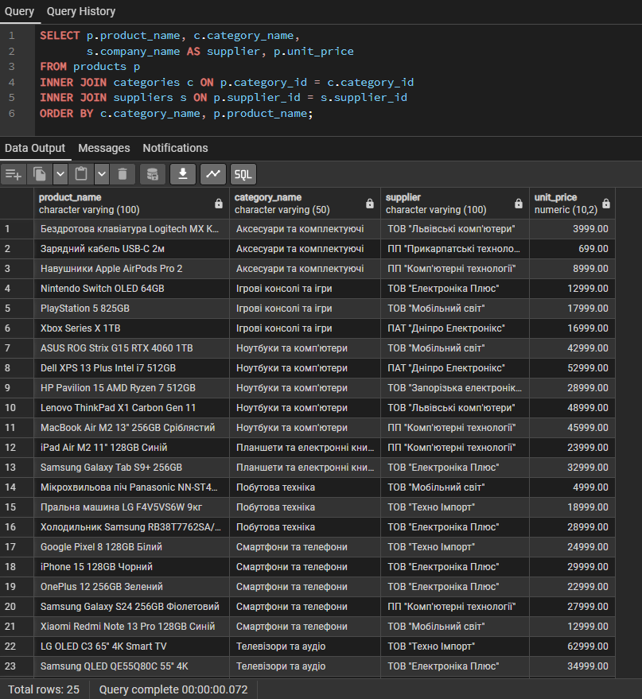

**Пояснення:** `INNER JOIN` повертає записи, для яких існують
відповідності у з'єднаних таблицях. `products` з'єднується з
`categories` через `category_id`, а з `suppliers` --- через
`supplier_id`.

------------------------------------------------------------------------

**Завдання 1.2:** LEFT JOIN --- клієнти з кількістю замовлень

``` sql
SELECT c.contact_name, c.customer_type, r.region_name,
       COUNT(o.order_id) AS order_count
FROM customers c
LEFT JOIN orders o ON c.customer_id = o.customer_id
LEFT JOIN regions r ON c.region_id = r.region_id
GROUP BY c.customer_id, c.contact_name, c.customer_type, r.region_name
ORDER BY order_count DESC;
```

**Результат виконання:** Отримано всіх клієнтів, включаючи тих, хто не
має замовлень.

**Скріншот:** 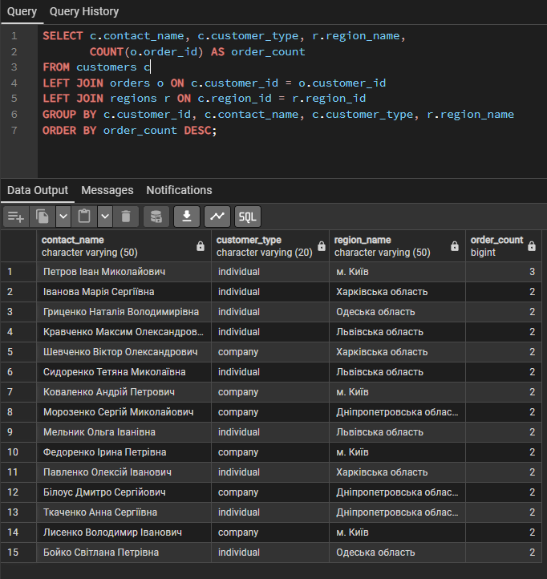

**Пояснення:** `LEFT JOIN`, на відміну від `INNER JOIN`, зберігає всі
записи лівої таблиці. Для клієнта без замовлень `order_count`
дорівнюватиме 0.

------------------------------------------------------------------------

**Завдання 1.3:** Множинне з'єднання --- детальна інформація про
замовлення

``` sql
SELECT o.order_id, o.order_date,
       cu.contact_name AS customer,
       p.product_name, c.category_name,
       oi.quantity, oi.unit_price, oi.discount,
       ROUND(oi.quantity * oi.unit_price * (1 - oi.discount), 2) AS item_total
FROM orders o
INNER JOIN customers cu ON o.customer_id = cu.customer_id
INNER JOIN order_items oi ON o.order_id = oi.order_id
INNER JOIN products p ON oi.product_id = p.product_id
INNER JOIN categories c ON p.category_id = c.category_id
ORDER BY o.order_id, p.product_name;
```

**Результат виконання:** Отримано детальний склад замовлень з клієнтом,
товаром, категорією, кількістю, ціною, знижкою та вартістю позиції.

**Скріншот:** 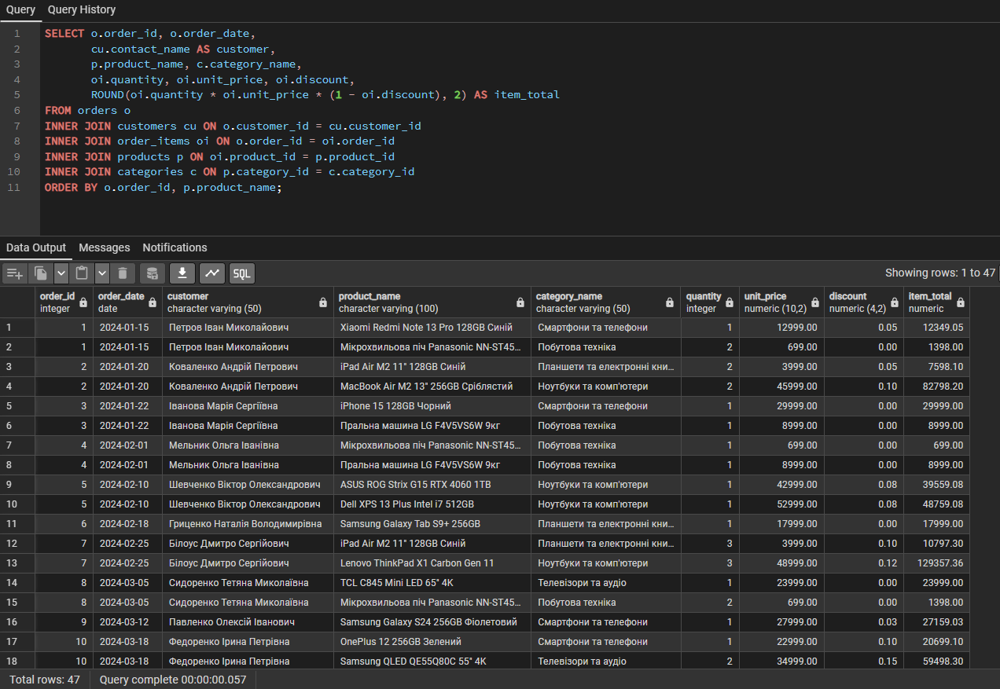

**Аналіз складності:** Запит з'єднує 5 таблиць. Послідовність зв'язків:
`orders → customers`, `orders → order_items → products → categories`.
Додатково обчислюється підсумкова вартість позиції.

#### 2. Агрегатні функції

**Завдання 2.1:** Статистика товарів за категоріями

``` sql
SELECT c.category_name,
       COUNT(p.product_id) AS product_count,
       ROUND(AVG(p.unit_price), 2) AS avg_price,
       MIN(p.unit_price) AS min_price,
       MAX(p.unit_price) AS max_price
FROM categories c
LEFT JOIN products p ON c.category_id = p.category_id
GROUP BY c.category_id, c.category_name
ORDER BY product_count DESC;
```

**Результат виконання:** Для кожної категорії визначено кількість
товарів, середню, мінімальну та максимальну ціну.

**Скріншот:** 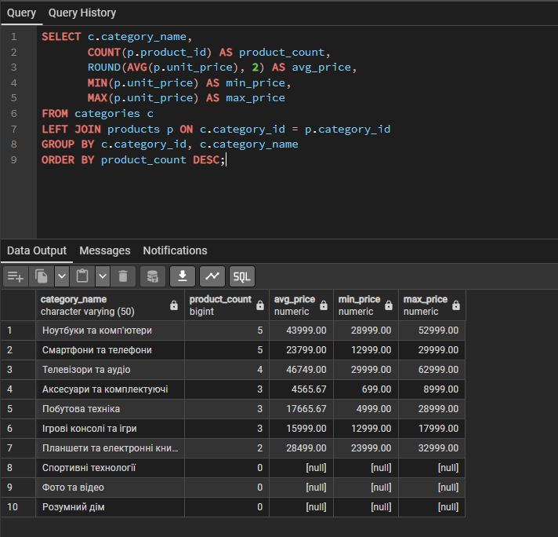

------------------------------------------------------------------------

**Завдання 2.2:** Продажі за регіонами з використанням HAVING

``` sql
SELECT r.region_name,
       COUNT(DISTINCT o.order_id) AS orders_count,
       ROUND(SUM(oi.quantity * oi.unit_price * (1 - oi.discount)), 2) AS total_sales
FROM regions r
INNER JOIN customers c ON r.region_id = c.region_id
INNER JOIN orders o ON c.customer_id = o.customer_id
INNER JOIN order_items oi ON o.order_id = oi.order_id
WHERE o.order_status = 'delivered'
GROUP BY r.region_id, r.region_name
HAVING SUM(oi.quantity * oi.unit_price * (1 - oi.discount)) > 0
ORDER BY total_sales DESC;
```

**Результат виконання:** Розраховано суму завершених продажів та
кількість замовлень за регіонами. `HAVING` фільтрує вже сформовані
групи.

**Скріншот:** 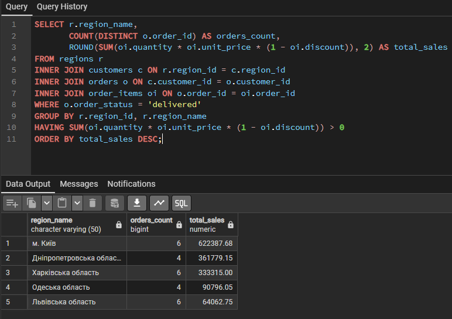

------------------------------------------------------------------------

**Завдання 2.3:** Постачальники з кількістю товарів більше 2

``` sql
SELECT s.company_name,
       COUNT(p.product_id) AS product_count
FROM suppliers s
INNER JOIN products p ON s.supplier_id = p.supplier_id
GROUP BY s.supplier_id, s.company_name
HAVING COUNT(p.product_id) > 2
ORDER BY product_count DESC, s.company_name;
```

**Результат виконання:** Отримано постачальників, які постачають більше
двох товарів.

**Скріншот:** 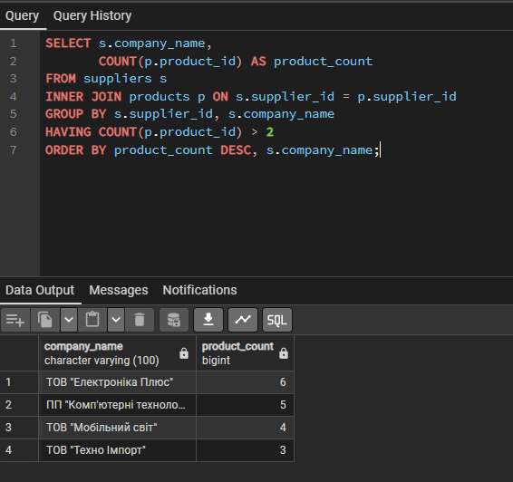

#### 3. Базові підзапити

**Завдання 3.1:** Товари з ціною вище середньої по категорії

``` sql
SELECT p.product_name, p.unit_price, c.category_name
FROM products p
INNER JOIN categories c ON p.category_id = c.category_id
WHERE p.unit_price > (
    SELECT AVG(p2.unit_price)
    FROM products p2
    WHERE p2.category_id = p.category_id
)
ORDER BY c.category_name, p.unit_price DESC;
```

**Результат виконання:** Отримано товари, ціна яких перевищує середню
ціну у власній категорії.

**Скріншот:** 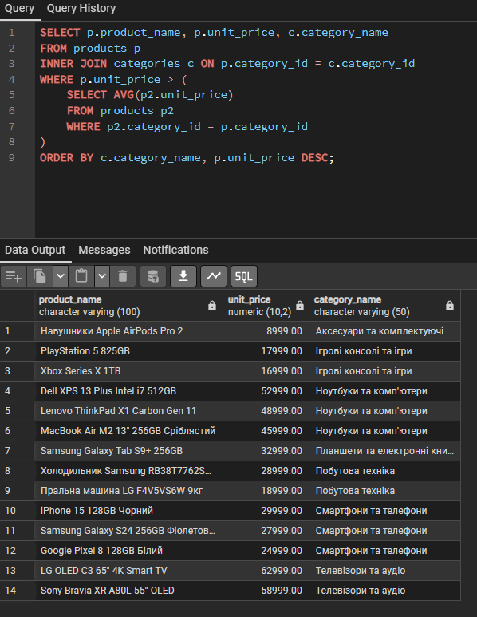

**Пояснення:** Підзапит є корельованим, оскільки використовує
`category_id` поточного товару із зовнішнього запиту.

------------------------------------------------------------------------

**Завдання 3.2:** Клієнти із замовленнями у 2024 році

``` sql
SELECT customer_id, contact_name, company_name, city
FROM customers
WHERE customer_id IN (
    SELECT customer_id
    FROM orders
    WHERE order_date >= '2024-01-01'
      AND order_date < '2025-01-01'
)
ORDER BY contact_name;
```

**Результат виконання:** Отримано клієнтів, які зробили хоча б одне
замовлення протягом 2024 року.

**Скріншот:** 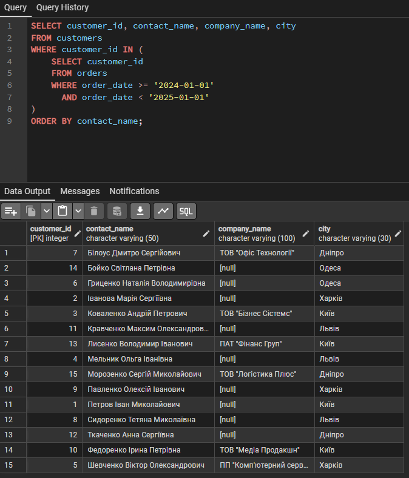

------------------------------------------------------------------------

**Завдання 3.3:** Товари із загальною кількістю продажів

``` sql
SELECT p.product_id, p.product_name, p.unit_price,
       (
           SELECT COALESCE(SUM(oi.quantity), 0)
           FROM order_items oi
           WHERE oi.product_id = p.product_id
       ) AS total_quantity_sold
FROM products p
ORDER BY total_quantity_sold DESC, p.product_name;
```

**Результат виконання:** Для кожного товару додано загальну кількість
проданих одиниць за допомогою підзапиту в `SELECT`.

**Скріншот:** 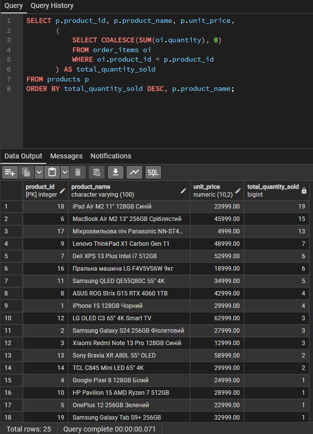

------------------------------------------------------------------------

**Завдання 3.4:** EXISTS --- клієнти, які мають замовлення

``` sql
SELECT c.customer_id, c.contact_name, c.city
FROM customers c
WHERE EXISTS (
    SELECT 1
    FROM orders o
    WHERE o.customer_id = c.customer_id
)
ORDER BY c.contact_name;
```

**Результат виконання:** Отримано клієнтів, для яких існує хоча б одне
замовлення.

**Скріншот:** 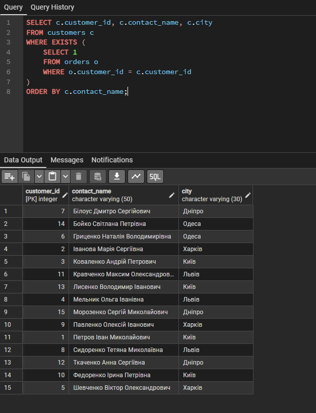

### Рівень 2

#### 4. Складні з'єднання

**Завдання 4.1:** RIGHT JOIN --- аналіз категорій та товарів

``` sql
SELECT c.category_name,
       COUNT(p.product_id) AS products_count,
       COALESCE(ROUND(AVG(p.unit_price), 2), 0) AS avg_price
FROM products p
RIGHT JOIN categories c ON p.category_id = c.category_id
GROUP BY c.category_id, c.category_name
ORDER BY products_count DESC;
```

**Результат виконання:** Отримано всі категорії, навіть якщо в окремій
категорії немає товарів.

**Скріншот:** 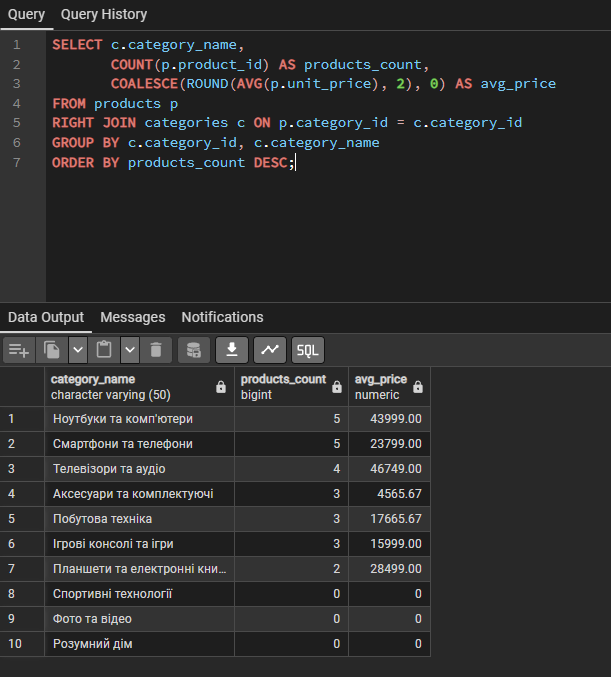

------------------------------------------------------------------------

**Завдання 4.2:** Self-join --- співробітники та керівники

``` sql
SELECT e1.first_name || ' ' || e1.last_name AS employee,
       e1.title AS employee_title,
       e2.first_name || ' ' || e2.last_name AS manager,
       e2.title AS manager_title
FROM employees e1
LEFT JOIN employees e2 ON e1.reports_to = e2.employee_id
ORDER BY e2.last_name NULLS FIRST, e1.last_name;
```

**Результат виконання:** Для кожного співробітника показано його
керівника. Для керівника найвищого рівня поле менеджера має `NULL`.

**Скріншот:** 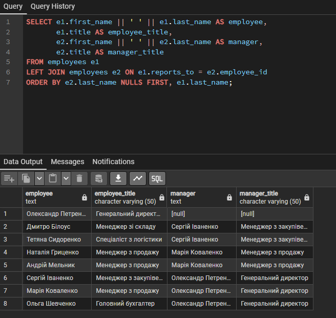

------------------------------------------------------------------------

**Завдання 4.3:** FULL OUTER JOIN --- повний аналіз категорій та товарів

``` sql
SELECT c.category_name, p.product_name, p.unit_price
FROM categories c
FULL OUTER JOIN products p ON c.category_id = p.category_id
ORDER BY c.category_name NULLS LAST, p.product_name;
```

**Результат виконання:** Повертаються всі категорії та всі товари
незалежно від наявності відповідності між таблицями.

**Скріншот:** 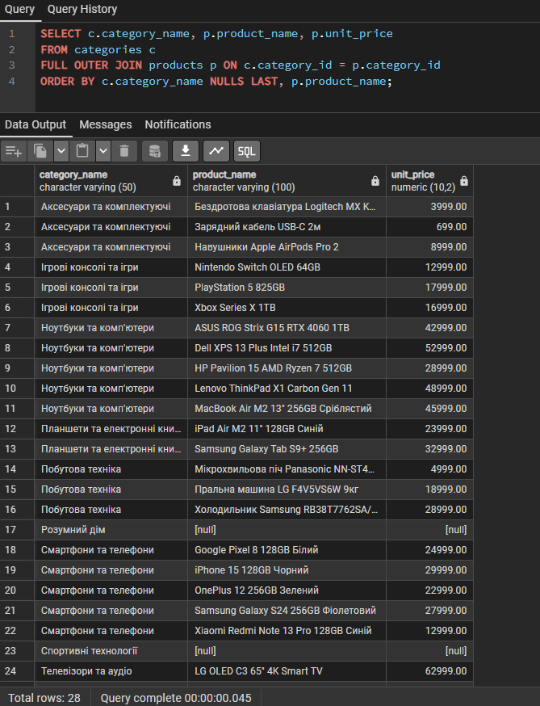

------------------------------------------------------------------------

**Завдання 4.4:** Умовне з'єднання з додатковими умовами в ON

``` sql
SELECT c.contact_name, c.customer_type,
       COUNT(o.order_id) AS delivered_orders_2024
FROM customers c
LEFT JOIN orders o
    ON c.customer_id = o.customer_id
   AND o.order_status = 'delivered'
   AND o.order_date >= '2024-01-01'
   AND o.order_date < '2025-01-01'
GROUP BY c.customer_id, c.contact_name, c.customer_type
ORDER BY delivered_orders_2024 DESC, c.contact_name;
```

**Результат виконання:** Для всіх клієнтів підраховано тільки доставлені
замовлення за 2024 рік.

**Скріншот:** 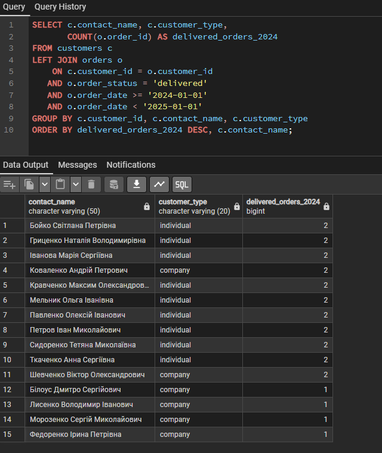

**Пояснення:** Фільтри розташовані в `ON`, тому клієнти без відповідних
замовлень не зникають із результату.

#### 5. Віконні функції

**Завдання 5.1:** Ранжування товарів за ціною в категоріях

``` sql
SELECT p.product_name, c.category_name, p.unit_price,
       RANK() OVER (
           PARTITION BY c.category_name ORDER BY p.unit_price DESC
       ) AS price_rank,
       DENSE_RANK() OVER (
           PARTITION BY c.category_name ORDER BY p.unit_price DESC
       ) AS price_dense_rank,
       ROW_NUMBER() OVER (
           PARTITION BY c.category_name
           ORDER BY p.unit_price DESC, p.product_name
       ) AS row_num
FROM products p
JOIN categories c ON p.category_id = c.category_id
ORDER BY c.category_name, p.unit_price DESC;
```

**Результат виконання:** Товари ранжовано за ціною окремо в межах кожної
категорії.

**Скріншот:** 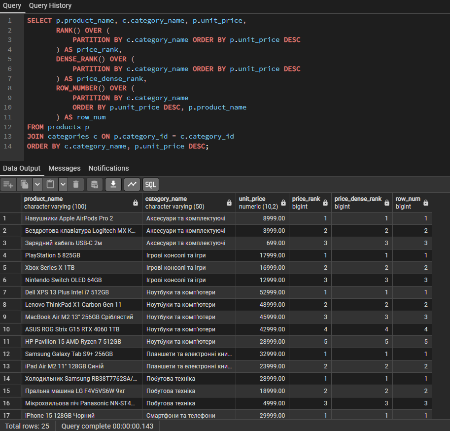

**Пояснення:** `ROW_NUMBER()` завжди формує унікальні номери; `RANK()`
залишає пропуски після однакових значень; `DENSE_RANK()` пропусків не
залишає.

------------------------------------------------------------------------

**Завдання 5.2:** Порівняння замовлень клієнта з попереднім і наступним

``` sql
SELECT c.contact_name, o.order_id, o.order_date, o.freight,
       LAG(o.order_date) OVER (
           PARTITION BY o.customer_id
           ORDER BY o.order_date, o.order_id
       ) AS previous_order_date,
       LEAD(o.order_date) OVER (
           PARTITION BY o.customer_id
           ORDER BY o.order_date, o.order_id
       ) AS next_order_date,
       LAG(o.freight) OVER (
           PARTITION BY o.customer_id
           ORDER BY o.order_date, o.order_id
       ) AS previous_freight
FROM orders o
JOIN customers c ON o.customer_id = c.customer_id
ORDER BY c.contact_name, o.order_date;
```

**Результат виконання:** Для кожного замовлення показано попереднє та
наступне замовлення того самого клієнта.

**Скріншот:** 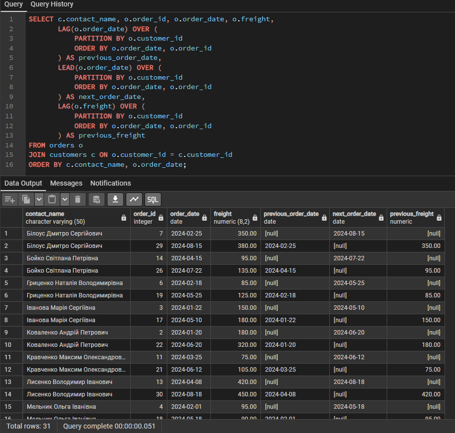

**Пояснення:** `PARTITION BY customer_id` формує окреме вікно для
кожного клієнта, а `LAG()` і `LEAD()` звертаються до сусідніх записів.

### Рівень 3

#### 6. Матеріалізовані представлення та рекурсивні запити

**Завдання 6.1:** Матеріалізоване представлення для аналізу продажів

``` sql
DROP MATERIALIZED VIEW IF EXISTS mv_monthly_sales;

CREATE MATERIALIZED VIEW mv_monthly_sales AS
SELECT
    EXTRACT(YEAR FROM o.order_date) AS year,
    EXTRACT(MONTH FROM o.order_date) AS month,
    c.category_name,
    r.region_name,
    ROUND(SUM(oi.quantity * oi.unit_price * (1 - oi.discount)), 2) AS total_revenue,
    COUNT(DISTINCT o.order_id) AS orders_count,
    ROUND(AVG(oi.quantity * oi.unit_price * (1 - oi.discount)), 2) AS avg_item_value
FROM orders o
JOIN order_items oi ON o.order_id = oi.order_id
JOIN products p ON oi.product_id = p.product_id
JOIN categories c ON p.category_id = c.category_id
JOIN customers cu ON o.customer_id = cu.customer_id
LEFT JOIN regions r ON cu.region_id = r.region_id
WHERE o.order_status = 'delivered'
GROUP BY
    EXTRACT(YEAR FROM o.order_date),
    EXTRACT(MONTH FROM o.order_date),
    c.category_name,
    r.region_name;

CREATE INDEX idx_mv_monthly_sales_date
    ON mv_monthly_sales(year, month);

SELECT *
FROM mv_monthly_sales
ORDER BY year, month, total_revenue DESC;
```

**Результат виконання:** Створено матеріалізоване представлення з
агрегованими продажами за роком, місяцем, категорією та регіоном.

**Скріншот:** 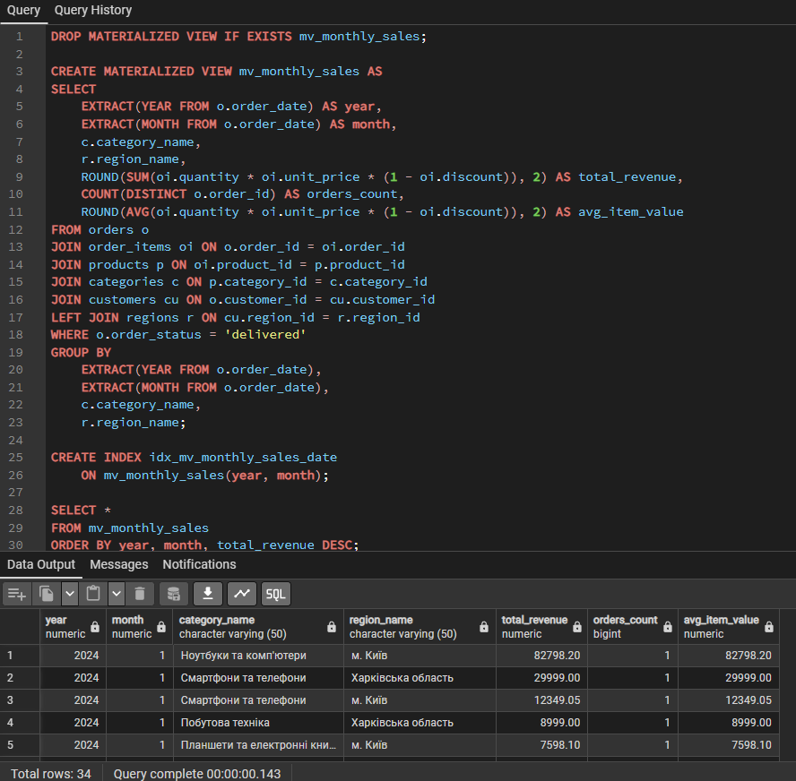

**Пояснення:** Матеріалізоване представлення фізично зберігає результат
складного запиту, тому повторна аналітика працює швидше. Після зміни
вихідних даних його можна оновити:

``` sql
REFRESH MATERIALIZED VIEW mv_monthly_sales;
```

------------------------------------------------------------------------

**Завдання 6.2:** Рекурсивний запит для ієрархії співробітників

``` sql
WITH RECURSIVE employee_hierarchy AS (
    SELECT employee_id, first_name, last_name, title, reports_to,
           0 AS level,
           CAST(last_name || ' ' || first_name AS VARCHAR(1000)) AS hierarchy_path
    FROM employees
    WHERE reports_to IS NULL

    UNION ALL

    SELECT e.employee_id, e.first_name, e.last_name, e.title, e.reports_to,
           eh.level + 1,
           CAST(
               eh.hierarchy_path || ' -> ' || e.last_name || ' ' || e.first_name
               AS VARCHAR(1000)
           )
    FROM employees e
    JOIN employee_hierarchy eh ON e.reports_to = eh.employee_id
)
SELECT *
FROM employee_hierarchy
ORDER BY hierarchy_path;
```

**Результат виконання:** Побудовано ієрархію співробітників від
керівника верхнього рівня до підлеглих.

**Скріншот:** 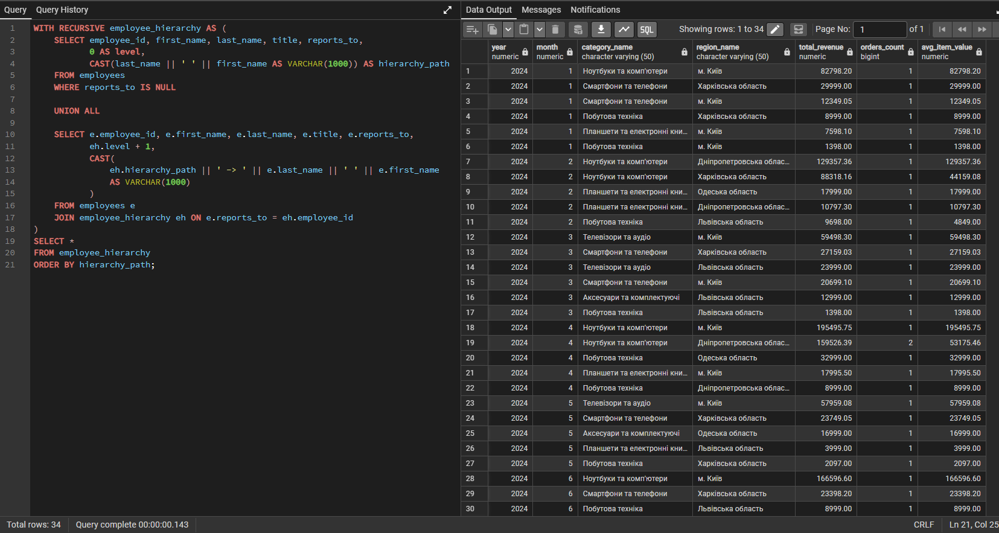

**Пояснення:** Базова частина знаходить працівників без керівника, а
рекурсивна --- послідовно додає їхніх підлеглих.

------------------------------------------------------------------------

**Завдання 6.3:** Збережена функція для параметризованої аналітики

``` sql
CREATE OR REPLACE FUNCTION get_products_by_price(
    min_price NUMERIC DEFAULT NULL,
    max_price NUMERIC DEFAULT NULL,
    selected_category INTEGER DEFAULT NULL
)
RETURNS TABLE (
    product_id INTEGER,
    product_name VARCHAR,
    category_id INTEGER,
    unit_price NUMERIC
)
LANGUAGE SQL
AS $$
    SELECT p.product_id, p.product_name, p.category_id, p.unit_price
    FROM products p
    WHERE (min_price IS NULL OR p.unit_price >= min_price)
      AND (max_price IS NULL OR p.unit_price <= max_price)
      AND (selected_category IS NULL OR p.category_id = selected_category)
    ORDER BY p.unit_price DESC;
$$;

SELECT *
FROM get_products_by_price(10000, 30000, NULL);
```

**Результат виконання:** Створено параметризовану функцію для пошуку
товарів за мінімальною ціною, максимальною ціною та категорією.

**Скріншот:** 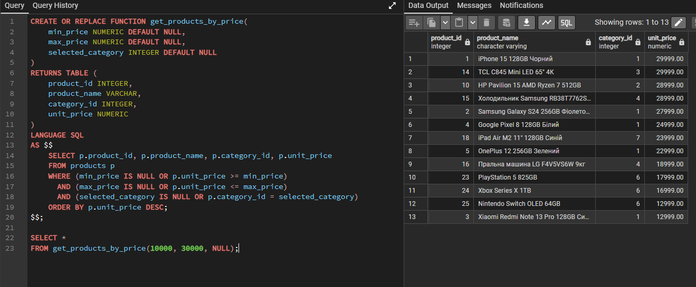

## Аналіз продуктивності

### Дослідження планів виконання

**Найскладніший запит для аналізу:**

``` sql
EXPLAIN (ANALYZE, BUFFERS)
SELECT o.order_id, o.order_date, cu.contact_name,
       p.product_name, c.category_name,
       oi.quantity, oi.unit_price
FROM orders o
JOIN customers cu ON o.customer_id = cu.customer_id
JOIN order_items oi ON o.order_id = oi.order_id
JOIN products p ON oi.product_id = p.product_id
JOIN categories c ON p.category_id = c.category_id
WHERE o.order_date >= '2024-01-01'
  AND o.order_date < '2025-01-01';
```

**План виконання:** 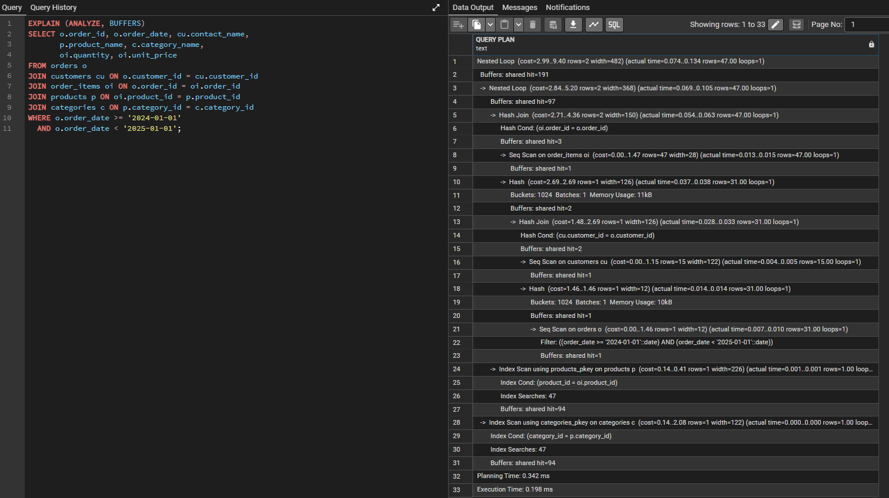

**Аналіз:** На маленькій навчальній БД PostgreSQL може обирати
`Seq Scan`, оскільки повне сканування невеликої таблиці дешеве. При
збільшенні обсягу даних важливими стають індекси за датою замовлення та
зовнішніми ключами.

**Запропоновані оптимізації:**

1.  Індекс для фільтрації замовлень за датою та роботи з клієнтом.
2.  Індекс для з'єднання позицій замовлення з замовленнями та товарами.
3.  Матеріалізоване представлення для часто повторюваної агрегованої
    аналітики.

### Створені індекси

**Індекс 1:**

``` sql
CREATE INDEX IF NOT EXISTS idx_orders_date_customer
    ON orders(order_date, customer_id);
```

**Обґрунтування:** Прискорює фільтрацію замовлень за датою та може
допомогти при подальшому з'єднанні за `customer_id`.

**Скріншот:** 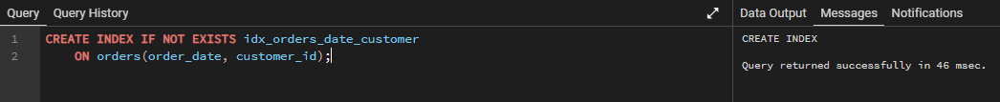

**Індекс 2:**

``` sql
CREATE INDEX IF NOT EXISTS idx_order_items_order_product
    ON order_items(order_id, product_id);
```

**Обґрунтування:** Оптимізує часті з'єднання `order_items` з `orders` та
`products`.

**Скріншот:** 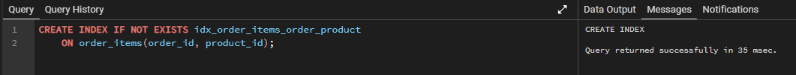

## Порівняльний аналіз

### Топ-5 найдорожчих товарів у кожній категорії

**Підхід 1: Віконна функція**

``` sql
SELECT product_name, category_name, unit_price, price_rank
FROM (
    SELECT p.product_name, c.category_name, p.unit_price,
           ROW_NUMBER() OVER (
               PARTITION BY p.category_id
               ORDER BY p.unit_price DESC, p.product_name
           ) AS price_rank
    FROM products p
    JOIN categories c ON p.category_id = c.category_id
) ranked_products
WHERE price_rank <= 5
ORDER BY category_name, price_rank;
```

**Скріншот:** 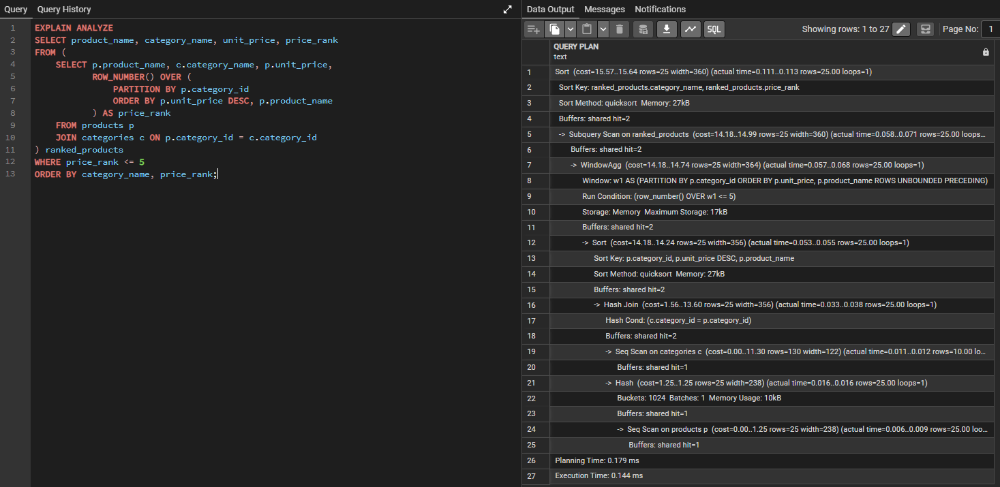

**Підхід 2: Корельований підзапит**

``` sql
SELECT p.product_name, c.category_name, p.unit_price
FROM products p
JOIN categories c ON p.category_id = c.category_id
WHERE (
    SELECT COUNT(*)
    FROM products p2
    WHERE p2.category_id = p.category_id
      AND (
          p2.unit_price > p.unit_price
          OR (p2.unit_price = p.unit_price AND p2.product_id < p.product_id)
      )
) < 5
ORDER BY c.category_name, p.unit_price DESC, p.product_name;
```

**Скріншот:** 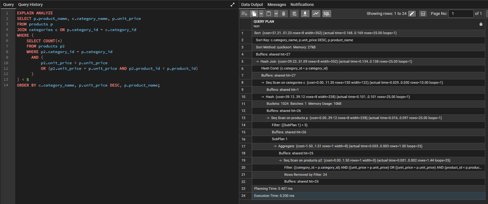

**Час виконання:**

-   Віконна функція: \[вказати Execution Time з EXPLAIN ANALYZE\]
-   Корельований підзапит: \[вказати Execution Time з EXPLAIN ANALYZE\]

**Висновок:** Віконна функція є простішою для читання та зазвичай краще
масштабується. Корельований підзапит виконує внутрішню перевірку для
кожного товару, тому на великих таблицях може бути дорожчим.

## Висновки

Під час лабораторної роботи створено складні SQL-запити для навчальної
бази. Використано `INNER JOIN`, `LEFT JOIN`, `RIGHT JOIN`,
`FULL OUTER JOIN`, self-join та умовне з'єднання. Для аналітики
застосовано `COUNT`, `SUM`, `AVG`, `MIN`, `MAX`, `GROUP BY` і `HAVING`.

Також використано корельовані підзапити, `IN`, `EXISTS`, `ROW_NUMBER`,
`RANK`, `DENSE_RANK`, `LAG`, `LEAD` і `PARTITION BY`. Для третього рівня
створено матеріалізоване представлення, рекурсивний CTE та
параметризовану функцію. Додатково проведено аналіз продуктивності через
`EXPLAIN ANALYZE`, створено індекси та порівняно два способи отримання
топ-5 товарів у категорії.

**Самооцінка:** 5

**Обґрунтування:** Виконано вимоги рівнів 1--3, використано передбачені
лабораторною типи складних SQL-запитів, проведено аналіз продуктивності
та запропоновано оптимізації.
