# Лабораторна робота 3. Модифікація даних та транзакції

## Загальна інформація

**Здобувач освіти:** Якимов Ілля  
**Група:** ІПЗ-32  
**Обраний рівень складності:** 3  
**СУБД:** PostgreSQL 18  
**Інструмент виконання:** pgAdmin 4  
**База даних:** `library_lab3`  
**Схема:** `library`

## Мета роботи

Опанувати безпечні операції модифікації даних, керування транзакціями та блокуваннями. Реалізувати обмеження цілісності, аудит, версіонування, відкладені операції, розмежування прав і логічне відновлення даних.

Завдання виконано за [методичними вказівками до лабораторної роботи 03](https://github.com/olroi421/course-bd/blob/main/labs/lab-03.md). SQL виконувався вручну в pgAdmin; автоматичні завдання запускалися службою pgAgent.

## Підготовка середовища

У підключенні до бази `postgres` створено окрему навчальну БД:

```sql
CREATE DATABASE library_lab3;
```

Після цього робочі запити виконувалися в `library_lab3`. Службові об'єкти pgAgent налаштовано в базі `postgres`, а SQL-кроки завдання спрямовано до `library_lab3`.

Для демонстрації помилок команди, що спричиняють порушення обмежень, і наступні `ROLLBACK` запускалися окремо. У досліді паралельного доступу використано дві незалежні вкладки Query Tool.

## Рівень 1. Структура, модифікація даних і транзакції

### 1.1. Створення схеми та основних таблиць

```sql
CREATE SCHEMA library;

CREATE TABLE library.authors (
    author_id BIGINT GENERATED BY DEFAULT AS IDENTITY PRIMARY KEY,
    first_name TEXT NOT NULL CHECK (LENGTH(TRIM(first_name)) > 0),
    last_name TEXT NOT NULL CHECK (LENGTH(TRIM(last_name)) > 0),
    birth_year INTEGER CHECK (birth_year BETWEEN 1000 AND 2100),
    country TEXT
);

CREATE TABLE library.books (
    book_id BIGINT GENERATED BY DEFAULT AS IDENTITY PRIMARY KEY,
    isbn VARCHAR(17) NOT NULL UNIQUE,
    title TEXT NOT NULL CHECK (LENGTH(TRIM(title)) > 0),
    author_id BIGINT NOT NULL,
    publication_year INTEGER CHECK (publication_year BETWEEN 1450 AND 2100),
    genre TEXT,
    total_copies INTEGER NOT NULL CHECK (total_copies >= 0),
    available_copies INTEGER NOT NULL,
    CONSTRAINT books_available_copies_check
        CHECK (available_copies >= 0 AND available_copies <= total_copies),
    CONSTRAINT books_author_fk FOREIGN KEY (author_id)
        REFERENCES library.authors(author_id)
        ON UPDATE CASCADE ON DELETE RESTRICT
);

CREATE TABLE library.readers (
    reader_id BIGINT GENERATED BY DEFAULT AS IDENTITY PRIMARY KEY,
    full_name TEXT NOT NULL CHECK (LENGTH(TRIM(full_name)) > 0),
    email TEXT NOT NULL UNIQUE,
    library_card_number TEXT NOT NULL UNIQUE,
    status TEXT NOT NULL DEFAULT 'Active',
    CONSTRAINT readers_status_check
        CHECK (status IN ('Active', 'Inactive', 'Blocked'))
);

CREATE TABLE library.lendings (
    lending_id BIGINT GENERATED BY DEFAULT AS IDENTITY PRIMARY KEY,
    book_id BIGINT NOT NULL,
    reader_id BIGINT NOT NULL,
    lending_date DATE NOT NULL DEFAULT CURRENT_DATE,
    due_date DATE NOT NULL,
    return_date DATE,
    CONSTRAINT lendings_book_fk FOREIGN KEY (book_id)
        REFERENCES library.books(book_id)
        ON UPDATE CASCADE ON DELETE RESTRICT,
    CONSTRAINT lendings_reader_fk FOREIGN KEY (reader_id)
        REFERENCES library.readers(reader_id)
        ON UPDATE CASCADE ON DELETE RESTRICT,
    CONSTRAINT lendings_due_date_check CHECK (due_date >= lending_date),
    CONSTRAINT lendings_return_date_check
        CHECK (return_date IS NULL OR return_date >= lending_date)
);

CREATE UNIQUE INDEX one_open_lending
ON library.lendings(book_id, reader_id)
WHERE return_date IS NULL;
```

**Результат виконання.** Створено схему library, чотири основні таблиці та частковий унікальний індекс. PRIMARY KEY ідентифікують записи; FOREIGN KEY захищають зв’язки; UNIQUE запобігає дублюванню ISBN, адрес і читацьких квитків; CHECK перевіряє залишки, статуси й дати. Індекс забороняє дві одночасні незавершені видачі тієї самої книги одному читачу.

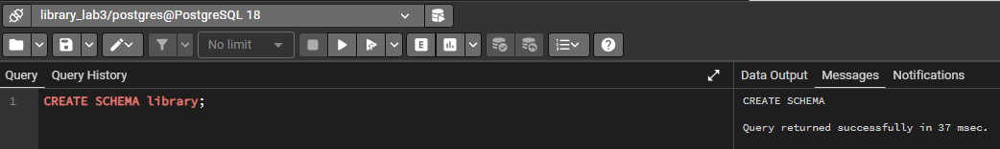

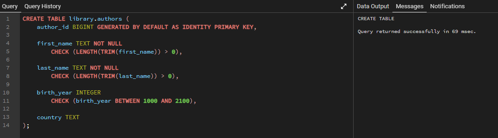

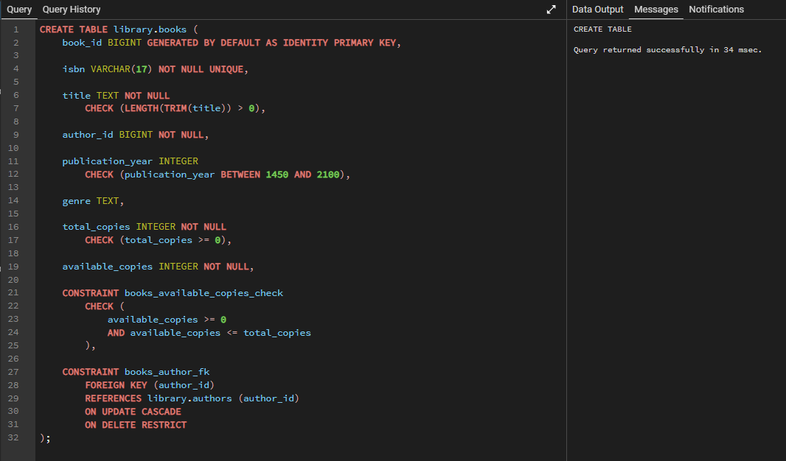

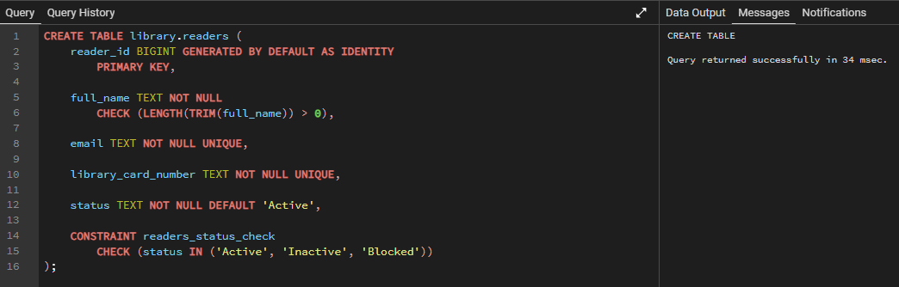

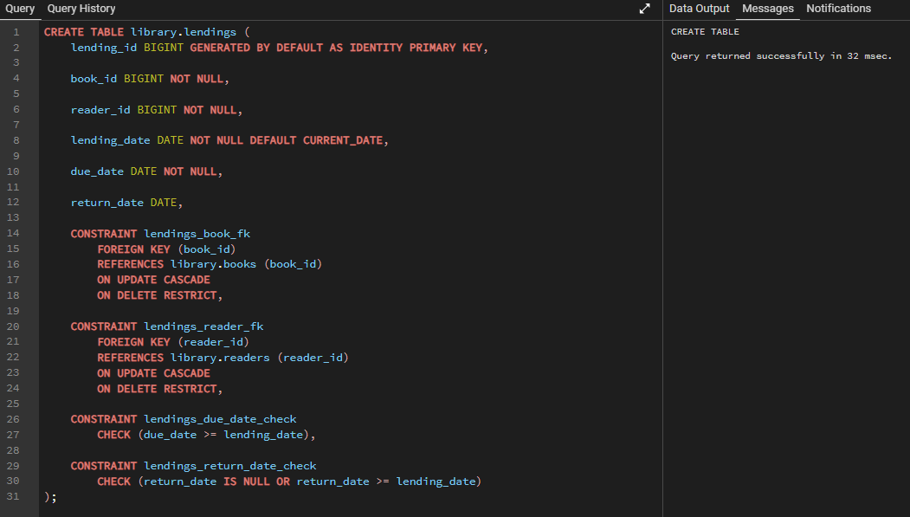

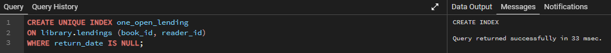

### 1.2. Наповнення таблиць

```sql
INSERT INTO library.authors(first_name, last_name, birth_year, country)
VALUES
    ('Тарас', 'Шевченко', 1814, 'Україна'),
    ('Леся', 'Українка', 1871, 'Україна'),
    ('Іван', 'Франко', 1856, 'Україна')
RETURNING *;

INSERT INTO library.books(
    isbn, title, author_id, publication_year, genre,
    total_copies, available_copies
)
VALUES
    ('978-966-01-0001-1', 'Кобзар', 1, 1840, 'Поезія', 3, 3),
    ('978-966-01-0002-8', 'Лісова пісня', 2, 1911, 'Драма', 2, 2),
    ('978-966-01-0003-5', 'Захар Беркут', 3, 1883, 'Повість', 1, 1)
RETURNING *;

INSERT INTO library.readers(full_name, email, library_card_number, status)
VALUES
    ('Ілля Якимов', 'illia@example.com', 'LIB-001', 'Active'),
    ('Марія Коваль', 'maria@example.com', 'LIB-002', 'Active'),
    ('Олег Бондар', 'oleh@example.com', 'LIB-003', 'Active'),
    ('Тестовий читач', 'inactive@example.com', 'TEMP-001', 'Inactive')
RETURNING *;
```

**Результат виконання.** Додано трьох авторів, три книги та чотирьох читачів. RETURNING повертає значення доданих записів, включно зі згенерованими ідентифікаторами. Таблиця видач наповнюється далі в транзакції зі зміною залишку книги.

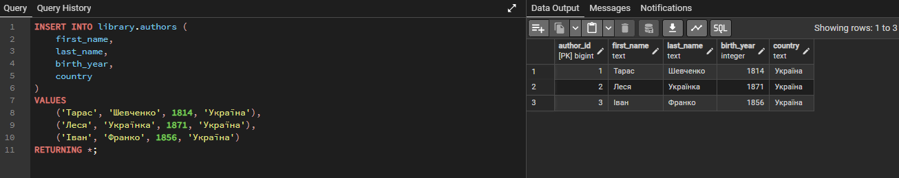

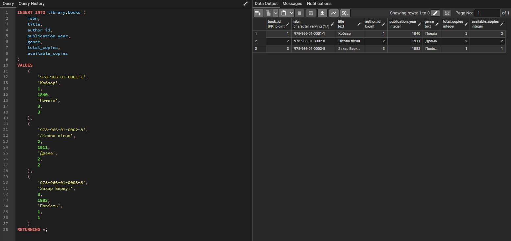

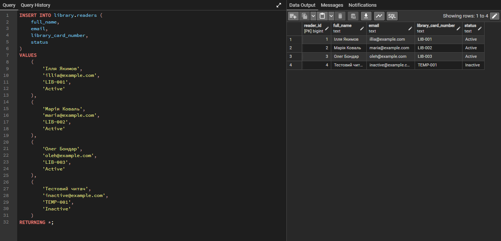

### 1.3. Перевірка структури та зв’язків

```sql
SELECT table_name
FROM information_schema.tables
WHERE table_schema = 'library' AND table_type = 'BASE TABLE'
ORDER BY table_name;

SELECT table_name, constraint_name, constraint_type
FROM information_schema.table_constraints
WHERE table_schema = 'library'
ORDER BY table_name, constraint_type, constraint_name;

SELECT b.book_id, b.title,
       a.first_name || ' ' || a.last_name AS author,
       b.publication_year, b.total_copies, b.available_copies
FROM library.books b
JOIN library.authors a ON a.author_id = b.author_id
ORDER BY b.book_id;
```

**Результат виконання.** Отримано список чотирьох таблиць, їхні обмеження та каталог із трьох книг з авторами. Початкові доступні залишки: 3, 2 та 1 примірник.

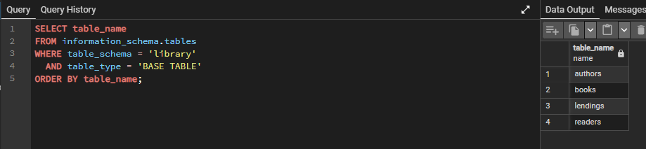

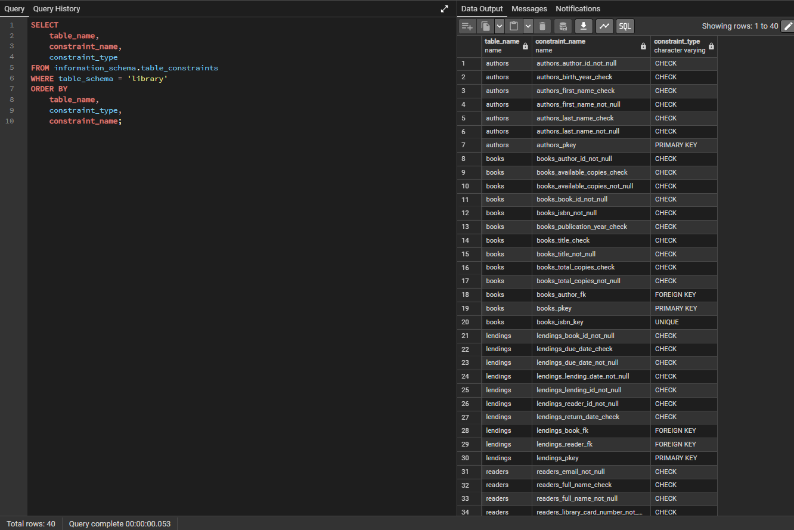

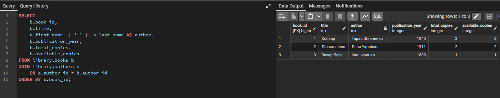

### 1.4. Безпечний UPDATE і COMMIT

```sql
SELECT book_id, title, genre FROM library.books WHERE book_id = 1;

BEGIN;
UPDATE library.books
SET genre = 'Українська поезія'
WHERE book_id = 1;
COMMIT;

SELECT book_id, title, genre FROM library.books WHERE book_id = 1;
```

**Результат виконання.** Перед оновленням перевірено цільовий рядок. Жанр «Кобзаря» змінено з «Поезія» на «Українська поезія» та підтверджено COMMIT. Умова WHERE обмежує зміну однією книгою.

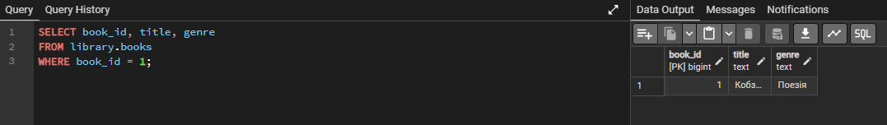

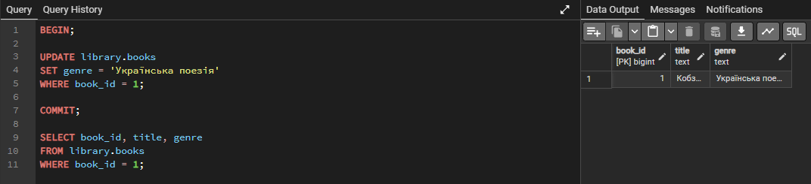

### 1.5. Безпечний DELETE

```sql
SELECT r.reader_id, r.full_name, r.status
FROM library.readers r
WHERE r.email = 'inactive@example.com' AND r.status = 'Inactive'
  AND NOT EXISTS (
      SELECT 1 FROM library.lendings l WHERE l.reader_id = r.reader_id
  );

DELETE FROM library.readers r
WHERE r.email = 'inactive@example.com' AND r.status = 'Inactive'
  AND NOT EXISTS (
      SELECT 1 FROM library.lendings l WHERE l.reader_id = r.reader_id
  )
RETURNING r.reader_id, r.full_name, r.status;

SELECT COUNT(*) AS remaining_test_readers
FROM library.readers WHERE email = 'inactive@example.com';
```

**Результат виконання.** Перед видаленням перевірено статус читача та відсутність видач. Підсумкова перевірка повернула remaining_test_readers = 0. Повторне виконання DELETE з тією самою умовою не видаляє інших читачів і повертає порожній набір.

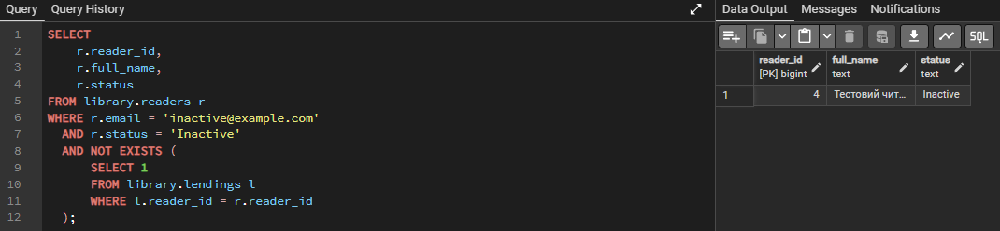

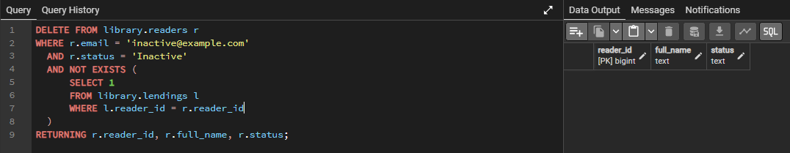

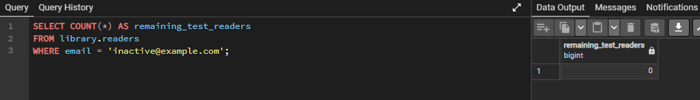

### 1.6. Видача книги як атомарна операція

```sql
SELECT b.book_id, b.title, b.available_copies,
       r.reader_id, r.full_name, r.status
FROM library.books b CROSS JOIN library.readers r
WHERE b.book_id = 1 AND r.reader_id = 1;

BEGIN;
DO $$
DECLARE
    v_available INTEGER;
    v_reader_status TEXT;
BEGIN
    SELECT available_copies INTO STRICT v_available
    FROM library.books WHERE book_id = 1 FOR UPDATE;
    SELECT status INTO STRICT v_reader_status
    FROM library.readers WHERE reader_id = 1 FOR UPDATE;
    IF v_reader_status <> 'Active' THEN
        RAISE EXCEPTION 'Читач неактивний';
    END IF;
    IF v_available <= 0 THEN
        RAISE EXCEPTION 'Немає доступних примірників';
    END IF;
    UPDATE library.books
    SET available_copies = available_copies - 1
    WHERE book_id = 1 AND available_copies > 0;
    IF NOT FOUND THEN
        RAISE EXCEPTION 'Не вдалося змінити залишок';
    END IF;
    INSERT INTO library.lendings(book_id, reader_id, due_date)
    VALUES (1, 1, CURRENT_DATE + 14);
END;
$$;
COMMIT;

SELECT l.lending_id, b.title, r.full_name,
       l.lending_date, l.due_date, l.return_date, b.available_copies
FROM library.lendings l
JOIN library.books b USING(book_id)
JOIN library.readers r USING(reader_id)
WHERE l.book_id = 1 AND l.reader_id = 1 AND l.return_date IS NULL;
```

**Результат виконання.** Створено активну видачу «Кобзаря» Іллі Якимову на 14 днів. Кількість доступних примірників зменшилася з 3 до 2. Зменшення залишку та INSERT видачі виконано в одній транзакції.

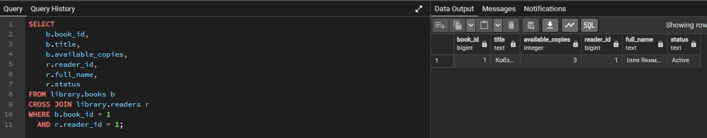

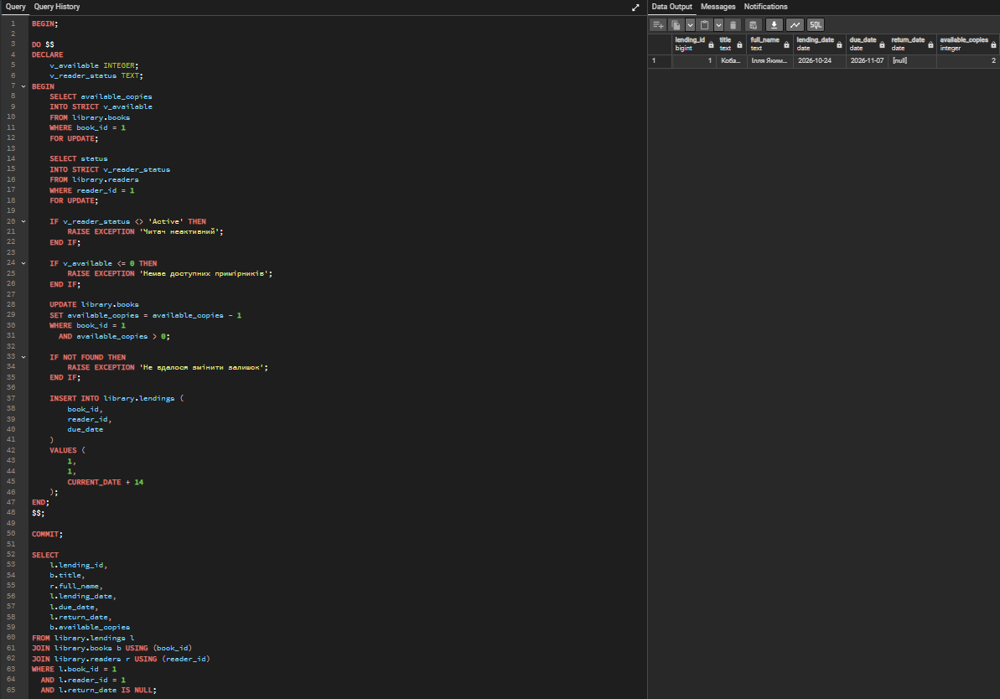

### 1.7. Помилка FOREIGN KEY та повний ROLLBACK

```sql
-- Перший запуск: початок транзакції.
BEGIN;
UPDATE library.books
SET title = 'Ця зміна буде скасована' WHERE book_id = 1;
SELECT book_id, title FROM library.books WHERE book_id = 1;

-- Другий запуск: очікувана помилка 23503.
DELETE FROM library.authors WHERE author_id = 1;

-- Третій запуск: відкат усієї транзакції.
ROLLBACK;
SELECT book_id, title, available_copies
FROM library.books WHERE book_id = 1;
```

**Результат виконання.** Видалення автора відхилено зовнішнім ключем books_author_fk. Після ROLLBACK назва повернулася до «Кобзар», а залишок залишився 2. Попередня підтверджена видача збереглася. Помилка переводить транзакцію у стан помилки; явний ROLLBACK завершує її та скасовує зміни.

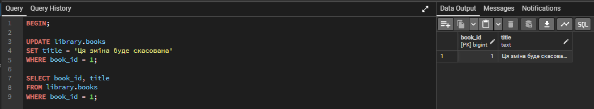

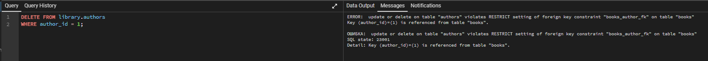

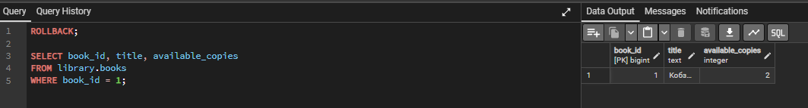

### 1.8. Відхилення некоректного залишку

```sql
-- Окремий запуск: очікувана помилка 23514.
UPDATE library.books SET available_copies = -1 WHERE book_id = 1;

-- Окремий запуск після помилки.
ROLLBACK;
SELECT book_id, title, total_copies, available_copies
FROM library.books WHERE book_id = 1;
```

**Результат виконання.** CHECK books_available_copies_check відхилив від’ємний залишок. Дані не змінилися: total_copies = 3, available_copies = 2.

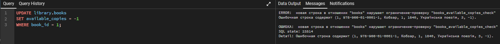

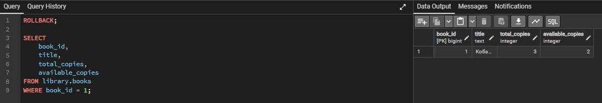

## Рівень 2. Аудит, SAVEPOINT, каскади та паралельний доступ

### 2.1. Бронювання книг

```sql
CREATE TABLE library.reservations (
    reservation_id BIGINT GENERATED BY DEFAULT AS IDENTITY PRIMARY KEY,
    book_id BIGINT NOT NULL,
    reader_id BIGINT NOT NULL,
    reservation_date TIMESTAMPTZ NOT NULL DEFAULT clock_timestamp(),
    expiration_date TIMESTAMPTZ NOT NULL,
    status TEXT NOT NULL DEFAULT 'Active',
    CONSTRAINT reservations_book_fk FOREIGN KEY (book_id)
        REFERENCES library.books(book_id)
        ON UPDATE CASCADE ON DELETE CASCADE,
    CONSTRAINT reservations_reader_fk FOREIGN KEY (reader_id)
        REFERENCES library.readers(reader_id)
        ON UPDATE CASCADE ON DELETE CASCADE,
    CONSTRAINT reservations_status_check
        CHECK (status IN ('Active', 'Fulfilled', 'Cancelled', 'Expired')),
    CONSTRAINT reservations_expiration_check
        CHECK (expiration_date > reservation_date)
);

CREATE UNIQUE INDEX one_active_reservation
ON library.reservations(book_id, reader_id) WHERE status = 'Active';

INSERT INTO library.reservations(book_id, reader_id, expiration_date)
VALUES (2, 2, clock_timestamp() + INTERVAL '7 days')
RETURNING *;
```

**Результат виконання.** Створено таблицю та частковий унікальний індекс. Марія Коваль забронювала «Лісову пісню» на сім днів. Дублювання активного бронювання тієї самої книги тим самим читачем заборонено.

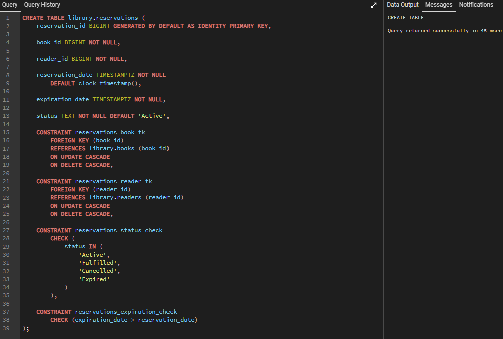

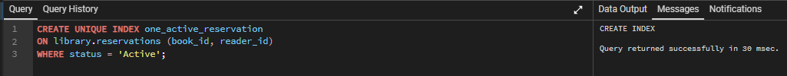

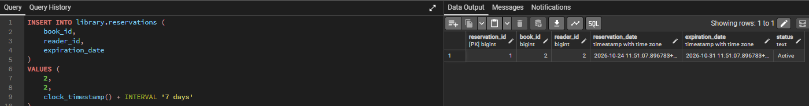

### 2.2. Журнал змін

```sql
CREATE TABLE library.audit_log (
    log_id BIGINT GENERATED ALWAYS AS IDENTITY PRIMARY KEY,
    table_name TEXT NOT NULL,
    record_id BIGINT NOT NULL,
    operation TEXT NOT NULL CHECK (operation IN ('INSERT', 'UPDATE', 'DELETE')),
    old_data JSONB,
    new_data JSONB,
    changed_at TIMESTAMPTZ NOT NULL DEFAULT clock_timestamp(),
    changed_by TEXT NOT NULL,
    login_name TEXT NOT NULL,
    transaction_id BIGINT NOT NULL
);
```

**Результат виконання.** Створено журнал із попереднім і новим станом запису, часом, виконавцем та ідентифікатором транзакції. Відсутність зовнішнього ключа на бізнес-запис дозволяє зберігати історію після його видалення.

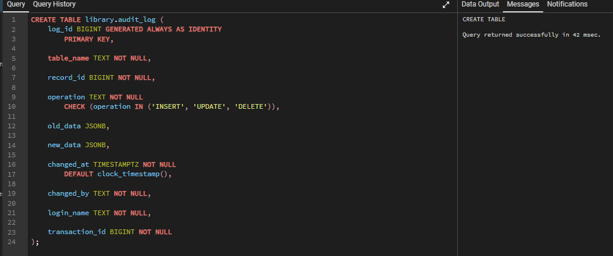

### 2.3. Універсальна функція аудиту

```sql
CREATE FUNCTION library.audit_change()
RETURNS TRIGGER LANGUAGE plpgsql SECURITY DEFINER
SET search_path = pg_catalog, library AS $$
DECLARE
    v_old JSONB;
    v_new JSONB;
    v_old_id BIGINT;
    v_new_id BIGINT;
    v_actor TEXT;
BEGIN
    v_actor := COALESCE(
        NULLIF(current_setting('role', true), 'none'), session_user
    );
    IF TG_OP <> 'INSERT' THEN
        v_old := to_jsonb(OLD);
        v_old_id := (v_old ->> TG_ARGV[0])::BIGINT;
    END IF;
    IF TG_OP <> 'DELETE' THEN
        v_new := to_jsonb(NEW);
        v_new_id := (v_new ->> TG_ARGV[0])::BIGINT;
    END IF;
    IF TG_OP = 'UPDATE' AND v_old_id IS DISTINCT FROM v_new_id THEN
        INSERT INTO library.audit_log(
            table_name, record_id, operation, old_data, new_data,
            changed_by, login_name, transaction_id
        ) VALUES
        (TG_TABLE_NAME, v_old_id, 'DELETE', v_old, NULL,
         v_actor, session_user, txid_current()),
        (TG_TABLE_NAME, v_new_id, 'INSERT', NULL, v_new,
         v_actor, session_user, txid_current());
    ELSE
        INSERT INTO library.audit_log(
            table_name, record_id, operation, old_data, new_data,
            changed_by, login_name, transaction_id
        ) VALUES (
            TG_TABLE_NAME, COALESCE(v_new_id, v_old_id), TG_OP,
            v_old, v_new, v_actor, session_user, txid_current()
        );
    END IF;
    RETURN NULL;
END;
$$;
```

**Результат виконання.** Функція автоматично фіксує INSERT, UPDATE і DELETE. У разі зміни первинного ключа записує DELETE старого ідентифікатора та INSERT нового, що забезпечує коректне подальше відновлення історичних станів.

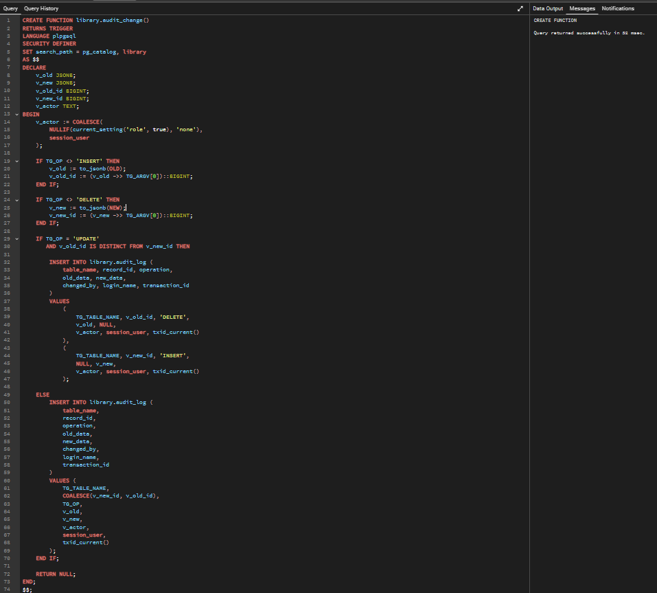

### 2.4. Тригери для всіх бізнес-таблиць

```sql
BEGIN;

CREATE TRIGGER authors_audit
AFTER INSERT OR UPDATE OR DELETE ON library.authors
FOR EACH ROW EXECUTE FUNCTION library.audit_change('author_id');

CREATE TRIGGER books_audit
AFTER INSERT OR UPDATE OR DELETE ON library.books
FOR EACH ROW EXECUTE FUNCTION library.audit_change('book_id');

CREATE TRIGGER readers_audit
AFTER INSERT OR UPDATE OR DELETE ON library.readers
FOR EACH ROW EXECUTE FUNCTION library.audit_change('reader_id');

CREATE TRIGGER lendings_audit
AFTER INSERT OR UPDATE OR DELETE ON library.lendings
FOR EACH ROW EXECUTE FUNCTION library.audit_change('lending_id');

CREATE TRIGGER reservations_audit
AFTER INSERT OR UPDATE OR DELETE ON library.reservations
FOR EACH ROW EXECUTE FUNCTION library.audit_change('reservation_id');

COMMIT;

SELECT event_object_table AS table_name, trigger_name,
       string_agg(event_manipulation, ', ' ORDER BY event_manipulation)
           AS tracked_operations
FROM information_schema.triggers WHERE trigger_schema = 'library'
GROUP BY event_object_table, trigger_name ORDER BY event_object_table;
```

**Результат виконання.** Створено п’ять тригерів. Для кожної таблиці перевірено відстеження DELETE, INSERT та UPDATE. Аудит виконується в тій самій транзакції, що й основна зміна, тому відкотовані зміни не залишають підтверджених записів журналу.

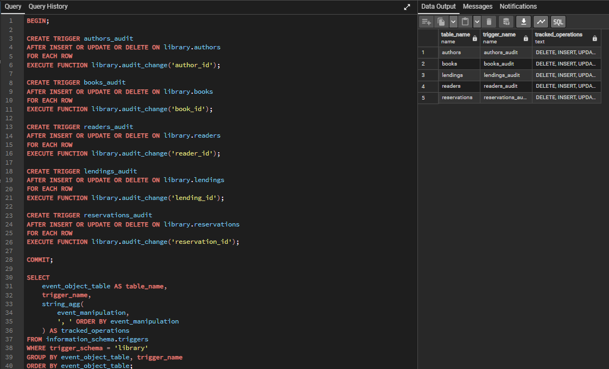

### 2.5. Початковий стан і перевірка аудиту

```sql
INSERT INTO library.audit_log(
    table_name, record_id, operation, old_data, new_data,
    changed_by, login_name, transaction_id
)
SELECT source.table_name, source.record_id, 'INSERT', NULL, source.row_data,
       current_user, session_user, txid_current()
FROM (
    SELECT 'authors'::TEXT AS table_name, author_id AS record_id,
           to_jsonb(a) AS row_data FROM library.authors a
    UNION ALL
    SELECT 'books', book_id, to_jsonb(b) FROM library.books b
    UNION ALL
    SELECT 'readers', reader_id, to_jsonb(r) FROM library.readers r
    UNION ALL
    SELECT 'lendings', lending_id, to_jsonb(l) FROM library.lendings l
    UNION ALL
    SELECT 'reservations', reservation_id, to_jsonb(r)
    FROM library.reservations r
) source
RETURNING log_id, table_name, record_id, operation;

UPDATE library.books SET genre = 'Класична українська поезія'
WHERE book_id = 1;

SELECT log_id, operation, record_id AS book_id,
       old_data ->> 'genre' AS previous_genre,
       new_data ->> 'genre' AS new_genre, changed_at, changed_by
FROM library.audit_log
WHERE table_name = 'books' AND record_id = 1 AND operation = 'UPDATE'
ORDER BY log_id DESC LIMIT 1;
```

**Результат виконання.** Зафіксовано 11 початкових записів, наявних на момент увімкнення аудиту. Потім тригер автоматично записав зміну жанру з «Українська поезія» на «Класична українська поезія». Історія до початкової фіксації не відновлюється цим журналом.

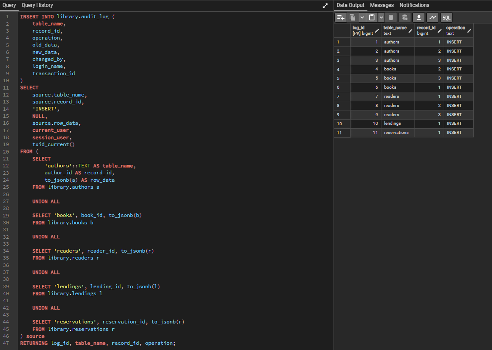

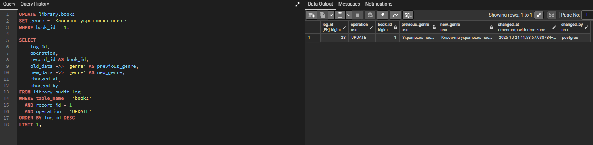

### 2.6. SAVEPOINT і частковий відкат

```sql
-- Перший запуск.
BEGIN;
INSERT INTO library.authors(first_name, last_name, birth_year, country)
VALUES ('Ольга', 'Кобилянська', 1863, 'Україна') RETURNING *;
SAVEPOINT after_author;

-- Другий запуск: очікувана помилка UNIQUE, SQLSTATE 23505.
INSERT INTO library.books(isbn, title, author_id, total_copies, available_copies)
SELECT '978-966-01-0001-1', 'Книга з помилковим ISBN', author_id, 3, 3
FROM library.authors
WHERE first_name = 'Ольга' AND last_name = 'Кобилянська';

-- Третій запуск.
ROLLBACK TO SAVEPOINT after_author;
INSERT INTO library.books(
    isbn, title, author_id, publication_year, genre,
    total_copies, available_copies
)
SELECT '978-966-01-0004-2', 'Земля', author_id, 1902, 'Роман', 3, 3
FROM library.authors
WHERE first_name = 'Ольга' AND last_name = 'Кобилянська';
COMMIT;

SELECT a.first_name, a.last_name, b.title, b.isbn, b.available_copies
FROM library.authors a JOIN library.books b USING(author_id)
WHERE b.isbn = '978-966-01-0004-2';
```

**Результат виконання.** Повторний ISBN відхилено. ROLLBACK TO SAVEPOINT зберіг доданого автора, після чого вставлено книгу «Земля» з іншим ISBN і підтверджено транзакцію. Значення identity можуть мати пропуски після невдалих INSERT: послідовності не відкочуються разом із рядками.

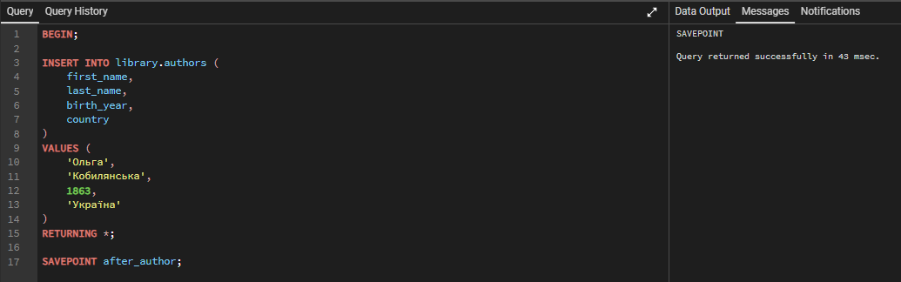

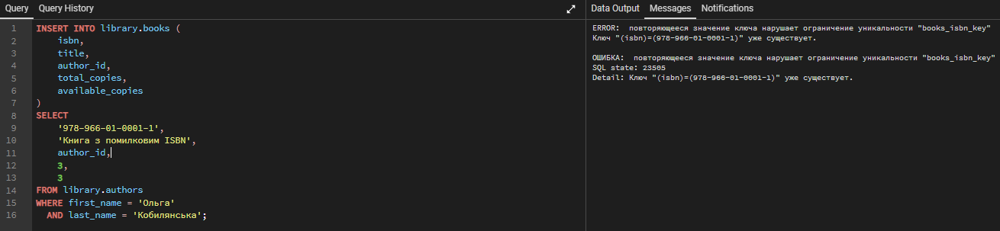

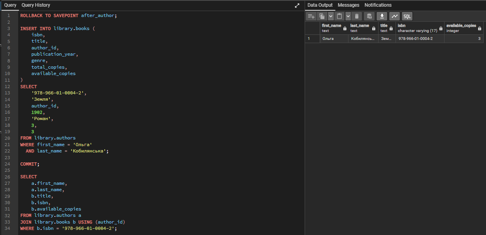

### 2.7. Каскадне оновлення та видалення

```sql
BEGIN;
WITH new_reader AS (
    INSERT INTO library.readers(full_name, email, library_card_number)
    VALUES ('Каскадний читач', 'cascade@example.com', 'TEMP-CASCADE')
    RETURNING reader_id
)
INSERT INTO library.reservations(book_id, reader_id, expiration_date)
SELECT 1, reader_id, clock_timestamp() + INTERVAL '1 day'
FROM new_reader;
COMMIT;

SELECT r.reader_id, r.full_name, res.reservation_id, res.book_id, res.status
FROM library.readers r JOIN library.reservations res USING(reader_id)
WHERE r.email = 'cascade@example.com';

BEGIN;
UPDATE library.readers SET reader_id = 10000
WHERE email = 'cascade@example.com';
COMMIT;

SELECT r.reader_id, r.full_name, res.reservation_id,
       res.reader_id AS reservation_reader_id
FROM library.readers r JOIN library.reservations res USING(reader_id)
WHERE r.email = 'cascade@example.com';

BEGIN;
DELETE FROM library.readers
WHERE reader_id = 10000 AND email = 'cascade@example.com';
COMMIT;

SELECT
    (SELECT COUNT(*) FROM library.readers WHERE reader_id = 10000)
        AS remaining_readers,
    (SELECT COUNT(*) FROM library.reservations WHERE reader_id = 10000)
        AS remaining_reservations;

SELECT log_id, table_name, record_id, operation,
       old_data ->> 'reader_id' AS deleted_reader_id,
       changed_at, transaction_id
FROM library.audit_log
WHERE operation = 'DELETE' AND (
    (table_name = 'readers' AND record_id = 10000)
    OR (table_name = 'reservations' AND old_data ->> 'reader_id' = '10000')
)
ORDER BY log_id;
```

**Результат виконання.** ON UPDATE CASCADE змінив reader_id у бронюванні на 10000. ON DELETE CASCADE автоматично видалив бронювання разом із тестовим читачем: обидва підсумкові лічильники дорівнюють 0. Аудит містить два видалення з одним transaction_id. Для історії видач застосовано RESTRICT, щоб не втрачати її через каскад.

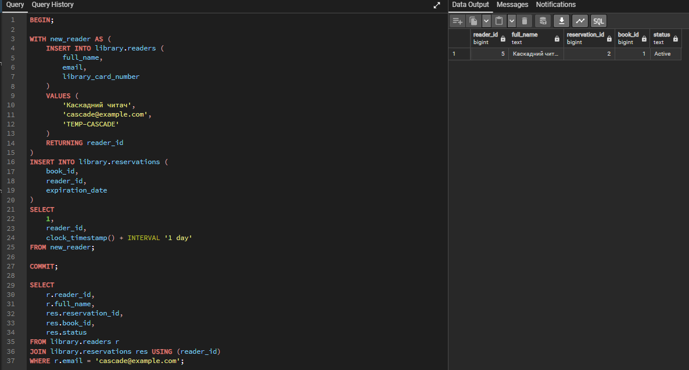

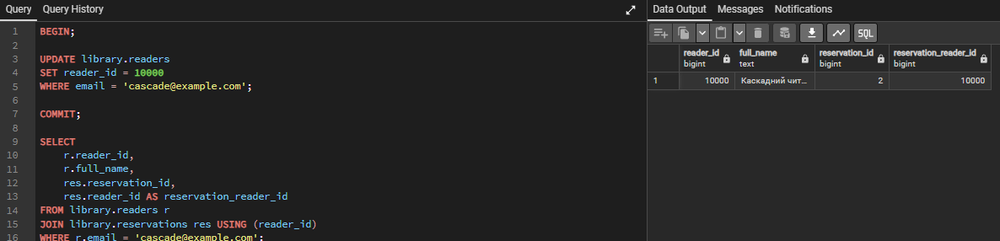

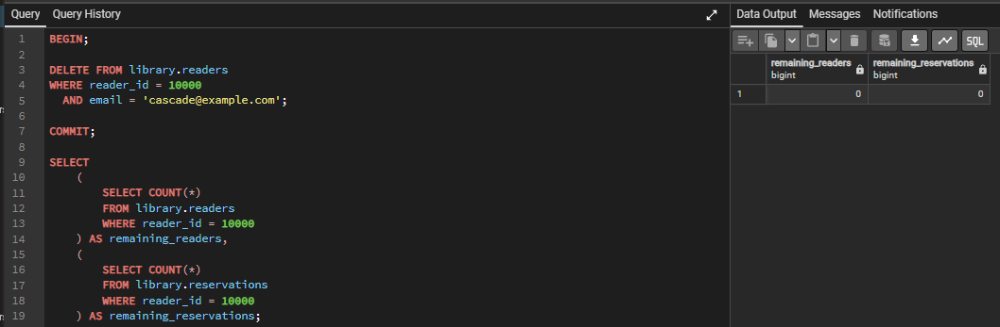

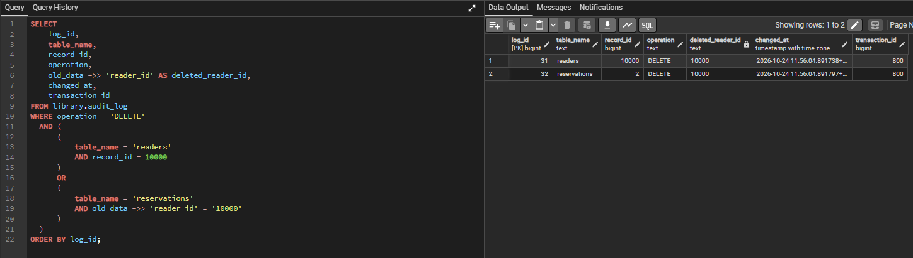

### 2.8. Збережені процедури видачі та повернення

```sql
CREATE PROCEDURE library.issue_book(
    p_book_id BIGINT, p_reader_id BIGINT, p_days INTEGER DEFAULT 14
)
LANGUAGE plpgsql SECURITY DEFINER
SET search_path = pg_catalog, library AS $$
DECLARE
    v_available INTEGER;
    v_reader_status TEXT;
    v_first_reader BIGINT;
BEGIN
    IF p_days IS NULL OR p_days NOT BETWEEN 1 AND 30 THEN
        RAISE EXCEPTION 'Термін видачі має бути від 1 до 30 днів';
    END IF;
    SELECT available_copies INTO STRICT v_available
    FROM library.books WHERE book_id = p_book_id FOR UPDATE;
    SELECT status INTO STRICT v_reader_status
    FROM library.readers WHERE reader_id = p_reader_id FOR UPDATE;
    IF v_reader_status <> 'Active' THEN
        RAISE EXCEPTION 'Читач неактивний або заблокований';
    END IF;
    IF EXISTS (
        SELECT 1 FROM library.lendings
        WHERE reader_id = p_reader_id AND return_date IS NULL
          AND due_date < CURRENT_DATE
    ) THEN
        RAISE EXCEPTION 'Читач має прострочені книги';
    END IF;
    IF v_available <= 0 THEN
        RAISE EXCEPTION 'Немає доступних примірників';
    END IF;
    SELECT reader_id INTO v_first_reader
    FROM library.reservations
    WHERE book_id = p_book_id AND status = 'Active'
      AND expiration_date > clock_timestamp()
    ORDER BY reservation_date, reservation_id LIMIT 1 FOR UPDATE;
    IF v_first_reader IS NOT NULL AND v_first_reader <> p_reader_id THEN
        RAISE EXCEPTION 'Книга заброньована іншим читачем';
    END IF;
    UPDATE library.books
    SET available_copies = available_copies - 1 WHERE book_id = p_book_id;
    INSERT INTO library.lendings(book_id, reader_id, due_date)
    VALUES (p_book_id, p_reader_id, CURRENT_DATE + p_days);
    UPDATE library.reservations SET status = 'Fulfilled'
    WHERE book_id = p_book_id AND reader_id = p_reader_id
      AND status = 'Active' AND expiration_date > clock_timestamp();
END;
$$;


CREATE OR REPLACE PROCEDURE library.return_book(p_lending_id BIGINT)
LANGUAGE plpgsql SECURITY DEFINER
SET search_path = pg_catalog, library AS $$
DECLARE
    v_book_id BIGINT;
    v_reader_id BIGINT;
    v_return_date DATE;
BEGIN
    SELECT book_id, reader_id INTO STRICT v_book_id, v_reader_id
    FROM library.lendings WHERE lending_id = p_lending_id;
    PERFORM 1 FROM library.books WHERE book_id = v_book_id FOR UPDATE;
    PERFORM 1 FROM library.readers WHERE reader_id = v_reader_id FOR UPDATE;
    SELECT return_date INTO STRICT v_return_date
    FROM library.lendings WHERE lending_id = p_lending_id FOR UPDATE;
    IF v_return_date IS NOT NULL THEN
        RAISE EXCEPTION 'Книгу вже повернуто';
    END IF;
    UPDATE library.lendings SET return_date = CURRENT_DATE
    WHERE lending_id = p_lending_id;
    UPDATE library.books SET available_copies = available_copies + 1
    WHERE book_id = v_book_id;
END;
$$;
```

**Результат виконання.** Бізнес-логіку перенесено в процедури. issue_book перевіряє строк видачі, статус читача, прострочення, залишок і чергу бронювань. return_book повертає примірник лише один раз. Порядок блокування - книга, читач, далі запис видачі під час повернення. SECURITY DEFINER дозволяє надати бібліотекарю доступ до операцій без прямого права змінювати залишок.

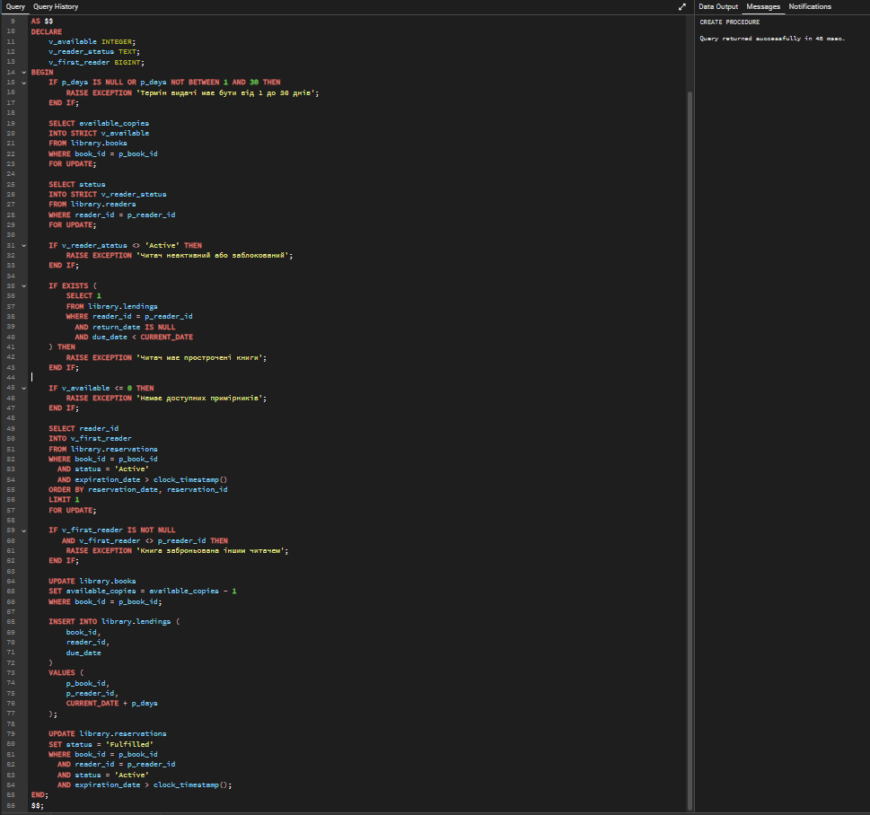

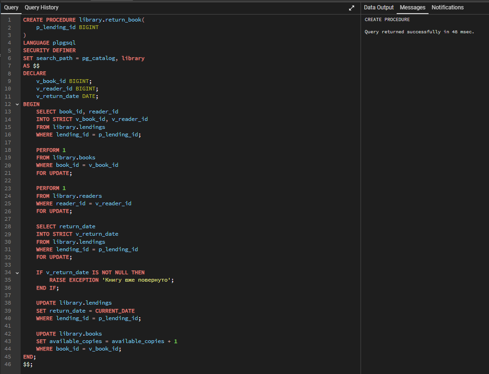

### 2.9. Повернення та захист від повторної операції

```sql
BEGIN;
DO $$
DECLARE v_lending_id BIGINT;
BEGIN
    SELECT lending_id INTO STRICT v_lending_id
    FROM library.lendings
    WHERE book_id = 1 AND reader_id = 1 AND return_date IS NULL;
    CALL library.return_book(v_lending_id);
END;
$$;
COMMIT;

SELECT l.lending_id, b.title, l.return_date,
       b.total_copies, b.available_copies
FROM library.lendings l JOIN library.books b USING(book_id)
WHERE l.book_id = 1 AND l.reader_id = 1 ORDER BY l.lending_id DESC;

-- Окремий запуск: очікувана помилка повторного повернення.
DO $$
DECLARE v_lending_id BIGINT;
BEGIN
    SELECT MAX(lending_id) INTO v_lending_id
    FROM library.lendings WHERE book_id = 1 AND reader_id = 1;
    CALL library.return_book(v_lending_id);
END;
$$;

-- Окремий запуск після помилки.
ROLLBACK;
SELECT book_id, title, total_copies, available_copies
FROM library.books WHERE book_id = 1;
```

**Результат виконання.** Повернення заповнило return_date і збільшило залишок «Кобзаря» до 3. Повторний виклик завершився повідомленням «Книгу вже повернуто»; залишок залишився 3. Оновлення видачі, книги та записи аудиту є частинами однієї транзакції.

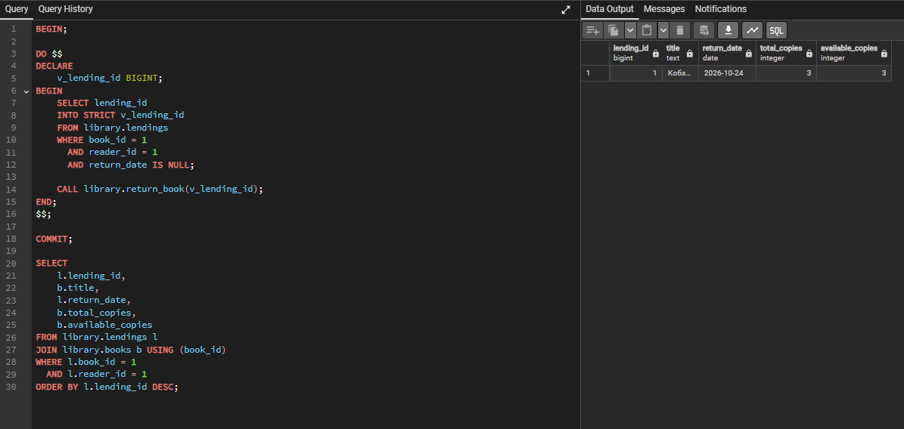

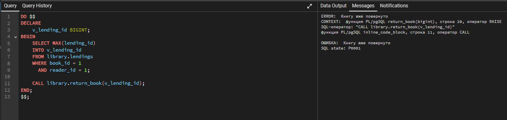

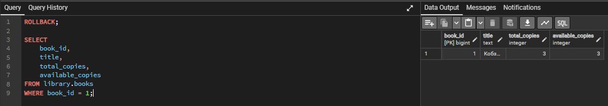

### 2.10. Дослід із двома паралельними з’єднаннями

Наведені нижче команди виконувалися у зазначених вкладках, а не одним SQL-блоком. Блокування FOR UPDATE захищає перевірку залишку й наступну зміну від конкурентної видачі останнього примірника.

```sql
-- Вкладка A: створення видачі, транзакція залишається відкритою.
BEGIN;
CALL library.issue_book(3, 1, 14);
SELECT pg_backend_pid() AS session_a, book_id, title, available_copies
FROM library.books WHERE book_id = 3;

-- Вкладка B: інше з'єднання до тієї самої БД. Запит очікує.
CALL library.issue_book(3, 3, 14);

-- Вкладка A: доказ очікування блокування.
SELECT pid AS waiting_session, wait_event_type, wait_event,
       pg_blocking_pids(pid) AS blocking_sessions, query
FROM pg_stat_activity
WHERE datname = current_database()
  AND cardinality(pg_blocking_pids(pid)) > 0;

-- Вкладка A: звільнення блокування.
COMMIT;

-- Вкладка B: після звільнення блокування отримано помилку
-- «Немає доступних примірників».

-- Вкладка A: перевірка результату.
SELECT b.book_id, b.title, b.total_copies, b.available_copies,
       COUNT(l.lending_id) AS active_lendings
FROM library.books b
LEFT JOIN library.lendings l
  ON l.book_id = b.book_id AND l.return_date IS NULL
WHERE b.book_id = 3
GROUP BY b.book_id, b.title, b.total_copies, b.available_copies;
```

**Результат виконання.** Перша транзакція захопила єдиний примірник «Захара Беркута». Друга очікувала: pg_stat_activity показав wait_event_type = Lock, а pg_blocking_pids - ідентифікатор першого з’єднання. Після COMMIT перша видача збереглася, другу відхилено через нульовий залишок. Підсумок: total_copies = 1, available_copies = 0, active_lendings = 1.

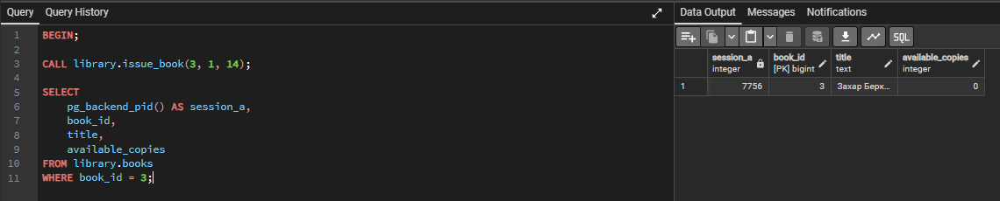

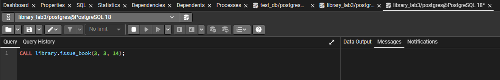

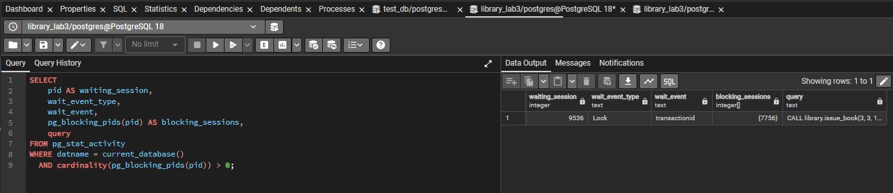

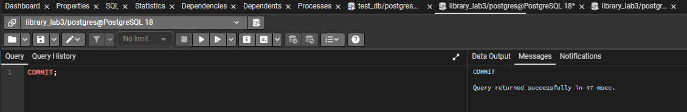

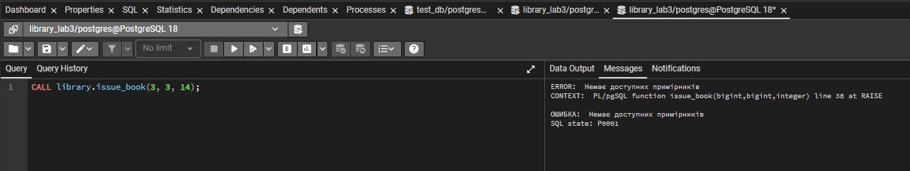

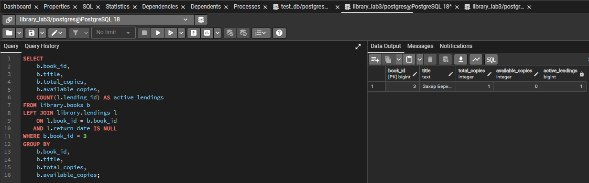

### 2.11. Завершення досліду та перевірка узгодженості

```sql
DO $$
DECLARE v_lending_id BIGINT;
BEGIN
    SELECT lending_id INTO STRICT v_lending_id
    FROM library.lendings WHERE book_id = 3 AND return_date IS NULL;
    CALL library.return_book(v_lending_id);
END;
$$;
SELECT book_id, title, available_copies
FROM library.books WHERE book_id = 3;

SELECT b.book_id, b.title, b.total_copies, b.available_copies,
       COUNT(l.lending_id) AS active_lendings,
       b.total_copies - b.available_copies = COUNT(l.lending_id) AS consistent
FROM library.books b
LEFT JOIN library.lendings l
  ON l.book_id = b.book_id AND l.return_date IS NULL
GROUP BY b.book_id, b.title, b.total_copies, b.available_copies
ORDER BY b.book_id;

SELECT transaction_id, COUNT(*) AS changes_count,
       string_agg(DISTINCT table_name, ', ' ORDER BY table_name) AS affected_tables,
       MIN(changed_at) AS first_change, MAX(changed_at) AS last_change
FROM library.audit_log GROUP BY transaction_id
HAVING COUNT(DISTINCT table_name) > 1 ORDER BY MAX(log_id) DESC;
```

**Результат виконання.** Тестовий примірник повернуто. Для всіх чотирьох книг consistent = true. Групування аудиту за transaction_id підтверджує спільні зміни books і lendings у транзакціях видачі та повернення.


## Рівень 3. Версіонування, автоматизація, права та відновлення

### 3.1. Структура версій книг

```sql
CREATE TABLE library.books_versions (
    version_id BIGINT GENERATED ALWAYS AS IDENTITY PRIMARY KEY,
    book_id BIGINT NOT NULL,
    version_number INTEGER NOT NULL,
    data JSONB,
    valid_from TIMESTAMPTZ NOT NULL,
    valid_to TIMESTAMPTZ,
    deleted BOOLEAN NOT NULL DEFAULT FALSE,
    created_by TEXT NOT NULL,
    CONSTRAINT books_versions_number_unique UNIQUE(book_id, version_number),
    CONSTRAINT books_versions_dates_check
        CHECK (valid_to IS NULL OR valid_to >= valid_from),
    CONSTRAINT books_versions_data_check CHECK (
        (deleted AND data IS NULL) OR (NOT deleted AND data IS NOT NULL)
    )
);
CREATE UNIQUE INDEX one_current_book_version
ON library.books_versions(book_id) WHERE valid_to IS NULL;
```

**Результат виконання.** Створено окрему таблицю версій з унікальною нумерацією для кожної книги. Частковий індекс дозволяє лише одну незакриту версію. Видалення представляється версією з deleted = true та data = NULL. Історія не залежить від подальшого існування книги в каталозі.


### 3.2. Перенесення накопиченої історії

```sql
INSERT INTO library.books_versions(
    book_id, version_number, data, valid_from, valid_to, deleted, created_by
)
SELECT record_id,
       (ROW_NUMBER() OVER(PARTITION BY record_id ORDER BY log_id))::INTEGER,
       new_data, changed_at,
       LEAD(changed_at) OVER(PARTITION BY record_id ORDER BY log_id),
       operation = 'DELETE', changed_by
FROM library.audit_log WHERE table_name = 'books';

SELECT book_id, version_number, data ->> 'title' AS title,
       data ->> 'available_copies' AS available_copies,
       valid_from, valid_to, deleted
FROM library.books_versions ORDER BY book_id, version_number;
```

**Результат виконання.** Версії ініціалізовано з аудиту без втрати вже виконаних змін. ROW_NUMBER визначив номер версії, а LEAD - момент закриття попередньої версії.


### 3.3. Автоматичне версіонування

```sql
CREATE FUNCTION library.version_book_from_audit()
RETURNS TRIGGER LANGUAGE plpgsql SECURITY DEFINER
SET search_path = pg_catalog, library AS $$
DECLARE v_version_number INTEGER;
BEGIN
    IF NEW.table_name <> 'books' THEN RETURN NULL; END IF;
    UPDATE library.books_versions SET valid_to = NEW.changed_at
    WHERE book_id = NEW.record_id AND valid_to IS NULL;
    SELECT COALESCE(MAX(version_number), 0) + 1 INTO v_version_number
    FROM library.books_versions WHERE book_id = NEW.record_id;
    INSERT INTO library.books_versions(
        book_id, version_number, data, valid_from, deleted, created_by
    ) VALUES (
        NEW.record_id, v_version_number, NEW.new_data,
        NEW.changed_at, NEW.operation = 'DELETE', NEW.changed_by
    );
    RETURN NULL;
END;
$$;

CREATE TRIGGER book_version_from_audit
AFTER INSERT ON library.audit_log FOR EACH ROW
WHEN (NEW.table_name = 'books')
EXECUTE FUNCTION library.version_book_from_audit();

UPDATE library.books SET genre = 'Українська класика' WHERE book_id = 1;
SELECT version_number, data ->> 'title' AS title, data ->> 'genre' AS genre,
       valid_from, valid_to, valid_to IS NULL AS is_current
FROM library.books_versions WHERE book_id = 1 ORDER BY version_number;
```

**Результат виконання.** Після оновлення жанру автоматично створено нову версію. Попередню закрито в момент changed_at, нова має valid_to = NULL. Версії формуються з аудиту, тому час обох механізмів узгоджений.


### 3.4. Отримання історичного стану

```sql
CREATE FUNCTION library.get_book_version(p_book_id BIGINT, p_at TIMESTAMPTZ)
RETURNS JSONB LANGUAGE sql STABLE
SET search_path = pg_catalog, library AS $$
    SELECT data FROM library.books_versions
    WHERE book_id = p_book_id AND valid_from <= p_at
      AND (valid_to IS NULL OR p_at < valid_to) AND NOT deleted
    ORDER BY version_number DESC LIMIT 1;
$$;

WITH first_version AS (
    SELECT valid_from FROM library.books_versions
    WHERE book_id = 1 ORDER BY version_number LIMIT 1
)
SELECT library.get_book_version(1, first_version.valid_from) ->> 'genre'
           AS initial_genre,
       library.get_book_version(1, clock_timestamp()) ->> 'genre'
           AS current_genre
FROM first_version;

SELECT book_id, COUNT(*) AS total_versions,
       COUNT(*) FILTER(WHERE valid_to IS NULL) AS current_versions,
       BOOL_AND(valid_to IS NULL OR valid_to >= valid_from) AS valid_intervals
FROM library.books_versions GROUP BY book_id ORDER BY book_id;
```

**Результат виконання.** Для першої зафіксованої версії «Кобзаря» отримано жанр «Українська поезія», для поточної на момент перевірки - «Українська класика». Для кожної книги current_versions = 1 та valid_intervals = true. Межі версії трактуються як напіввідкритий інтервал [valid_from, valid_to).


### 3.5. Черга відкладених операцій

```sql
CREATE TABLE library.scheduled_operations (
    operation_id BIGINT GENERATED BY DEFAULT AS IDENTITY PRIMARY KEY,
    operation_type TEXT NOT NULL,
    target_id BIGINT NOT NULL,
    scheduled_for TIMESTAMPTZ NOT NULL,
    status TEXT NOT NULL DEFAULT 'Pending',
    executed_at TIMESTAMPTZ,
    error_message TEXT,
    CONSTRAINT scheduled_operations_type_check
        CHECK (operation_type IN ('EXPIRE_RESERVATION', 'BLOCK_READER')),
    CONSTRAINT scheduled_operations_status_check
        CHECK (status IN ('Pending', 'Executed', 'Failed', 'Cancelled'))
);
CREATE INDEX pending_operations_due
ON library.scheduled_operations(scheduled_for, operation_id)
WHERE status = 'Pending';
```

**Результат виконання.** Створено чергу з типами операцій, строком запуску, статусом, часом завершення та повідомленням про помилку. Частковий індекс прискорює пошук незавершених завдань.


### 3.6. Обробник із локальною обробкою помилок

```sql
CREATE FUNCTION library.execute_scheduled_operations()
RETURNS INTEGER LANGUAGE plpgsql SECURITY DEFINER
SET search_path = pg_catalog, library AS $$
DECLARE
    v_job RECORD;
    v_count INTEGER := 0;
    v_error TEXT;
BEGIN
    FOR v_job IN
        SELECT operation_id, operation_type, target_id
        FROM library.scheduled_operations
        WHERE status = 'Pending' AND scheduled_for <= clock_timestamp()
        ORDER BY scheduled_for, operation_id FOR UPDATE SKIP LOCKED
    LOOP
        BEGIN
            CASE v_job.operation_type
                WHEN 'EXPIRE_RESERVATION' THEN
                    UPDATE library.reservations SET status = 'Expired'
                    WHERE reservation_id = v_job.target_id
                      AND status = 'Active'
                      AND expiration_date <= clock_timestamp();
                    IF NOT FOUND THEN
                        RAISE EXCEPTION
                            'Прострочене активне бронювання не знайдено';
                    END IF;
                WHEN 'BLOCK_READER' THEN
                    UPDATE library.readers SET status = 'Blocked'
                    WHERE reader_id = v_job.target_id;
                    IF NOT FOUND THEN
                        RAISE EXCEPTION 'Читача не знайдено';
                    END IF;
                ELSE
                    RAISE EXCEPTION 'Невідомий тип операції';
            END CASE;
            UPDATE library.scheduled_operations
            SET status = 'Executed', executed_at = clock_timestamp(),
                error_message = NULL
            WHERE operation_id = v_job.operation_id;
            v_count := v_count + 1;
        EXCEPTION WHEN OTHERS THEN
            GET STACKED DIAGNOSTICS v_error = MESSAGE_TEXT;
            UPDATE library.scheduled_operations
            SET status = 'Failed', executed_at = clock_timestamp(),
                error_message = v_error
            WHERE operation_id = v_job.operation_id;
        END;
    END LOOP;
    RETURN v_count;
END;
$$;
```

**Результат виконання.** Готові завдання обираються через FOR UPDATE SKIP LOCKED. Кожна операція виконується у вкладеному блоці з EXCEPTION, тому її помилка не скасовує інші завдання. Статус Failed зберігає причину; автоматичних повторних спроб для нього не передбачено.


### 3.7. Бізнес-процедура бронювання

```sql
CREATE OR REPLACE PROCEDURE library.reserve_book(
    p_book_id BIGINT, p_reader_id BIGINT, p_minutes INTEGER DEFAULT 10080
)
LANGUAGE plpgsql SECURITY DEFINER
SET search_path = pg_catalog, library AS $$
DECLARE
    v_reader_status TEXT;
    v_reservation_id BIGINT;
    v_created_at TIMESTAMPTZ;
    v_expiration TIMESTAMPTZ;
BEGIN
    IF p_minutes IS NULL OR p_minutes NOT BETWEEN 1 AND 43200 THEN
        RAISE EXCEPTION
            'Тривалість бронювання має бути від 1 до 43200 хвилин';
    END IF;
    PERFORM 1 FROM library.books WHERE book_id = p_book_id FOR UPDATE;
    IF NOT FOUND THEN RAISE EXCEPTION 'Книгу не знайдено'; END IF;
    SELECT status INTO STRICT v_reader_status
    FROM library.readers WHERE reader_id = p_reader_id FOR UPDATE;
    IF v_reader_status <> 'Active' THEN
        RAISE EXCEPTION 'Читач неактивний або заблокований';
    END IF;
    IF EXISTS (
        SELECT 1 FROM library.reservations
        WHERE book_id = p_book_id AND reader_id = p_reader_id
          AND status = 'Active'
    ) THEN RAISE EXCEPTION 'Активне бронювання вже існує'; END IF;
    v_created_at := clock_timestamp();
    v_expiration := v_created_at + make_interval(mins => p_minutes);
    INSERT INTO library.reservations(
        book_id, reader_id, reservation_date, expiration_date
    ) VALUES (p_book_id, p_reader_id, v_created_at, v_expiration)
    RETURNING reservation_id INTO v_reservation_id;
    INSERT INTO library.scheduled_operations(
        operation_type, target_id, scheduled_for
    ) VALUES ('EXPIRE_RESERVATION', v_reservation_id, v_expiration);
END;
$$;
```

**Результат виконання.** Процедура перевіряє книгу, активність читача, допустиму тривалість і наявність дубля. Бронювання та завдання його завершення створюються атомарно. Типова тривалість - 10080 хвилин, тобто сім днів.


### 3.8. Перевірка успіху, помилки та майбутнього завдання

```sql
BEGIN;
WITH expired_reservation AS (
    INSERT INTO library.reservations(
        book_id, reader_id, reservation_date, expiration_date
    ) VALUES (
        1, 3, clock_timestamp() - INTERVAL '2 hours',
        clock_timestamp() - INTERVAL '1 hour'
    ) RETURNING reservation_id
)
INSERT INTO library.scheduled_operations(operation_type, target_id, scheduled_for)
SELECT 'EXPIRE_RESERVATION', reservation_id,
       clock_timestamp() - INTERVAL '1 minute'
FROM expired_reservation;
INSERT INTO library.scheduled_operations(operation_type, target_id, scheduled_for)
VALUES
    ('BLOCK_READER', 999999, clock_timestamp() - INTERVAL '1 minute'),
    ('BLOCK_READER', 999999, clock_timestamp() + INTERVAL '30 days');
COMMIT;

SELECT operation_id, operation_type, target_id, scheduled_for, status
FROM library.scheduled_operations ORDER BY operation_id;

SELECT library.execute_scheduled_operations() AS successfully_executed;

SELECT operation_id, operation_type, target_id, status, executed_at, error_message
FROM library.scheduled_operations ORDER BY operation_id;

SELECT r.reservation_id, r.book_id, r.reader_id, r.status,
       a.old_data ->> 'status' AS previous_status,
       a.new_data ->> 'status' AS new_status, a.changed_at
FROM library.reservations r
JOIN library.audit_log a ON a.table_name = 'reservations'
  AND a.record_id = r.reservation_id AND a.operation = 'UPDATE'
WHERE r.book_id = 1 AND r.reader_id = 3 AND r.status = 'Expired'
ORDER BY a.log_id DESC;

SELECT library.execute_scheduled_operations() AS repeated_execution_count;
```

**Результат виконання.** Початково всі три завдання мали Pending. Перший запуск повернув 1: прострочене бронювання стало Expired, його завдання - Executed. Операція для неіснуючого читача отримала Failed і текст «Читача не знайдено». Майбутнє завдання залишилося Pending. Повторний запуск повернув 0: завершені й помилкові завдання не повторюються.


### 3.9. Підключення pgAgent

pgAgent встановлено через Stack Builder. Об’єкти планувальника розміщено в базі postgres. Файл pgpass.conf використовує формат hostname:port:database:username:password; поле database налаштовано для потрібних баз. Служба та pgAdmin використовують незалежні підключення.

```sql
-- База postgres.
CREATE EXTENSION IF NOT EXISTS pgagent;

SELECT name, default_version, installed_version
FROM pg_available_extensions WHERE name = 'pgagent';

SELECT jagpid AS agent_pid, jagstation AS computer_name,
       jaglogintime AS connected_at
FROM pgagent.pga_jobagent;
```

**Результат виконання.** Установлено розширення pgAgent 4.2 та перевірено активне підключення служби. Для автоматичного доступу до навчальної БД налаштовано файл паролів облікового запису служби. Паролі до SQL і скріншотів звіту не включаються.


### 3.10. Щохвилинний запуск черги

```sql
-- База postgres. Блок створення виконується один раз.
DO $$
DECLARE v_job_id INTEGER; v_class_id INTEGER;
BEGIN
    IF EXISTS (
        SELECT 1 FROM pgagent.pga_job
        WHERE jobname = 'Library: process scheduled operations'
    ) THEN RAISE EXCEPTION 'Це завдання вже створене'; END IF;
    SELECT MIN(jclid) INTO v_class_id FROM pgagent.pga_jobclass;
    IF v_class_id IS NULL THEN
        RAISE EXCEPTION 'Не знайдено класів завдань pgAgent';
    END IF;
    INSERT INTO pgagent.pga_job(
        jobjclid, jobname, jobdesc, jobhostagent, jobenabled
    ) VALUES (
        v_class_id, 'Library: process scheduled operations',
        'Щохвилинна обробка відкладених операцій бібліотеки', '', TRUE
    ) RETURNING jobid INTO v_job_id;
    INSERT INTO pgagent.pga_jobstep(
        jstjobid, jstname, jstenabled, jstkind, jstcode,
        jstconnstr, jstdbname, jstonerror
    ) VALUES (
        v_job_id, '01 Process queue', TRUE, 's',
        'SELECT library.execute_scheduled_operations();',
        '', 'library_lab3', 'f'
    );
    INSERT INTO pgagent.pga_schedule(
        jscjobid, jscname, jscenabled, jscstart,
        jscminutes, jschours, jscweekdays, jscmonthdays, jscmonths
    ) VALUES (
        v_job_id, 'Every minute', TRUE, clock_timestamp(),
        array_fill(TRUE, ARRAY[60]), array_fill(TRUE, ARRAY[24]),
        array_fill(TRUE, ARRAY[7]), array_fill(TRUE, ARRAY[32]),
        array_fill(TRUE, ARRAY[12])
    );
END;
$$;

SELECT j.jobid, j.jobname, j.jobenabled, s.jscname AS schedule_name, j.jobnextrun
FROM pgagent.pga_job j
JOIN pgagent.pga_schedule s ON s.jscjobid = j.jobid
WHERE j.jobname = 'Library: process scheduled operations';
```

**Результат виконання.** Створено увімкнене завдання Every minute з SQL-кроком у library_lab3. Усі хвилини, години, дні тижня та місяці дозволені розкладом.


### 3.11. Автоматичне завершення бронювання

```sql
-- База library_lab3: початкова демонстрація.
CALL library.reserve_book(1, 2, 1);

SELECT r.reservation_id, r.book_id, r.reader_id,
       r.reservation_date, r.expiration_date,
       r.status AS reservation_status, o.status AS operation_status
FROM library.reservations r
JOIN library.scheduled_operations o
  ON o.operation_type = 'EXPIRE_RESERVATION'
 AND o.target_id = r.reservation_id
WHERE r.book_id = 1 AND r.reader_id = 2
ORDER BY r.reservation_id DESC LIMIT 1;

-- Після виправлення підключення планувальника прострочений
-- тестовий запис завершено перед новою перевіркою.
UPDATE library.reservations SET status = 'Expired'
WHERE book_id = 1 AND reader_id = 2 AND status = 'Active'
  AND expiration_date <= clock_timestamp();
CALL library.reserve_book(1, 2, 1);

-- Через 2-3 хвилини, без ручного виклику обробника:
SELECT r.reservation_id, r.status AS reservation_status,
       o.status AS operation_status, o.executed_at
FROM library.reservations r
JOIN library.scheduled_operations o
  ON o.operation_type = 'EXPIRE_RESERVATION'
 AND o.target_id = r.reservation_id
WHERE r.book_id = 1 AND r.reader_id = 2
ORDER BY r.reservation_id DESC LIMIT 1;
```

**Результат виконання.** Початковий стан бронювання - Active, завдання - Pending. Після виправлення підключення та повторної перевірки нове бронювання автоматично отримало Expired, а завдання - Executed; executed_at заповнений. Підсумковий SELECT виконувався після очікування без ручного запуску обробника.


### 3.12. Журнал автоматичних запусків

```sql
-- База postgres.
SELECT j.jobname, l.jlgid AS run_id, l.jlgstart AS started_at,
       l.jlgduration AS duration,
       CASE l.jlgstatus
           WHEN 's' THEN 'Success' WHEN 'f' THEN 'Failed'
           WHEN 'r' THEN 'Running' WHEN 'i' THEN 'Internal failure'
           WHEN 'd' THEN 'Aborted' ELSE l.jlgstatus::TEXT
       END AS run_status
FROM pgagent.pga_job j
JOIN pgagent.pga_joblog l ON l.jlgjobid = j.jobid
WHERE j.jobname = 'Library: process scheduled operations'
ORDER BY l.jlgid DESC LIMIT 5;
```

**Результат виконання.** Після виправлення підключення п’ять останніх запусків мають статус Success. Рядки є історією виконань за розкладом, а не п’ятьма одночасними процесами.


### 3.13. Ролі та принцип мінімальних прав

```sql
BEGIN;
DO $$
BEGIN
    IF NOT EXISTS (SELECT 1 FROM pg_roles WHERE rolname = 'lab3_read') THEN
        CREATE ROLE lab3_read NOLOGIN;
    END IF;
    IF NOT EXISTS (SELECT 1 FROM pg_roles WHERE rolname = 'lab3_write') THEN
        CREATE ROLE lab3_write NOLOGIN;
    END IF;
    IF NOT EXISTS (SELECT 1 FROM pg_roles WHERE rolname = 'lab3_admin') THEN
        CREATE ROLE lab3_admin NOLOGIN;
    END IF;
END;
$$;
REVOKE ALL ON SCHEMA library FROM PUBLIC;
REVOKE EXECUTE ON ALL FUNCTIONS IN SCHEMA library FROM PUBLIC;
REVOKE EXECUTE ON ALL PROCEDURES IN SCHEMA library FROM PUBLIC;
GRANT USAGE ON SCHEMA library TO lab3_read, lab3_write, lab3_admin;
GRANT SELECT ON ALL TABLES IN SCHEMA library
TO lab3_read, lab3_write, lab3_admin;
GRANT EXECUTE ON FUNCTION library.get_book_version(BIGINT, TIMESTAMPTZ)
TO lab3_read, lab3_write, lab3_admin;
GRANT UPDATE(title, genre, publication_year) ON library.books TO lab3_write;
GRANT EXECUTE ON PROCEDURE
    library.issue_book(BIGINT, BIGINT, INTEGER),
    library.return_book(BIGINT), library.reserve_book(BIGINT, BIGINT, INTEGER)
TO lab3_write, lab3_admin;
GRANT INSERT, UPDATE, DELETE ON
    library.authors, library.books, library.readers, library.lendings,
    library.reservations, library.scheduled_operations
TO lab3_admin;
GRANT USAGE, SELECT ON ALL SEQUENCES IN SCHEMA library TO lab3_admin;
GRANT EXECUTE ON FUNCTION library.execute_scheduled_operations() TO lab3_admin;
ALTER DEFAULT PRIVILEGES IN SCHEMA library
REVOKE EXECUTE ON FUNCTIONS FROM PUBLIC;
COMMIT;
```

**Результат виконання.** Створено три NOLOGIN-ролі. Читач має перегляд; бібліотекар - редагування метаданих книги та виклик бізнес-процедур; прикладний адміністратор - модифікацію бізнес-таблиць. Жодній прикладній ролі не надано DELETE журналу аудиту. Адміністратор БД postgres як власник/суперкористувач залишається довіреним оператором.


### 3.14. Матриця прав і перевірка заборон

```sql
SELECT role_name,
    has_table_privilege(role_name, 'library.books', 'SELECT') AS can_read,
    has_column_privilege(role_name, 'library.books', 'title', 'UPDATE')
        AS can_edit_title,
    has_column_privilege(role_name, 'library.books', 'available_copies', 'UPDATE')
        AS can_edit_stock,
    has_table_privilege(role_name, 'library.audit_log', 'DELETE')
        AS can_delete_audit
FROM (VALUES ('lab3_read'), ('lab3_write'), ('lab3_admin')) roles(role_name)
ORDER BY role_name;

-- Окремий запуск: очікувана помилка доступу.
SET ROLE lab3_read;
UPDATE library.books SET title = 'Заборонена зміна' WHERE book_id = 1;

-- Окремий запуск після помилки.
ROLLBACK;
RESET ROLE;
SET ROLE lab3_write;
UPDATE library.books SET genre = 'Українська класика - поезія'
WHERE book_id = 1
RETURNING current_user AS active_role, book_id, title, genre;

-- Окремий запуск: очікувана помилка доступу.
UPDATE library.books SET available_copies = 0 WHERE book_id = 1;

-- Окремий запуск після помилки.
ROLLBACK;
RESET ROLE;
SELECT log_id, operation, old_data ->> 'genre' AS previous_genre,
       new_data ->> 'genre' AS new_genre, changed_by, login_name
FROM library.audit_log
WHERE table_name = 'books' AND changed_by = 'lab3_write'
ORDER BY log_id DESC LIMIT 5;
```

**Результат виконання.** Матриця підтвердила розмежування прав. UPDATE від lab3_read і пряму зміну залишку від lab3_write відхилено з SQLSTATE 42501. Оновлення жанру бібліотекарем дозволено. Аудит зберіг changed_by = lab3_write та login_name = postgres.


### 3.15. Контрольні точки

```sql
CREATE TABLE library.backup_points (
    backup_id BIGINT GENERATED ALWAYS AS IDENTITY PRIMARY KEY,
    backup_name TEXT NOT NULL,
    backup_timestamp TIMESTAMPTZ NOT NULL DEFAULT clock_timestamp(),
    data_snapshot JSONB NOT NULL
);
GRANT SELECT ON library.backup_points TO lab3_admin;
```

**Результат виконання.** Створено сховище іменованих логічних знімків. У кожній контрольній точці зберігається стан шести бізнес-таблиць, але журнал аудиту й таблиця версій не очищуються під час відновлення.


### 3.16. Узгоджений знімок шести таблиць

```sql
CREATE FUNCTION library.current_snapshot()
RETURNS JSONB LANGUAGE sql VOLATILE
SET search_path = pg_catalog, library AS $$
    SELECT jsonb_build_object(
        'authors', COALESCE(
            (SELECT jsonb_agg(to_jsonb(t) ORDER BY author_id)
             FROM library.authors t), '[]'::JSONB
        ),
        'books', COALESCE(
            (SELECT jsonb_agg(to_jsonb(t) ORDER BY book_id)
             FROM library.books t), '[]'::JSONB
        ),
        'readers', COALESCE(
            (SELECT jsonb_agg(to_jsonb(t) ORDER BY reader_id)
             FROM library.readers t), '[]'::JSONB
        ),
        'lendings', COALESCE(
            (SELECT jsonb_agg(to_jsonb(t) ORDER BY lending_id)
             FROM library.lendings t), '[]'::JSONB
        ),
        'reservations', COALESCE(
            (SELECT jsonb_agg(to_jsonb(t) ORDER BY reservation_id)
             FROM library.reservations t), '[]'::JSONB
        ),
        'scheduled_operations', COALESCE(
            (SELECT jsonb_agg(to_jsonb(t) ORDER BY operation_id)
             FROM library.scheduled_operations t), '[]'::JSONB
        )
    );
$$;

CREATE FUNCTION library.create_backup_point(p_name TEXT)
RETURNS BIGINT LANGUAGE plpgsql SECURITY DEFINER
SET search_path = pg_catalog, library AS $$
DECLARE v_backup_id BIGINT;
BEGIN
    LOCK TABLE library.authors, library.books, library.readers,
        library.lendings, library.reservations, library.scheduled_operations
    IN SHARE MODE;
    INSERT INTO library.backup_points(backup_name, data_snapshot)
    VALUES (p_name, library.current_snapshot())
    RETURNING backup_id INTO v_backup_id;
    RETURN v_backup_id;
END;
$$;
GRANT EXECUTE ON FUNCTION library.create_backup_point(TEXT) TO lab3_admin;
```

**Результат виконання.** current_snapshot формує впорядковані JSONB-масиви, замінюючи порожні результати на []. create_backup_point блокує модифікації таблиць у SHARE MODE на час зняття копії. Це дозволяє зберегти взаємно узгоджений стан пов’язаних записів.


### 3.17. Повне логічне відновлення

```sql
CREATE FUNCTION library.restore_from_backup(p_backup_id BIGINT)
RETURNS BOOLEAN LANGUAGE plpgsql SECURITY DEFINER
SET search_path = pg_catalog, library AS $$
DECLARE
    v_snapshot JSONB;
    v_table TEXT;
    v_id_column TEXT;
    v_sequence TEXT;
    v_max_id BIGINT;
    v_sequence_value BIGINT;
BEGIN
    SELECT data_snapshot INTO STRICT v_snapshot
    FROM library.backup_points WHERE backup_id = p_backup_id;
    FOREACH v_table IN ARRAY ARRAY[
        'authors', 'books', 'readers', 'lendings',
        'reservations', 'scheduled_operations'
    ] LOOP
        IF jsonb_typeof(v_snapshot -> v_table) IS DISTINCT FROM 'array' THEN
            RAISE EXCEPTION 'Некоректний знімок таблиці %', v_table;
        END IF;
    END LOOP;
    LOCK TABLE library.authors, library.books, library.readers,
        library.lendings, library.reservations, library.scheduled_operations
    IN ACCESS EXCLUSIVE MODE;
    DELETE FROM library.scheduled_operations WHERE TRUE;
    DELETE FROM library.reservations WHERE TRUE;
    DELETE FROM library.lendings WHERE TRUE;
    DELETE FROM library.books WHERE TRUE;
    DELETE FROM library.readers WHERE TRUE;
    DELETE FROM library.authors WHERE TRUE;
    FOREACH v_table IN ARRAY ARRAY[
        'authors', 'books', 'readers', 'lendings',
        'reservations', 'scheduled_operations'
    ] LOOP
        EXECUTE format(
            'INSERT INTO library.%I SELECT * FROM jsonb_populate_recordset(NULL::library.%I, $1)',
            v_table, v_table
        ) USING v_snapshot -> v_table;
        v_id_column := CASE v_table
            WHEN 'authors' THEN 'author_id'
            WHEN 'books' THEN 'book_id'
            WHEN 'readers' THEN 'reader_id'
            WHEN 'lendings' THEN 'lending_id'
            WHEN 'reservations' THEN 'reservation_id'
            WHEN 'scheduled_operations' THEN 'operation_id'
        END;
        v_sequence := pg_get_serial_sequence('library.' || v_table, v_id_column);
        EXECUTE format('SELECT COALESCE(MAX(%I), 0) FROM library.%I',
                       v_id_column, v_table) INTO v_max_id;
        EXECUTE format('SELECT last_value FROM %s', v_sequence)
        INTO v_sequence_value;
        PERFORM setval(v_sequence::regclass,
                       GREATEST(v_max_id, v_sequence_value, 1), TRUE);
    END LOOP;
    IF EXISTS (
        SELECT 1 FROM library.books b
        WHERE b.total_copies - b.available_copies <> (
            SELECT COUNT(*) FROM library.lendings l
            WHERE l.book_id = b.book_id AND l.return_date IS NULL
        )
    ) THEN
        RAISE EXCEPTION 'Відновлений знімок порушує узгодженість залишків';
    END IF;
    RETURN TRUE;
END;
$$;
GRANT EXECUTE ON FUNCTION library.restore_from_backup(BIGINT) TO lab3_admin;
```

**Результат виконання.** Реалізовано відновлення всіх шести таблиць. Залежні записи видаляються перед батьківськими, а вставляються після них. Імена таблиць беруться з фіксованого списку; ідентифікатори екрануються format(%I), дані передаються через USING. Після вставки синхронізуються identity-послідовності та перевіряється інваріант залишків. У разі помилки зміни рядків і аудиту відкочуються як одна транзакція; значення послідовностей можуть просунутися вперед.


### 3.18. Моделювання пошкодження та перевірка відновлення

```sql
CREATE TEMP TABLE lab3_recovery_state(backup_id BIGINT NOT NULL);
INSERT INTO lab3_recovery_state(backup_id)
VALUES (library.create_backup_point('Перед моделюванням помилкових змін'));

UPDATE library.books SET title = 'ПОМИЛКОВО ЗМІНЕНА НАЗВА'
WHERE book_id = 1;
DELETE FROM library.reservations WHERE book_id = 2;

SELECT b.book_id, b.title,
       (SELECT COUNT(*) FROM library.reservations WHERE book_id = 2)
           AS reservations_for_book_2
FROM library.books b WHERE b.book_id = 1;

SELECT library.restore_from_backup(
    (SELECT backup_id FROM lab3_recovery_state)
) AS restored;

SELECT b.title AS restored_title,
       (SELECT COUNT(*) FROM library.reservations WHERE book_id = 2)
           AS restored_reservations,
       library.current_snapshot() = (
           SELECT data_snapshot FROM library.backup_points
           WHERE backup_id = (SELECT backup_id FROM lab3_recovery_state)
       ) AS all_six_tables_match
FROM library.books b WHERE b.book_id = 1;
```

**Результат виконання.** Після моделювання помилки назва книги була пошкоджена, а кількість бронювань книги 2 дорівнювала 0. Відновлення повернуло назву «Кобзар» та одне бронювання. Порівняння JSONB-знімків дало all_six_tables_match = true, підтвердивши збіг усіх шести таблиць, а не лише одного запису.


### 3.19. Автоматичні контрольні точки через pgAgent

```sql
-- База postgres: другий крок наявного завдання.
INSERT INTO pgagent.pga_jobstep(
    jstjobid, jstname, jstenabled, jstkind, jstcode,
    jstconnstr, jstdbname, jstonerror
)
SELECT j.jobid, '02 Create checkpoint', TRUE, 's',
       'SELECT library.create_backup_point(''Automatic checkpoint'');',
       '', 'library_lab3', 'f'
FROM pgagent.pga_job j
WHERE j.jobname = 'Library: process scheduled operations'
  AND NOT EXISTS (
      SELECT 1 FROM pgagent.pga_jobstep s
      WHERE s.jstjobid = j.jobid AND s.jstname = '02 Create checkpoint'
  );

SELECT j.jobname, s.jstname, s.jstdbname, s.jstenabled, s.jstcode
FROM pgagent.pga_job j
JOIN pgagent.pga_jobstep s ON s.jstjobid = j.jobid
WHERE j.jobname = 'Library: process scheduled operations'
ORDER BY s.jstname;

-- База library_lab3, після очікування запусків за розкладом.
SELECT backup_id, backup_name, backup_timestamp,
       jsonb_array_length(data_snapshot -> 'books') AS saved_books,
       jsonb_array_length(data_snapshot -> 'reservations') AS saved_reservations
FROM library.backup_points WHERE backup_name = 'Automatic checkpoint'
ORDER BY backup_id DESC LIMIT 5;
```

**Результат виконання.** До завдання додано другий SQL-крок. Перший обробляє чергу, другий створює контрольну точку. На скріншоті зафіксовано п’ять автоматичних контрольних точок із різними часовими позначками; у кожній збережено чотири книги. Кількість бронювань змінюється між знімками відповідно до стану даних.


**Межі механізму відновлення.** Реалізовано логічні контрольні точки та відновлення після помилкової модифікації даних у працюючій БД. Функція сама відновлює весь знімок після виклику уповноваженим оператором; автоматичним є створення контрольних точок. Це не фізичний PostgreSQL CHECKPOINT і не WAL-based PITR. Знімки в тій самій БД не захищають від втрати сервера чи його диска; для такого сценарію потрібні зовнішні резервні копії та, за потреби, архівація WAL.

### 3.20. Інтерфейс історії та звітів

```sql
CREATE VIEW library.books_change_history AS
SELECT log_id, record_id AS book_id, operation,
       COALESCE(new_data ->> 'title', old_data ->> 'title') AS title,
       old_data ->> 'genre' AS previous_genre,
       new_data ->> 'genre' AS new_genre,
       old_data ->> 'available_copies' AS previous_copies,
       new_data ->> 'available_copies' AS new_copies,
       changed_at, changed_by, transaction_id
FROM library.audit_log WHERE table_name = 'books';

CREATE FUNCTION library.get_changes_report(
    p_start TIMESTAMPTZ, p_end TIMESTAMPTZ DEFAULT CURRENT_TIMESTAMP
)
RETURNS TABLE(
    change_date DATE, total_changes BIGINT, inserts BIGINT,
    updates BIGINT, deletes BIGINT
)
LANGUAGE sql STABLE SET search_path = pg_catalog, library AS $$
    SELECT changed_at::DATE, COUNT(*),
           COUNT(*) FILTER(WHERE operation = 'INSERT'),
           COUNT(*) FILTER(WHERE operation = 'UPDATE'),
           COUNT(*) FILTER(WHERE operation = 'DELETE')
    FROM library.audit_log
    WHERE changed_at >= p_start AND changed_at < p_end
    GROUP BY changed_at::DATE ORDER BY changed_at::DATE;
$$;
GRANT SELECT ON library.books_change_history
TO lab3_read, lab3_write, lab3_admin;
GRANT EXECUTE ON FUNCTION library.get_changes_report(TIMESTAMPTZ, TIMESTAMPTZ)
TO lab3_read, lab3_write, lab3_admin;

SELECT * FROM library.books_change_history ORDER BY log_id DESC LIMIT 10;
```

**Результат виконання.** Представлення відображає зміни книг у табличному вигляді. Функція get_changes_report групує події за датами та видами операцій у напіввідкритому періоді [p_start, p_end). Доступ до перегляду надано всім трьом прикладним ролям.


### 3.21. Відкат змін за період

Інтерфейс реалізує відкат останнього періоду, а не довільне вибіркове вилучення окремих подій із середини історії. Якщо після p_end є новіші зміни або p_start розділяє транзакцію, операція відхиляється. Це захищає узгодженість пов’язаних записів. Відкат є новою операцією, тому початкова історія аудиту та версій зберігається.

```sql
CREATE FUNCTION library.rollback_changes_period(
    p_start TIMESTAMPTZ, p_end TIMESTAMPTZ DEFAULT NULL
)
RETURNS BIGINT LANGUAGE plpgsql SECURITY DEFINER
SET search_path = pg_catalog, library AS $$
DECLARE
    v_end TIMESTAMPTZ;
    v_table TEXT;
    v_rows JSONB;
    v_snapshot JSONB := '{}'::JSONB;
    v_backup_id BIGINT;
BEGIN
    LOCK TABLE library.authors, library.books, library.readers,
        library.lendings, library.reservations, library.scheduled_operations
    IN ACCESS EXCLUSIVE MODE;
    v_end := COALESCE(p_end, clock_timestamp());
    IF p_start IS NULL OR p_start >= v_end OR v_end > clock_timestamp() THEN
        RAISE EXCEPTION 'Некоректні межі періоду';
    END IF;
    IF NOT EXISTS (
        SELECT 1 FROM library.audit_log WHERE changed_at < p_start
    ) THEN RAISE EXCEPTION 'Немає історії до початку вибраного періоду'; END IF;
    IF EXISTS (
        SELECT 1 FROM library.audit_log WHERE changed_at >= v_end
    ) THEN RAISE EXCEPTION 'Після кінця періоду є новіші зміни'; END IF;
    IF EXISTS (
        SELECT 1 FROM library.audit_log GROUP BY transaction_id
        HAVING MIN(changed_at) < p_start AND MAX(changed_at) >= p_start
    ) THEN RAISE EXCEPTION 'Початок періоду розділяє транзакцію'; END IF;
    FOREACH v_table IN ARRAY ARRAY[
        'authors', 'books', 'readers', 'lendings', 'reservations'
    ] LOOP
        SELECT COALESCE(jsonb_agg(new_data ORDER BY record_id), '[]'::JSONB)
        INTO v_rows FROM (
            SELECT DISTINCT ON(record_id) record_id, operation, new_data
            FROM library.audit_log
            WHERE table_name = v_table AND changed_at < p_start
            ORDER BY record_id, log_id DESC
        ) latest WHERE operation <> 'DELETE';
        v_snapshot := v_snapshot || jsonb_build_object(v_table, v_rows);
    END LOOP;
    SELECT COALESCE(jsonb_agg(
        CASE WHEN s.status = 'Pending' THEN
            to_jsonb(s) || jsonb_build_object('status', 'Cancelled')
        ELSE to_jsonb(s) END ORDER BY s.operation_id
    ), '[]'::JSONB) INTO v_rows FROM library.scheduled_operations s;
    v_snapshot := v_snapshot
        || jsonb_build_object('scheduled_operations', v_rows);
    INSERT INTO library.backup_points(backup_name, data_snapshot)
    VALUES ('Історичний стан перед ' || p_start::TEXT, v_snapshot)
    RETURNING backup_id INTO v_backup_id;
    PERFORM library.restore_from_backup(v_backup_id);
    RETURN v_backup_id;
END;
$$;
GRANT EXECUTE ON FUNCTION library.rollback_changes_period(TIMESTAMPTZ, TIMESTAMPTZ)
TO lab3_admin;
```

**Результат виконання.** Створено адміністративну функцію, яка реконструює стан п’яти основних таблиць на початок періоду за останніми подіями аудиту для кожного запису. DELETE означає відсутність запису. Історичний знімок передається механізму повного відновлення. Незавершені завдання черги скасовуються; виконані та помилкові зберігають свої поточні стани.


### 3.22. Перевірка історичного відкату

```sql
-- Перший запуск: зафіксовано межу періоду та початковий стан.
CREATE TEMP TABLE lab3_period_test(
    started_at TIMESTAMPTZ NOT NULL,
    original_snapshot JSONB NOT NULL
);
INSERT INTO lab3_period_test(started_at, original_snapshot)
SELECT clock_timestamp(), library.current_snapshot();
SELECT p.started_at, b.title, r.email
FROM lab3_period_test p
CROSS JOIN library.books b CROSS JOIN library.readers r
WHERE b.book_id = 1 AND r.reader_id = 1;

-- Другий запуск: дві зміни в одній транзакції.
BEGIN;
UPDATE library.books
SET title = 'Тимчасова назва для перевірки відкату' WHERE book_id = 1;
UPDATE library.readers SET email = 'rollback.test@example.com'
WHERE reader_id = 1;
COMMIT;
SELECT log_id, table_name, record_id, operation,
       COALESCE(old_data ->> 'title', old_data ->> 'email') AS previous_value,
       COALESCE(new_data ->> 'title', new_data ->> 'email') AS new_value,
       changed_at, transaction_id
FROM library.audit_log
WHERE changed_at >= (SELECT started_at FROM lab3_period_test)
ORDER BY log_id;

-- Третій запуск: відкат і точне порівняння.
SELECT library.rollback_changes_period(
    (SELECT started_at FROM lab3_period_test)
) AS historical_backup_id;
SELECT b.title AS restored_title, r.email AS restored_email,
       (library.current_snapshot() - 'scheduled_operations')
         = (p.original_snapshot - 'scheduled_operations') AS all_five_tables_match,
       (SELECT COUNT(*) FROM library.scheduled_operations WHERE status = 'Pending')
           AS pending_operations
FROM lab3_period_test p
CROSS JOIN library.books b CROSS JOIN library.readers r
WHERE b.book_id = 1 AND r.reader_id = 1;
```

**Результат виконання.** У межах періоду змінено назву книги та email читача. Обидві події мають один transaction_id. Після відкату повернулися «Кобзар» та illia@example.com; all_five_tables_match = true, pending_operations = 0. Черга перевіряється окремо, оскільки її незавершені завдання навмисно скасовано.


### 3.23. Підсумкова статистика змін

```sql
SELECT * FROM library.get_changes_report(
    CURRENT_DATE::TIMESTAMPTZ, clock_timestamp()
);
```

**Результат виконання.** На момент зняття скріншота за 24.10.2026 зафіксовано 111 подій: 62 INSERT, 14 UPDATE та 35 DELETE. Сума типів операцій дорівнює загальній кількості. Пізніші контрольні запуски можуть змінити ці лічильники; наведені значення відповідають саме зафіксованому результату.


## Відповідність критеріям рівнів 1-3

| Вимога | Реалізація та перевірка |
|---|---|
| Структура та обмеження | Чотири основні таблиці, NOT NULL, PRIMARY KEY, UNIQUE, CHECK, FOREIGN KEY; розділи 1.1-1.3 |
| INSERT, безпечні UPDATE і DELETE | Наповнення, попередні SELECT, умови WHERE, RETURNING; розділи 1.2, 1.4-1.5 |
| COMMIT і ROLLBACK | Видача та повний відкат після помилки; розділи 1.6-1.8 |
| Бронювання, аудит, складні транзакції | Додаткові таблиці, п’ять тригерів, процедури; розділи 2.1-2.5, 2.8-2.9 |
| SAVEPOINT і каскадні дії | Помилка ISBN, частковий відкат, ON UPDATE/DELETE CASCADE; розділи 2.6-2.7 |
| Паралельний доступ | Два з’єднання, FOR UPDATE, pg_blocking_pids, одна успішна видача; розділи 2.10-2.11 |
| Версії та історичні стани | books_versions, тригер, get_book_version; розділи 3.1-3.4 |
| Відкладені операції й автоматичне виконання | Черга, обробник, pgAgent, Expired/Executed, журнал Success; розділи 3.5-3.12 |
| Бізнес-логіка | issue_book, return_book, reserve_book; розділи 2.8-2.9, 3.7 |
| Права доступу | Три ролі, матриця дозволів, фактичні помилки доступу; розділи 3.13-3.14 |
| Автоматичні контрольні точки та логічне відновлення | pgAgent, знімок шести таблиць, точне порівняння після відновлення; розділи 3.15-3.19 |
| Перегляд історії та відкат періоду | Представлення, звіт, rollback_changes_period, порівняння п’яти таблиць; розділи 3.20-3.23 |

## Аналіз результатів

Умови WHERE та попередні SELECT обмежують область модифікації. Водночас перевірка SELECT сама по собі не усуває конкурентні зміни: для критичних операцій використано транзакції та блокування FOR UPDATE. Дослід із двома з’єднаннями показав, що другий запит очікує й після завершення першого враховує актуальний залишок.

CHECK і FOREIGN KEY відхиляють некоректні зміни незалежно від прикладного коду. Для бронювань застосовано CASCADE, а для видач - RESTRICT, оскільки історію видач не слід автоматично видаляти разом із читачем або книгою. SAVEPOINT дозволив виправити помилку ISBN без втрати раніше доданого автора.

Аудит і версії беруть участь у транзакції основної зміни. Версії відображають послідовність станів зафіксованих рядків; вони не є фізичним журналом WAL або універсальним механізмом відтворення стану сервера за часом COMMIT. Для історичного відкату вибирається межа між завершеними демонстраційними транзакціями.

Ролі перевірено фактичними дозволеними й забороненими операціями. SECURITY DEFINER-процедури мають фіксований search_path; прямий EXECUTE для PUBLIC відкликано. Прикладний адміністратор може змінювати бізнес-таблиці, тому дотримання бізнес-інваріантів під час його прямих змін залишається його відповідальністю. Звичайний бібліотекар змінює залишки через процедури.

Повне відновлення перевірено порівнянням JSONB усіх шести таблиць. Історичний відкат окремо перевірено для п’яти основних таблиць зі скасуванням незавершеної черги. Повторне вставлення знімка формує нові події аудиту та версії, зберігаючи відомості про сам факт відновлення.

## Відповіді на контрольні запитання

### 1. Чим відрізняються INSERT, UPDATE і DELETE та які обмеження вони враховують?

INSERT додає записи, UPDATE змінює наявні, DELETE видаляє їх. INSERT та UPDATE перевіряють NOT NULL, CHECK, UNIQUE і FOREIGN KEY. DELETE може бути заборонений зовнішнім ключем або спричинити каскадні дії. У роботі повторний ISBN відхилено через UNIQUE, від’ємний залишок - через CHECK, видалення автора з книгою - через FOREIGN KEY.

### 2. Чому WHERE важливий для UPDATE і DELETE?

WHERE визначає цільові рядки. Без нього оператор змінює або видаляє всі рядки таблиці. Перед звичайною модифікацією корисно виконати SELECT з тією самою умовою. У функції повного відновлення WHERE TRUE застосовано навмисно до всіх рядків визначених таблиць під ексклюзивним блокуванням.

### 3. Що таке транзакція та властивості ACID?

Транзакція об’єднує зміни в логічну одиницю. Атомарність забезпечує спільне підтвердження або скасування видачі й зміни залишку. Узгодженість означає збереження обмежень та інваріантів. Ізольованість обмежує вплив паралельних операцій; у досліді її доповнено явним блокуванням книги. Довговічність забезпечує збереження підтверджених змін після збою процесу за належної конфігурації PostgreSQL та справного сховища.

### 4. Чим відрізняються COMMIT і ROLLBACK?

COMMIT підтверджує транзакцію. ROLLBACK скасовує її непідтверджені зміни. У роботі COMMIT зберіг видачу, а ROLLBACK після помилки зовнішнього ключа скасував тимчасову зміну назви книги. ROLLBACK не скасовує вже завершену попередню транзакцію.

### 5. Для чого потрібний SAVEPOINT?

SAVEPOINT позначає проміжний стан усередині транзакції. ROLLBACK TO SAVEPOINT скасовує пізніші зміни, залишаючи транзакцію відкритою. Так збережено автора Ольгу Кобилянську після невдалого INSERT книги з повторним ISBN. Наступну коректну вставку підтверджено COMMIT.

### 6. Які є обмеження цілісності?

PRIMARY KEY забезпечує унікальний ненульовий ідентифікатор. FOREIGN KEY перевіряє існування пов’язаного запису. UNIQUE забороняє дублювання значень, NOT NULL - відсутність значення. CHECK перевіряє логічну умову. Часткові унікальні індекси додатково забороняють дублювання лише для активних видач або бронювань.

### 7. Які варіанти каскадних дій існують?

CASCADE поширює оновлення ключа або видалення на залежні записи. SET NULL очищує зовнішній ключ, SET DEFAULT установлює його типове значення. RESTRICT забороняє дію за наявності залежностей. NO ACTION також вимагає посилальної цілісності, а для відкладених обмежень може дозволити перевірку пізніше. У роботі продемонстровано ON UPDATE CASCADE та ON DELETE CASCADE; історію видач захищено RESTRICT.

### 8. Яка роль тригерів?

Тригери автоматично виконують функції у відповідь на події таблиці. Тут вони зберігають старі й нові значення для INSERT, UPDATE і DELETE, а події аудиту книг створюють версії. Це дозволяє відстежувати також зміни, виконані каскадом або з іншої дозволеної точки доступу.

### 9. Навіщо потрібні блокування при паралельному доступі?

Без узгодження дві транзакції можуть одночасно прочитати залишок 1 і видати один примірник двом читачам. FOR UPDATE серіалізує доступ до критичного рядка. У досліді друга транзакція чекала, а після звільнення блокування відхилила видачу через залишок 0. Для кількох об’єктів слід дотримуватися сталого порядку блокувань і враховувати можливі взаємні блокування.

### 10. Як рівні ізоляції впливають на аномалії?

У PostgreSQL READ UNCOMMITTED фактично працює як READ COMMITTED. READ COMMITTED читає підтверджений стан на початок кожної команди, тому повторне читання в транзакції може змінитися. REPEATABLE READ використовує стабільний знімок і в PostgreSQL запобігає також фантомним читанням, але допускає деякі аномалії серіалізації, зокрема write skew. SERIALIZABLE забезпечує результат, сумісний із послідовним виконанням, однак може завершити транзакцію помилкою серіалізації, після якої потрібен повтор. Для точкової видачі застосовано READ COMMITTED із FOR UPDATE; для складніших інваріантів між багатьма рядками може бути потрібний SERIALIZABLE або додаткові блокування.

## Висновки

Створено бібліотечну БД з обмеженнями цілісності. Виконано INSERT, безпечні UPDATE і DELETE, підтвердження транзакцій, повний і частковий відкат. Реалізовано каскадні операції, аудит п’яти бізнес-таблиць, версіонування книг, бізнес-процедури та перевірку конкуренції за останній примірник.

Для третього рівня додано чергу відкладених операцій, автоматичний запуск через pgAgent, ролі з різними правами, автоматичні логічні контрольні точки, повне відновлення знімка та інтерфейс історії й відкату останнього періоду. Результати перевірено скріншотами виконання в pgAdmin; межі логічного відновлення описано окремо.

**Самооцінка:** 5.  
**Обґрунтування:** реалізовано завдання рівнів 1-3 та наведено фактичні перевірки обмежень, транзакцій, блокувань, прав доступу, версій і відновлення.