# Лабораторна робота 4. Розробка реляційної бази даних з простою інтеграцією

## Загальна інформація

**Здобувач освіти:** Якимов Ілля  
**Група:** ІПЗ-32  
**Предметна область:** система обліку книжкового магазину  
**Рівень виконання:** 3, із виконанням завдань рівнів 1 і 2  
**СУБД:** PostgreSQL 18  
**База даних:** `bookstore_lab4`  
**Схема:** `bookstore`  
**Засоби розробки:** Python, Psycopg 3, FastAPI, Jinja2, HTML, CSS, JavaScript, openpyxl, pgAdmin 4.

## Мета роботи

Спроєктувати нормалізовану реляційну базу даних, реалізувати обмеження цілісності та бізнес-операції в PostgreSQL, створити консольний і вебзастосунок. Реалізувати автентифікацію, ролі, аудит, аналітику, Excel-звіти, API та резервне копіювання.

## 1. Опис предметної області

Книгарня веде каталог книг, довідники авторів і категорій, облік покупців, замовлень та складських залишків. Книга має ISBN, назву, основного автора, категорію, рік видання, поточну ціну й кількість примірників.

Замовлення належить покупцю та містить позиції з кількістю й зафіксованою ціною продажу. Чернетка не резервує товар. Підтвердження списує залишки, а скасування підтвердженого замовлення повертає їх. Повторне скасування заборонене, щоб не збільшувати склад повторно.

Облікові записи користувачів відокремлено від карток покупців. Користувач має роль читача, менеджера або адміністратора. Події з даними фіксуються в журналі.

## 2. Концептуальна модель

Модель містить вісім сутностей: автор, категорія, книга, покупець, замовлення, позиція замовлення, користувач і подія журналу.

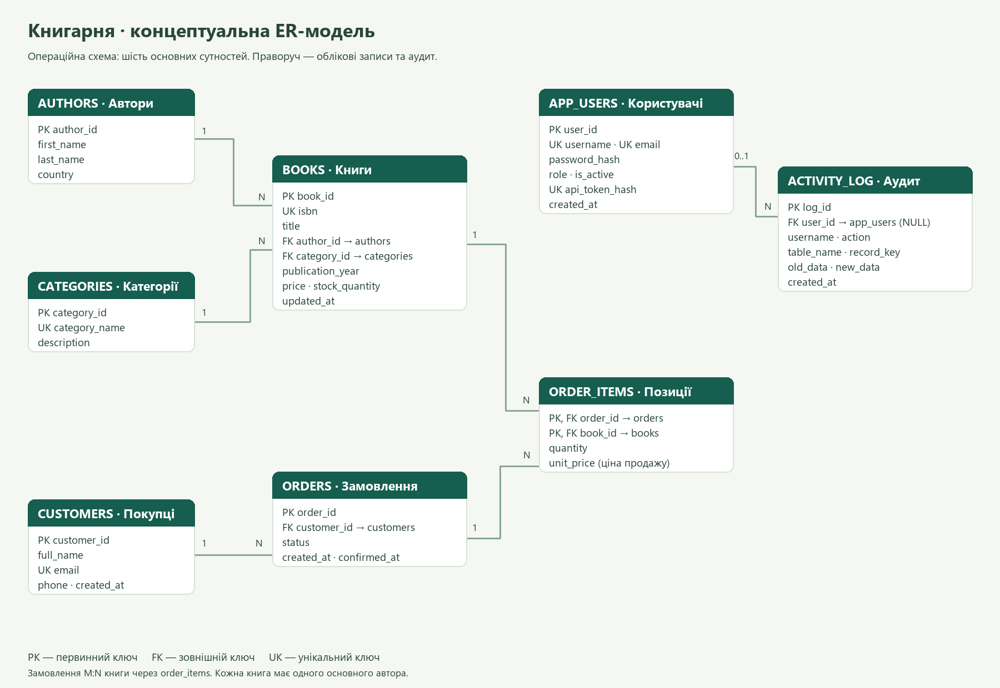

Автор і категорія пов’язані з книгами як 1:N. Покупець має 0:N замовлень. Зв’язок M:N між книгами й замовленнями реалізовано через позиції замовлення. Користувач може бути виконавцем багатьох подій журналу; для операцій поза застосунком зв’язок із користувачем може бути відсутній.

У навчальній моделі книга має одного основного автора та одну категорію. Ціна позиції є історичною ціною продажу, тому зміна ціни каталогу не змінює суму вже створеної позиції.

## 3. Логічна схема та нормалізація

| Таблиця | Первинний ключ | Основні атрибути та зовнішні ключі |
|---|---|---|
| `authors` | `author_id` | Ім’я, прізвище, країна |
| `categories` | `category_id` | Унікальна назва, опис |
| `books` | `book_id` | ISBN, назва, `author_id`, `category_id`, рік, ціна, залишок, час зміни |
| `customers` | `customer_id` | ПІБ, унікальний email, телефон, дата створення |
| `orders` | `order_id` | `customer_id`, статус, час створення та підтвердження |
| `order_items` | (`order_id`, `book_id`) | Кількість, ціна продажу; обидві частини ключа є зовнішніми ключами |
| `app_users` | `user_id` | Логін, email, хеш пароля, роль, активність, хеш API-токена |
| `activity_log` | `log_id` | `user_id`, ім’я виконавця, дія, об’єкт, ключ, стани до/після, час |

Операційні таблиці приведено до третьої нормальної форми:

1. Значення атрибутів атомарні, повторювані позиції замовлення винесено в `order_items`.
2. Неключові атрибути залежать від повного ключа. Зокрема, кількість і ціна продажу залежать від пари замовлення та книги.
3. Дані автора й категорії не дублюються в книгах, контакти покупця не дублюються в замовленнях. Транзитивні залежності усунуто.
4. Підсумкову суму замовлення обчислює представлення, тому вона не може розійтися з його позиціями.

Журнал зберігає історичні знімки JSONB та ім’я виконавця на момент події. Це навмисна фіксація історії, а не дублювання довідників для редагування. Хеші паролів і токенів до знімків не потрапляють.

Повний опис наведено в [логічній схемі](docs/logical_schema.md).

## 4. Реалізація в PostgreSQL

### 4.1. Таблиці та обмеження

Основну структуру створює [01_create_tables.sql](database/01_create_tables.sql). Використано `BIGINT IDENTITY` для ідентифікаторів, `NUMERIC(10,2)` для грошей, `TIMESTAMPTZ` для часових позначок і `JSONB` для журналу.

Приклад таблиці позицій:

```sql
CREATE TABLE bookstore.order_items (
    order_id BIGINT NOT NULL,
    book_id BIGINT NOT NULL,
    quantity INTEGER NOT NULL CHECK (quantity > 0),
    unit_price NUMERIC(10,2) NOT NULL CHECK (unit_price >= 0),
    PRIMARY KEY (order_id, book_id),
    CONSTRAINT order_items_order_fk FOREIGN KEY (order_id)
        REFERENCES bookstore.orders
        ON UPDATE CASCADE ON DELETE CASCADE,
    CONSTRAINT order_items_book_fk FOREIGN KEY (book_id)
        REFERENCES bookstore.books
        ON UPDATE CASCADE ON DELETE RESTRICT
);
```

`PRIMARY KEY` ідентифікує рядок; `FOREIGN KEY` забезпечує посилальну цілісність. `NOT NULL` і `CHECK` забороняють порожні обов’язкові поля, від’ємні ціни та залишки, недодатну кількість і неприпустимі роки. `UNIQUE` захищає ISBN, назви категорій, логіни та email від дублювання. У PostgreSQL перевіряється формат ISBN із 13 цифр; контрольна цифра додатково перевіряється програмою.

Книгу, використану в позиціях, видалити не можна. Каскадне видалення позицій використовується при дозволеному застосунком видаленні чернетки. Правила статусу і дат замовлення перевіряються обмеженнями таблиці.

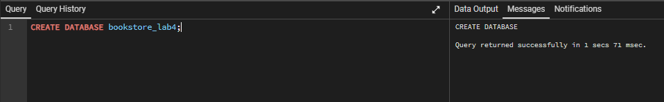

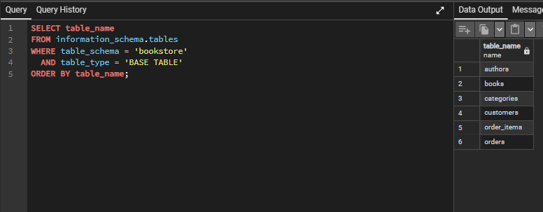

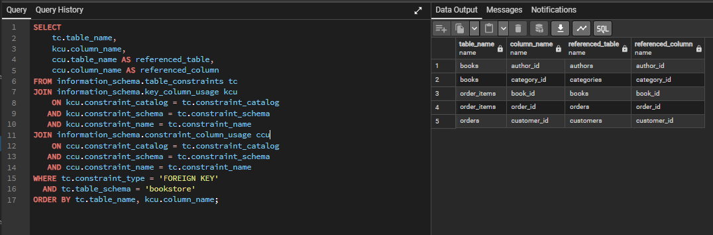

### 4.2. Тестові дані

Навчальні дані містять 10 авторів, 10 категорій, 20 книг, 10 покупців, 10 початкових замовлень і 20 їхніх позицій. Окремо створено 10 демонстраційних облікових записів. Журнал автоматично наповнюється операціями й містить понад 10 подій.

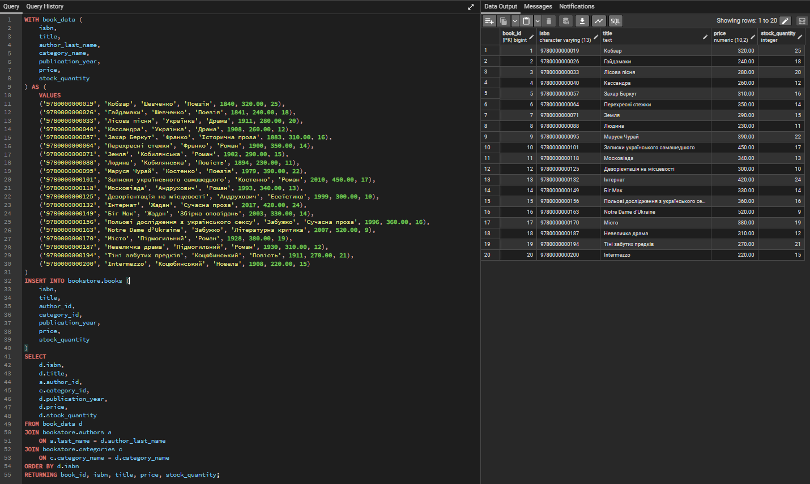

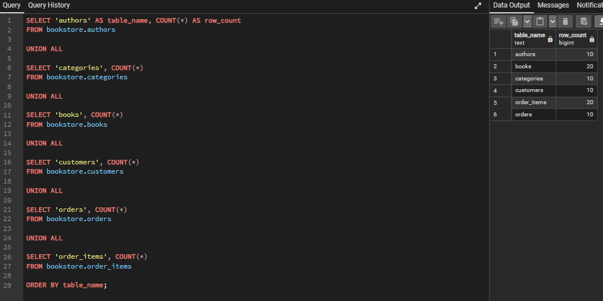

Скріншот кількостей зроблено до додавання облікових записів і журналу до остаточної моделі. Подальша реєстрація та демонстраційні замовлення збільшують кількість записів; тимчасові книги для перевірки CRUD видалено після досліду.

Дані каталогу, користувачів і демонстраційні стани замовлень відокремлено в [database/fixtures](database/fixtures). Звичайна ініціалізація створює структуру без демонстраційних паролів; навчальні дані завантажуються явно через `--demo`.

## 5. SQL-запити

У [queries.sql](database/queries.sql) збережено п’ять основних і три аналітичні запити, перевірку плану та підсумкові кількості.

### 5.1. Фільтрація та сортування

```sql
SELECT title, author_name, price, stock_quantity
FROM bookstore.book_catalog
WHERE price BETWEEN 300 AND 450 AND stock_quantity >= 15
ORDER BY price DESC, title;
```

Отримано книги у заданому ціновому діапазоні з достатнім залишком, відсортовані за спаданням ціни.

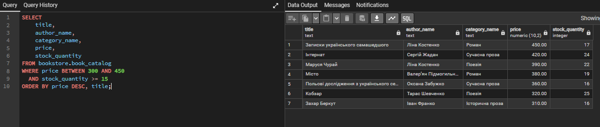

### 5.2. Об’єднання таблиць

```sql
SELECT b.title, a.first_name || ' ' || a.last_name AS author,
       c.category_name, b.price
FROM bookstore.books b
JOIN bookstore.authors a USING (author_id)
JOIN bookstore.categories c USING (category_id)
ORDER BY b.title;
```

Ключі книги замінено зрозумілими назвами автора й категорії. Аналогічні об’єднання використовує `book_catalog`.

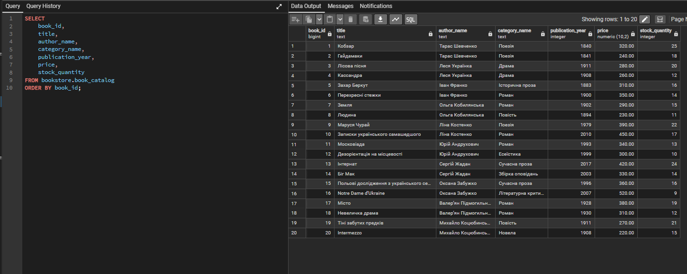

### 5.3. Агрегація за категоріями

```sql
SELECT c.category_name, COUNT(b.book_id) AS book_titles,
       COALESCE(SUM(b.stock_quantity), 0) AS available_copies,
       ROUND(AVG(b.price), 2) AS average_price,
       COALESCE(SUM(b.price * b.stock_quantity), 0) AS inventory_value
FROM bookstore.categories c
LEFT JOIN bookstore.books b USING (category_id)
GROUP BY c.category_id, c.category_name
ORDER BY inventory_value DESC;
```

`LEFT JOIN` зберігає категорії без книг, `COUNT` підраховує назви, `SUM` - примірники та складську вартість, `AVG` - середню ціну.

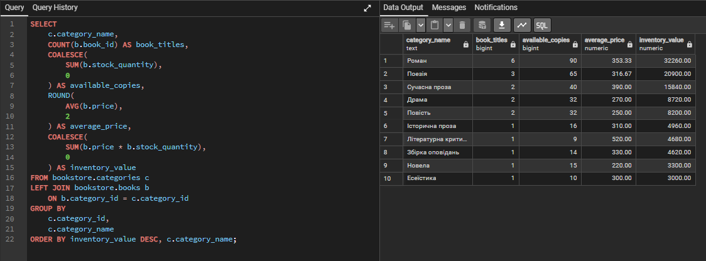

### 5.4. Підзапит для порівняння із середньою ціною

```sql
SELECT title, author_name, price
FROM bookstore.book_catalog
WHERE price > (SELECT AVG(price) FROM bookstore.books)
ORDER BY price DESC;
```

Для початкового каталогу середня ціна становила 328,50 грн. Запит вибрав дев’ять дорожчих книг.

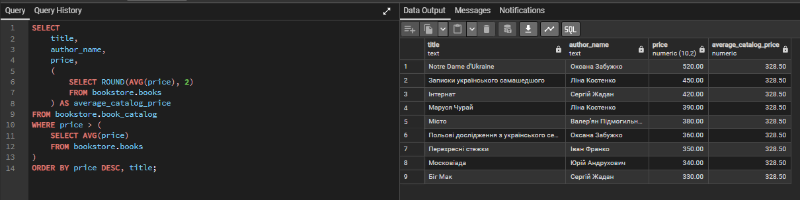

### 5.5. Пошук відсутніх пов’язаних записів

```sql
SELECT c.customer_id, c.full_name, c.email
FROM bookstore.customers c
WHERE NOT EXISTS (
    SELECT 1 FROM bookstore.orders o
    WHERE o.customer_id = c.customer_id AND o.status = 'Confirmed'
)
ORDER BY c.customer_id;
```

Запит знаходить покупців без підтверджених замовлень. На момент початкової перевірки повернуто всіх десять покупців: підтвердження виконувалися пізніше.

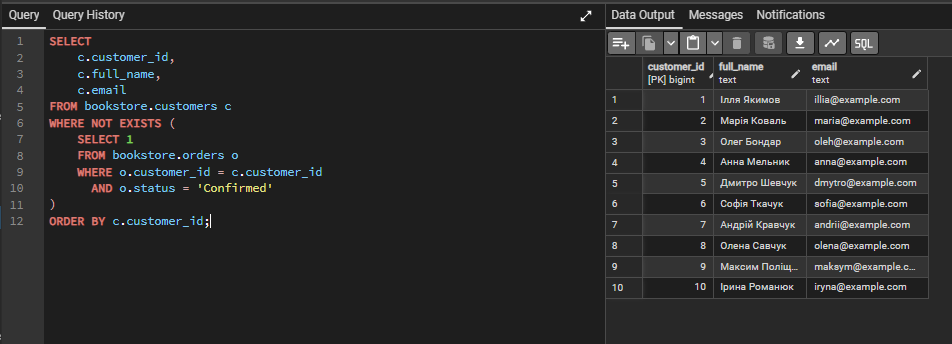

## 6. Процедури, тригери та представлення

### 6.1. Збережені процедури

У [03_create_procedures.sql](database/03_create_procedures.sql) реалізовано:

| Процедура | Призначення |
|---|---|
| `set_order_item(order_id, book_id, quantity)` | Додати позицію або змінити її кількість у чернетці; при першому додаванні зафіксувати поточну ціну |
| `confirm_order(order_id)` | Перевірити непорожнє замовлення і залишки, списати товар та підтвердити замовлення |
| `cancel_order(order_id)` | Скасувати замовлення; для підтвердженого повернути товар на склад |

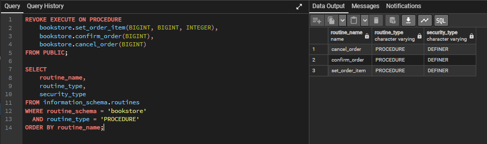

```sql
CALL bookstore.set_order_item(1, 1, 3);
```

Позиція містить три примірники за ціною 320 грн; сума позиції становить 960 грн.

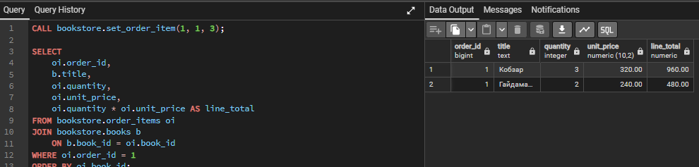

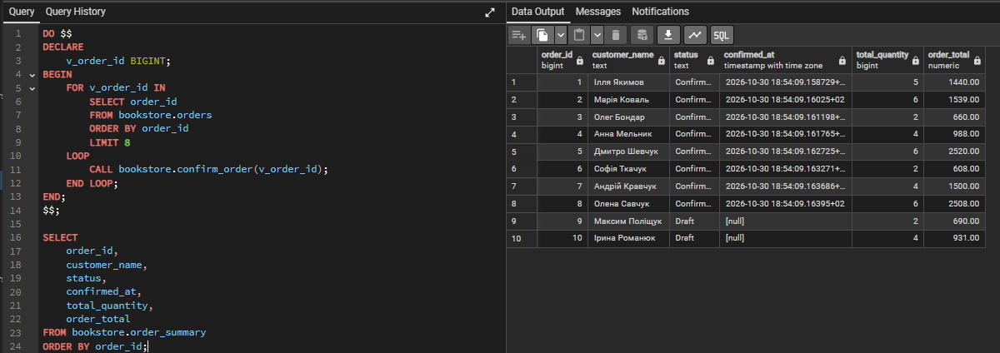

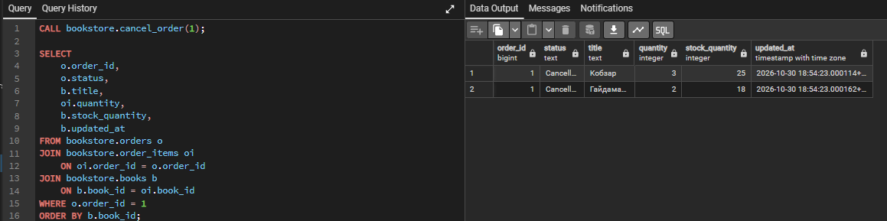

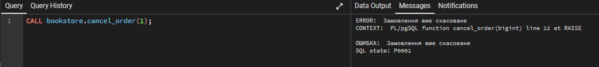

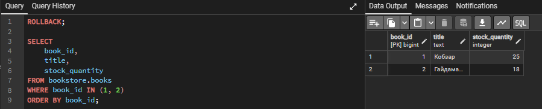

Перед зміною процедура блокує замовлення через `FOR UPDATE`. При підтвердженні та поверненні книги блокуються у порядку `book_id`, що зменшує ризик взаємного блокування. Перевірка залишків, списання і зміна статусу виконуються в одній транзакції. Помилка призводить до відкату операції.

### 6.2. Тригери й аудит змін

[04_create_triggers.sql](database/04_create_triggers.sql) створює журнал, функції аудиту та оновлення часу книги. Початкові сім тригерів охоплюють шість основних таблиць і час зміни книги. [06_create_users.sql](database/06_create_users.sql) додає восьмий тригер для користувачів.

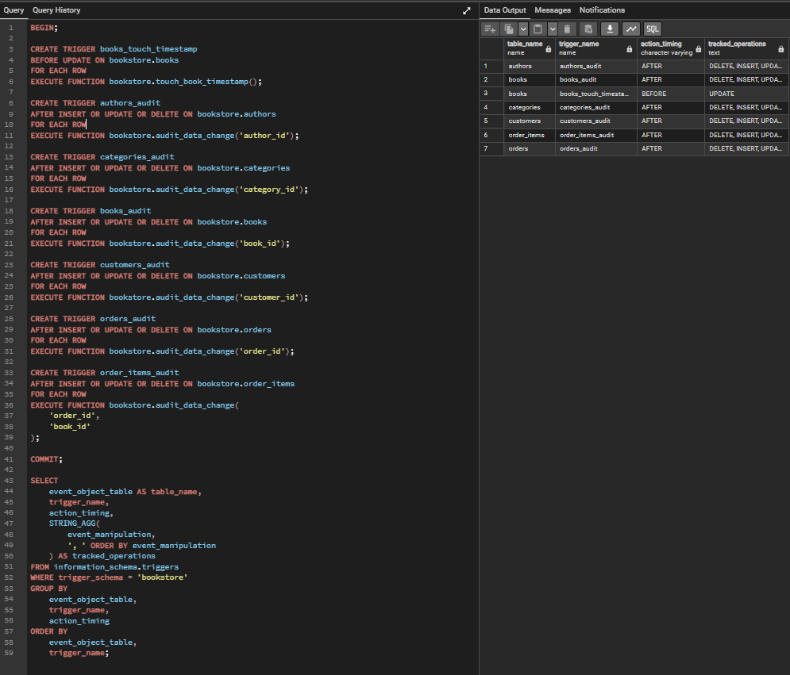

`BEFORE UPDATE` змінює `books.updated_at`. Тригери `AFTER INSERT OR UPDATE OR DELETE` записують тип операції, ключ і JSONB-знімки до/після. Ідентифікатор та ім’я користувача застосунок передає через локальні параметри транзакції. Хеші паролів і API-токенів вилучаються до запису події.

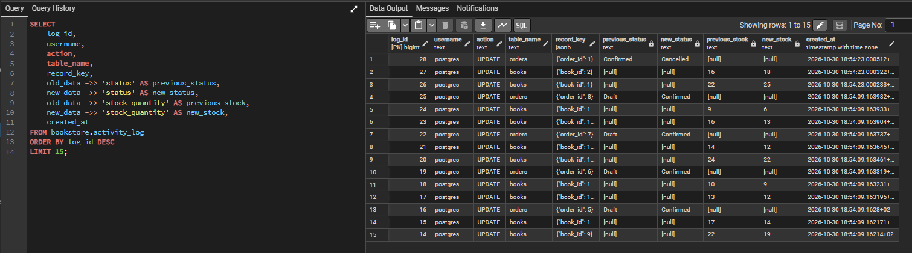

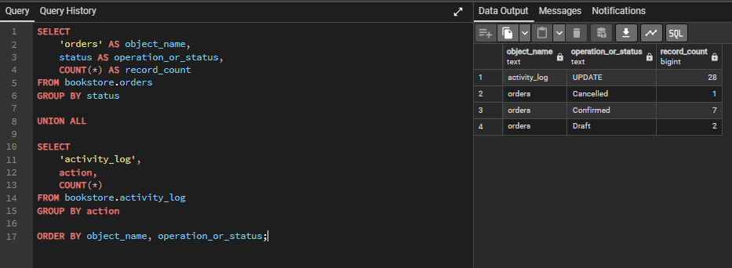

### 6.3. Представлення

[05_create_views.sql](database/05_create_views.sql) містить два представлення:

- `book_catalog` - книга з автором, країною та категорією; використовується каталогом і пошуком.
- `order_summary` - замовлення з покупцем, кількістю позицій, примірників і загальною сумою; використовується списком замовлень та аналітикою.

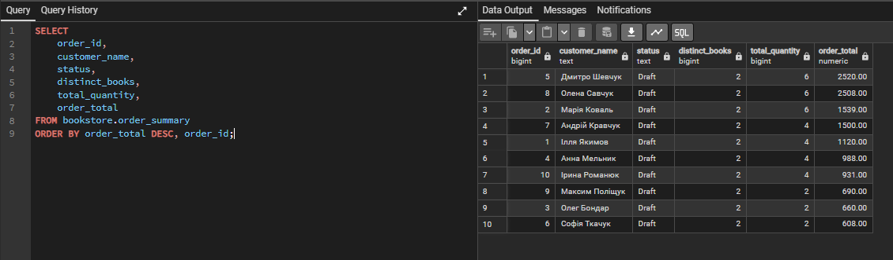

## 7. Складні аналітичні запити

### 7.1. Рейтинг продажів за категоріями

Перший запит використовує два CTE: один агрегує підтверджені продажі, інший - каталог і склад. Результати окремо приєднуються до категорій; це запобігає множенню залишків при об’єднанні книги з кількома продажами. `DENSE_RANK()` формує рейтинг за виручкою, `COALESCE` замінює відсутні підсумки нулями.

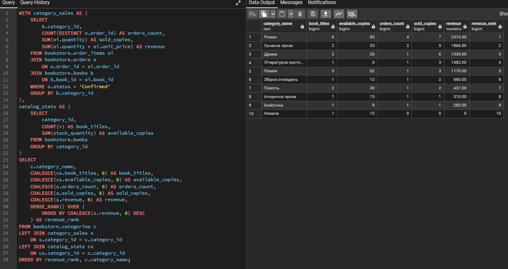

### 7.2. Покупці та частка в продажах

Другий запит об’єднує покупців із `order_summary`, використовує `FILTER` для підрахунку статусів, обчислює витрати лише за підтвердженими замовленнями. Віконна сума формує загальну виручку для розрахунку відсотка покупця. `NULLIF` запобігає діленню на нуль.

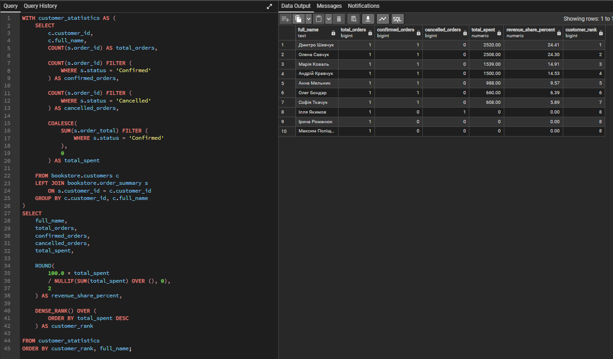

### 7.3. Продажі за календарем

Третій запит створює календар із 14 днів через `generate_series`, приєднує денні продажі та заповнює дні без продажів нулями. Вікно `ROWS BETWEEN 6 PRECEDING AND CURRENT ROW` обчислює рухомий підсумок за сім днів. На збереженому результаті сім підтверджених замовлень дали виручку 10 323 грн.

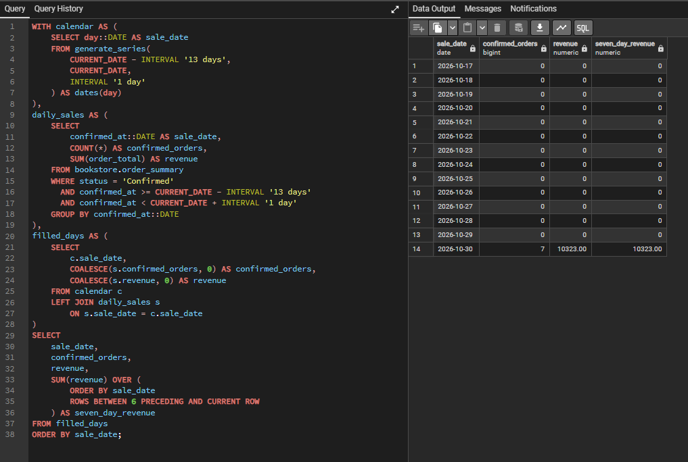

Повний текст усіх трьох запитів міститься в [queries.sql](database/queries.sql).

## 8. Консольний застосунок

[console_app/main.py](console_app/main.py) використовує той самий сервісний шар, валідацію і правила доступу, що й вебзастосунок. Після входу доступні пошук, CRUD книг, замовлення і статистика.

```powershell
cd lab-4
.\.venv\Scripts\python.exe -m console_app.main
```

Перевірено повний цикл CRUD на тимчасовій книзі з ISBN `9780000000996`:

| Крок | Результат |
|---|---|
| Create | Створено книгу «Консольна демонстрація», ID 22, ціна 150 грн, залишок 5 |
| Read | Пошук повернув книгу разом з автором і категорією |
| Update | Ціну змінено з 150 до 175 грн; програма підтвердила збереження ID 22 |
| Delete | Видалено саме демонстраційну книгу, програма підтвердила операцію |

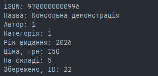

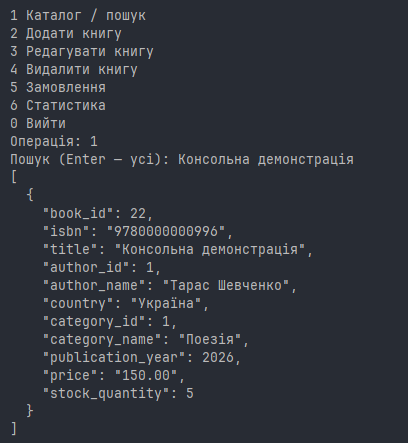

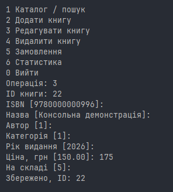

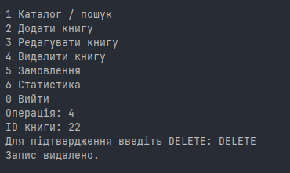

Окремо перевірено ISBN із неправильною контрольною цифрою. Запис відхилено без аварійного завершення програми; меню залишилося доступним.

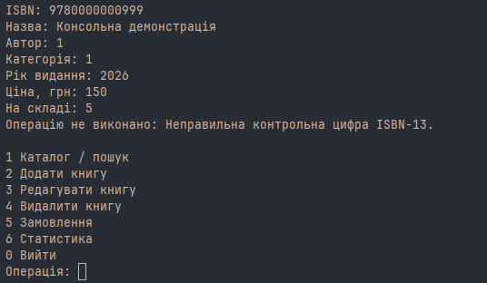

## 9. Вебзастосунок FastAPI

Вебчастина використовує Jinja2-шаблони, спільні сервіси та параметризовані запити Psycopg. Книги, автори, категорії й покупці мають сторінки перегляду та форми створення й редагування. Видалення доступне адміністратору з підтвердженням. Для замовлень реалізовано окремий процес роботи з позиціями та статусами.

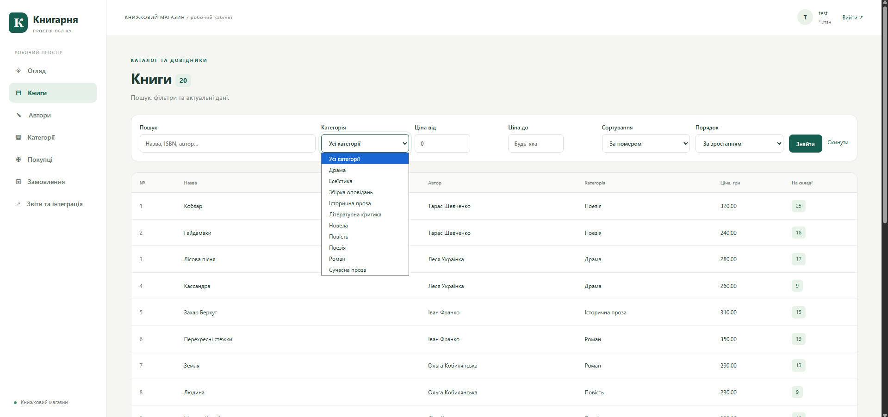

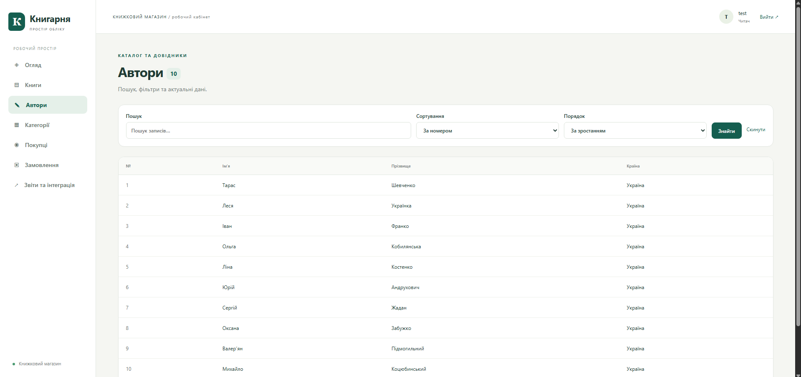

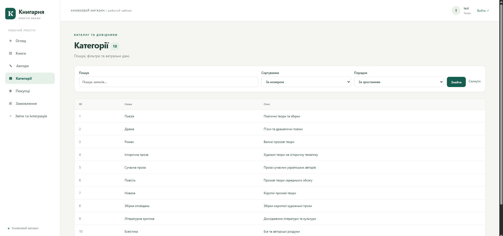

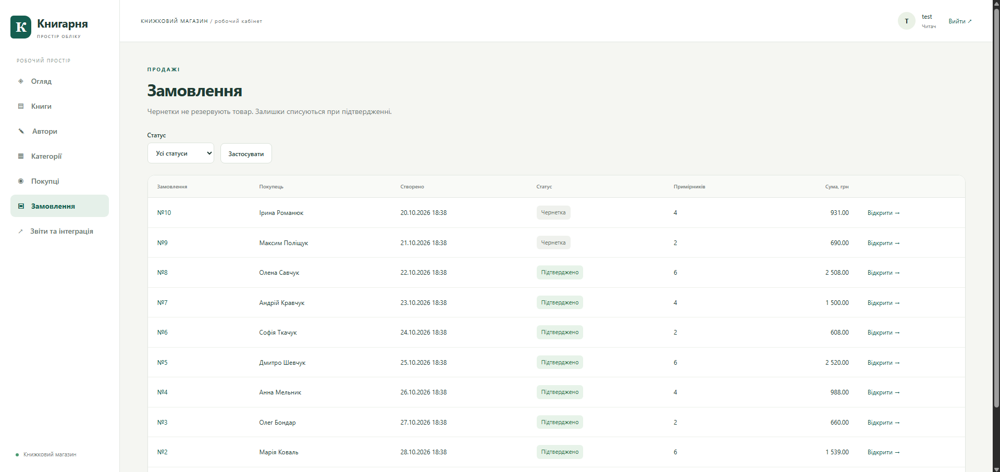

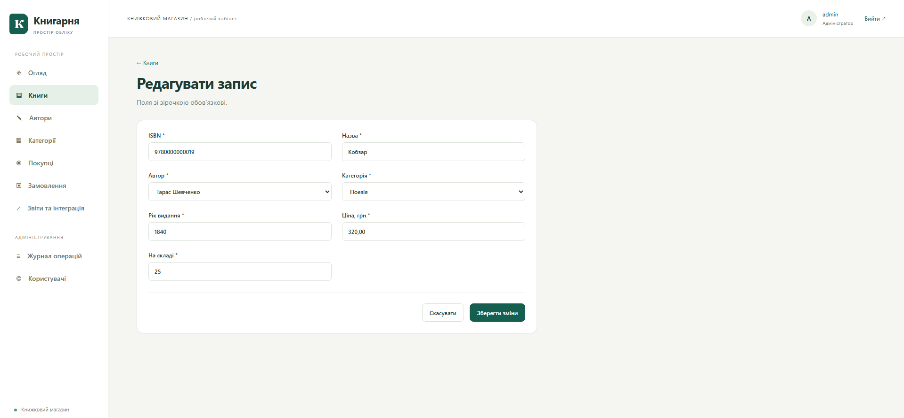

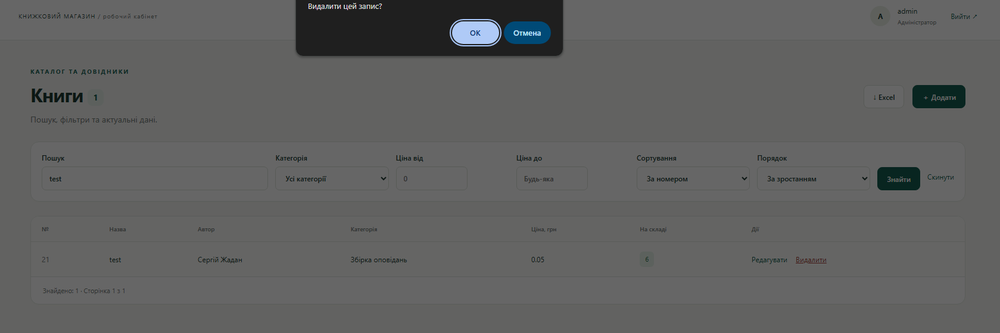

Форма та діалог підтвердження ілюструють інтерфейс; фактичне виконання CRUD окремо підтверджене консольними результатами та інтеграційними тестами.

### 9.1. Оформлення замовлення

Створено замовлення №11 для покупця Андрія Кравчука. Додано один примірник «Кобзаря» за 320 грн, після чого послідовно виконано підтвердження та скасування.

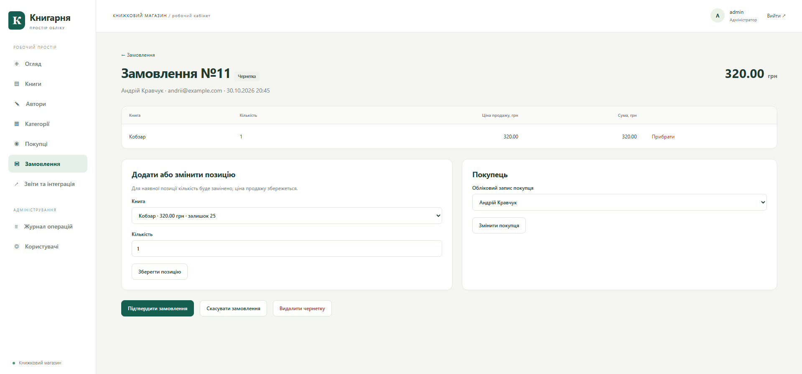

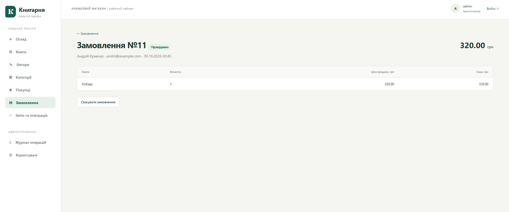

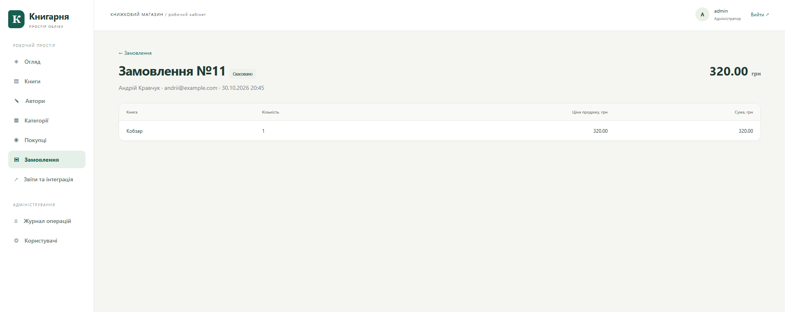

## 10. Розширена функціональність

### 10.1. Реєстрація, вхід і ролі

Реєстрація створює активного читача. Паролі зберігаються як PBKDF2-SHA256 із випадковою сіллю та 600 000 ітерацій. Вебвхід використовує підписану сесію з `HttpOnly` і `SameSite`; операції зміни даних захищені CSRF-перевіркою.

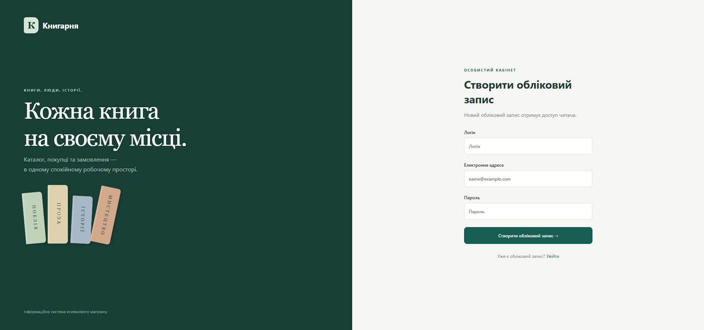


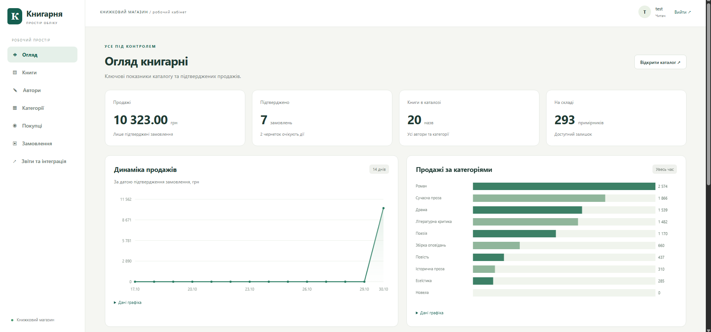

| Роль | Доступ |
|---|---|
| `reader` | Перегляд каталогу, довідників, замовлень і статистики |
| `manager` | Додатково створення та редагування даних, обробка замовлень, Excel-експорт |
| `admin` | Додатково видалення, керування користувачами, журнал, резервне копіювання |

Перевірки виконуються на сервері незалежно від видимості кнопок. Адміністратор не може позбавити власний обліковий запис адміністративної ролі або деактивувати його.

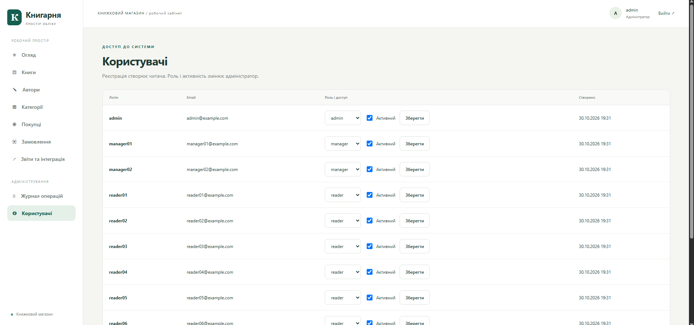

### 10.2. Журнал операцій

Тригери журналюють успішні зміни таблиць. Застосунок додатково записує читання даних, реєстрацію, вхід, вихід, експорт і резервне копіювання. Скасовані транзакції не залишають успішних подій зміни даних. Журнал можна фільтрувати за користувачем, таблицею та дією; деталі містять історичні знімки.

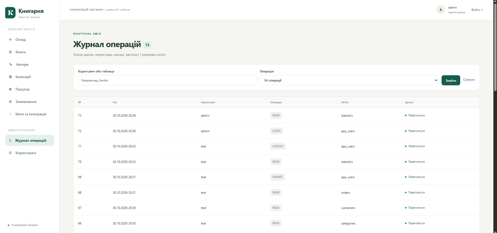

### 10.3. Excel-звіти

[web_app/reports.py](web_app/reports.py) формує XLSX через openpyxl. Доступні каталог книг, замовлення та продажі за категоріями. Використано заголовки, грошові формати, фільтри й оформлення таблиць. Експорт каталогу враховує фільтри та охоплює всі сторінки результату. Текстові поля захищено від перетворення на Excel-формули.

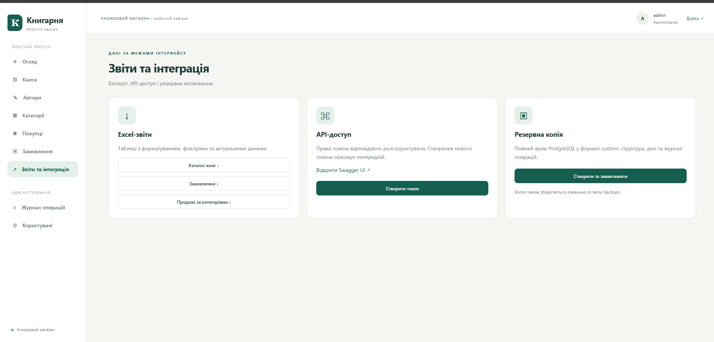

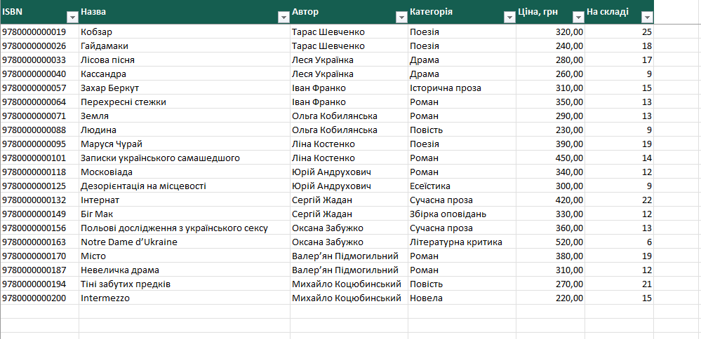

Приклад сформованого файлу: [bookstore-books.xlsx](bookstore-books.xlsx).

### 10.4. Пошук, фільтрація та сортування

Каталог підтримує текстовий пошук, категорію, мінімальну й максимальну ціну, вибір поля сортування, напрямку та пагінацію. Значення пошуку передаються параметрами, а поля сортування обираються з дозволеного переліку.

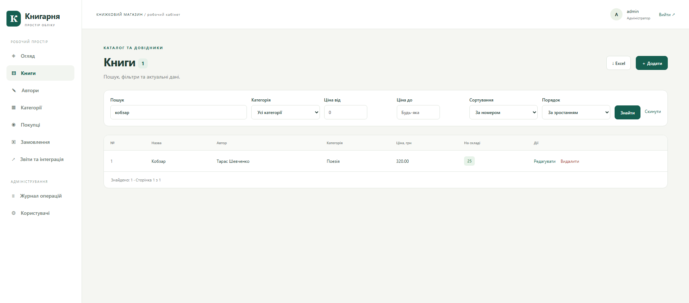

### 10.5. Візуалізація

На огляді показано виручку за підтвердженими замовленнями, їх кількість, число назв і складський залишок. Canvas-графіки відображають продажі за 14 днів і виручку за категоріями. Під графіками доступні табличні дані. Скасовані замовлення не враховуються у виручці.

На знімку огляду зафіксовано 10 323 грн, сім підтверджених замовлень, 20 назв і 293 примірники.


### 10.6. API

FastAPI надає JSON API та інтерактивну документацію `/docs`.

| Метод і маршрут | Призначення |
|---|---|
| `POST /api/token` | Перевірка облікових даних і видача Bearer-токена |
| `GET /api/books` | Пошук, фільтри, сортування та пагінація |
| `GET /api/books/{book_id}` | Одна книга |
| `POST /api/books` | Створення книги |
| `PUT /api/books/{book_id}` | Редагування книги |
| `DELETE /api/books/{book_id}` | Видалення книги |
| `GET /api/orders` | Перегляд замовлень |
| `GET /api/orders/{order_id}` | Замовлення з позиціями |
| `POST /api/orders` | Створення чернетки |
| `POST /api/orders/{order_id}/items` | Додавання або зміна позиції |
| `POST /api/orders/{order_id}/confirm` | Підтвердження |
| `POST /api/orders/{order_id}/cancel` | Скасування |
| `GET /api/statistics` | Статистика |

Для зовнішнього клієнта токен передається як `Authorization: Bearer <token>`. У БД зберігається лише SHA256-хеш токена. Створення нового токена анулює попередній. Swagger у браузері також може використовувати чинну сесію користувача; запити зміни даних із сесією проходять CSRF-перевірку.

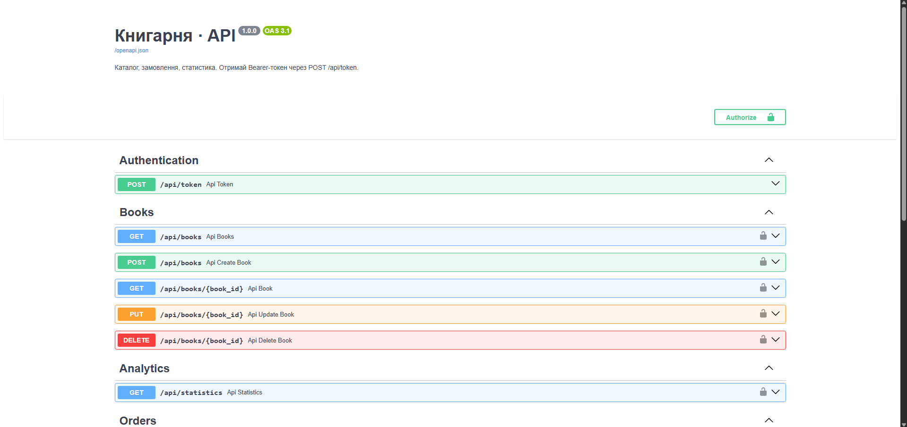

Під час ручної перевірки виконано `GET /api/books?q=Кобзар`. Сервер повернув `200`, один запис, `total: 1` та параметри пагінації. У відповіді присутні дані автора й категорії, ціна 320 грн і залишок 25.

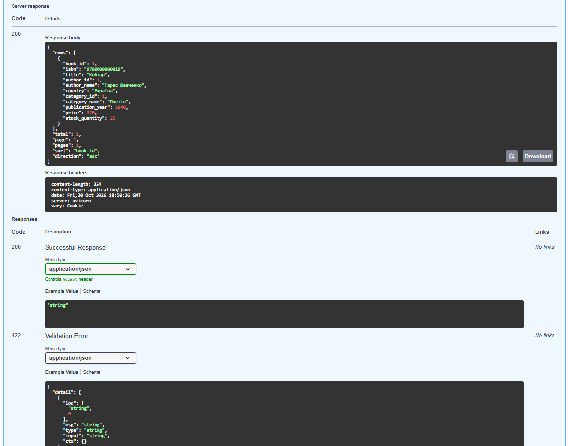

### 10.7. Резервне копіювання

Адміністратор запускає резервне копіювання кнопкою «Створити та завантажити» на сторінці звітів. Застосунок викликає `pg_dump` для всієї робочої БД у форматі custom. Архів зберігається в `backups/` і повертається для завантаження; успішна дія фіксується в журналі. Пароль передається процесу через середовище, а не аргумент командного рядка.

Файл `.dump` призначений для `pg_restore`, а не для перегляду як текстовий документ. Інтерфейс наведено на скріншоті сторінки звітів; коректність архіву й відновлення в окрему тестову БД перевіряє інтеграційний тест.

### 10.8. Валідація та безпечні запити

JavaScript перевіряє обов’язкові поля, контрольну цифру ISBN-13 і вимоги до пароля через HTML Constraint Validation API. Перед видаленням запитується підтвердження. Сервер незалежно перевіряє поля, діапазони, ролі та обмеження бізнес-операцій. Помилковий ISBN у консольному досліді відхилено до вставлення рядка.

Запити використовують параметри `%s`; ідентифікатори та сортування обмежено дозволеним переліком. Шаблони екранують користувацькі значення. Облікові дані винесено в ігнорований `.env`, шаблон параметрів - у `.env.example`.

## 11. Індекси та перевірка плану

[07_create_indexes.sql](database/07_create_indexes.sql) додає шість індексів:

| Індекс | Призначення |
|---|---|
| `books_author_idx` | Книги автора та зв’язки за `author_id` |
| `books_category_price_idx` | Фільтрація за категорією, ціною та впорядкування за ідентифікатором |
| `orders_customer_created_idx` | Замовлення покупця за часом |
| `orders_confirmed_at_idx` | Частковий індекс дат лише підтверджених замовлень |
| `order_items_book_idx` | Пошук позицій за книгою |
| `activity_log_created_idx` | Нові події журналу |

Первинні ключі та унікальні обмеження також мають індекси PostgreSQL.

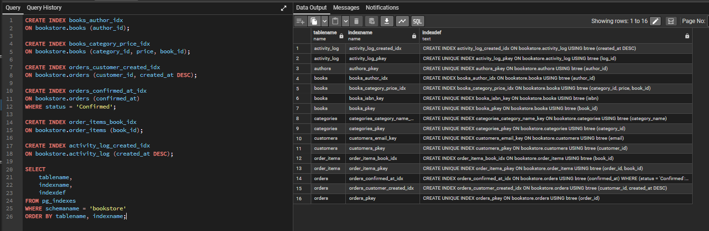

```sql
EXPLAIN (ANALYZE, BUFFERS)
SELECT book_id, title, price, stock_quantity
FROM bookstore.books
WHERE category_id = 3 AND price >= 300
ORDER BY price, book_id
LIMIT 5;
```

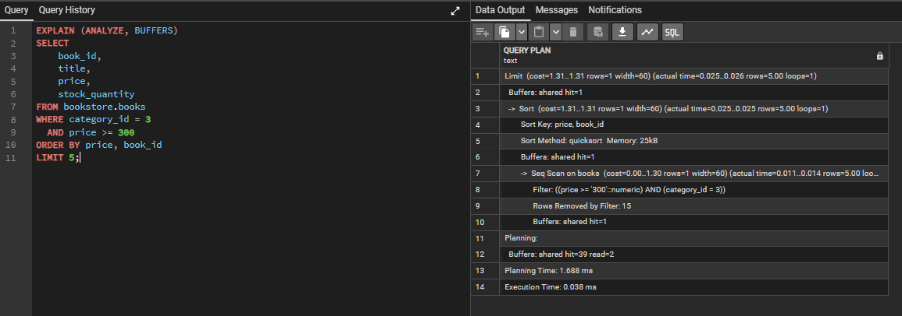

На малому наборі з 20 книг планувальник обрав послідовне сканування: читання всієї таблиці дешевше за додатковий доступ через індекс. Цей дослід не доводить прискорення від індексу; для кількісного порівняння потрібні більший набір, актуальна статистика та виміри до/після. Структуру складеного індексу підібрано під умови наведеного запиту.

## 12. Структура коду, запуск і перевірка

| Каталог або файл | Відповідальність |
|---|---|
| `common/` | Конфігурація, транзакції, безпека, валідація, спільні бізнес-сервіси |
| `console_app/` | Інтерактивний консольний клієнт |
| `web_app/` | FastAPI, API, шаблони, статичні файли, Excel |
| `database/` | SQL структури, процедур, тригерів, представлень, індексів і запитів |
| `database/fixtures/` | Демонстраційні дані |
| `tools/` | Ініціалізація порожньої БД та створення адміністратора |
| `tests/` | Інтеграційні перевірки |
| `docs/` | ER-діаграма та логічна схема |

Використано локально встановлений PostgreSQL та pgAdmin. Docker у цьому виконанні не застосовувався.

Параметри сервера зберігаються в `.env`: база `bookstore_lab4`, адреса `localhost`, порт `5432`. Пароль у звіті не наводиться. Встановлення та запуск:

```powershell
cd lab-4
python -m venv .venv
.\.venv\Scripts\python.exe -m pip install -r requirements.lock.txt
.\.venv\Scripts\python.exe run.py
```

Адреса вебінтерфейсу - `http://127.0.0.1:8000`. Команди початкової ініціалізації та консольного запуску наведено в [README](README.md). Скрипт ініціалізації відмовляється перезаписувати вже наявну схему.

Виконано 11 інтеграційних тестів із реальною PostgreSQL в ізольованій тестовій БД. Перевірено структуру та навчальні дані, автентифікацію й ролі, CRUD та валідацію, відкат помилкових замовлень, HTML і XLSX, сесії та CSRF, створення архіву з відновленням, захист Excel від формул, консольний CRUD, довідники та звичайне розгортання без демонстраційних користувачів. Тестовий набір відокремлений від робочої БД.

## 13. Відповіді на контрольні запитання

**1. Які етапи включає розробка БД?** Аналіз визначає дані та правила предметної області. Концептуальне проєктування виділяє сутності й зв’язки, логічне - таблиці та залежності, фізичне - типи, обмеження й індекси конкретної СУБД. Далі виконуються наповнення, інтеграція, тестування та супровід.

**2. Чим відрізняються моделі?** Концептуальна описує предметні поняття, логічна - реляційну структуру та ключі, фізична - конкретну реалізацію PostgreSQL, включно з типами, індексами та процедурами.

**3. Що таке нормалізація та 3НФ?** Нормалізація зменшує надлишковість і аномалії вставлення, зміни й видалення. Для 3НФ має виконуватися 2НФ, а нетривіальна функціональна залежність повинна мати суперключ зліва або ключовий атрибут справа. У звичайній схемі це означає усунення транзитивних залежностей неключових атрибутів від ключа.

**4. Які існують обмеження цілісності?** `PRIMARY KEY` забезпечує ідентифікацію, `FOREIGN KEY` - посилання на наявні дані, `UNIQUE` - унікальність, `NOT NULL` - обов’язковість, `CHECK` - допустимі значення та співвідношення полів.

**5. Чим відрізняються первинний і зовнішній ключі?** Первинний ключ однозначно визначає рядок, наприклад `books.book_id`. Зовнішній посилається на ключ іншої таблиці, наприклад `books.author_id` на `authors.author_id`; його значення можуть повторюватися.

**6. Які типи зв’язків існують?** 1:1 реалізується зовнішнім ключем з унікальністю, 1:N - зовнішнім ключем на стороні N, M:N - проміжною таблицею. У роботі M:N реалізовано через `order_items`.

**7. Що таке процедура?** Це іменована програма в БД, яку викликають через `CALL`. Вона об’єднує пов’язану бізнес-логіку, перевірки та зміни, зменшує кількість звернень клієнта. Приклад - атомарне підтвердження замовлення зі списанням товару.

**8. Для чого потрібні тригери?** Вони автоматично реагують на події таблиці. У роботі оновлюють час зміни книги й записують аудит DML незалежно від конкретного клієнта.

**9. Чим відрізняються JOIN?** `INNER JOIN` повертає лише відповідні пари, `LEFT JOIN` зберігає всі рядки зліва, `RIGHT JOIN` - справа, `FULL JOIN` - з обох сторін. Невідповідні поля зовнішніх об’єднань мають NULL. `CROSS JOIN` утворює декартів добуток.

**10. Що таке VIEW?** Це збережений запит, доступний як табличне джерело. Звичайне представлення не зберігає окрему копію результату. Воно приховує повторювані JOIN та агрегації, як `book_catalog` і `order_summary`.

**11. Як захиститися від SQL-ін’єкцій?** Значення передаються параметрами драйвера; назви таблиць, полів і напрямок сортування обираються з дозволеного переліку. Не можна вставляти довільний користувацький текст у SQL через конкатенацію.

**12. Які переваги й недоліки ORM?** ORM спрощує типові CRUD, зв’язки та супровід моделей. Недоліки - приховані запити, ризик N+1 і складність нестандартної аналітики. Прямий SQL дає контроль над запитами, але потребує ручного мапування та дисципліни параметризації. У роботі використано Psycopg і прямий SQL.

**13. Як працюють індекси і чи завжди вони потрібні?** Індекс скорочує пошук і може допомогти сортуванню, але займає місце та уповільнює зміни. На малій таблиці послідовне сканування може бути дешевшим. Індекси створюються під реальні умови та порядок обробки даних.

**14. Що таке транзакція та ACID?** Транзакція - логічно єдина група операцій. Atomicity означає все або нічого, Consistency - збереження правил цілісності, Isolation - контроль взаємодії паралельних операцій, Durability - збереження підтверджених змін після збою.

**15. Як оптимізувати запит?** Виміряти `EXPLAIN (ANALYZE, BUFFERS)`, порівняти оцінені й фактичні рядки, перевірити фільтри, JOIN і сортування. Усунути зайві дані та множення рядків, підібрати індекси, оновити статистику й повторити вимірювання на репрезентативному наборі.

**16. Які переваги Docker?** Відтворюване оточення, ізоляція залежностей, фіксована версія СУБД і спрощення запуску. Дані потрібно зберігати в томі, а також окремо резервувати; сам контейнер не замінює резервну копію.

**17. Як підключитися до PostgreSQL у Docker?** Контейнеру задають назву БД, користувача й пароль, монтують том і публікують порт. З хоста використовують `localhost` та опублікований порт; з іншого контейнера тієї самої мережі - ім’я сервісу й внутрішній порт `5432`. Потрібно дочекатися готовності сервера та передати параметри драйверу без розміщення секретів у коді.

## Висновки

Створено інформаційну систему книгарні з вісьмома таблицями, нормалізованою операційною структурою, обмеженнями цілісності, трьома процедурами, тригерами та двома представленнями. Реалізовано п’ять основних і три складні аналітичні запити, консольний CRUD та вебінтерфейс FastAPI.

Система підтримує реєстрацію й ролі, аудит, пошук і сортування, Excel, графіки, JSON API та резервне копіювання. Практично перевірено зміну статусів замовлення, відхилення повторного скасування, повний консольний CRUD, помилковий ISBN та відповідь API. Опрацьовано нормалізацію, транзакції, блокування і розподіл правил між БД та застосунком.
