# Лабораторна робота 5. Керування БД, оптимізація продуктивності та автоматизація

## Загальна інформація

**Здобувач освіти:** Якимов Ілля  
**Група:** ІПЗ-32  
**Предметна область:** облік книжкового магазину  
**Обраний рівень складності:** 3  
**СУБД:** PostgreSQL 18.6  
**Інструменти:** pgAdmin 4, PowerShell, Python  
**База даних:** `bookstore_lab5`  
**Схеми:** `bookstore`, `lab5`

## Мета роботи

Перевірити, як індекси впливають на швидкість запитів у PostgreSQL. Навчитися створювати представлення й тригери, налаштовувати права користувачів, стежити за роботою бази та відновлювати її з резервної копії.

## Підготовка середовища

Базу книгарні `bookstore_lab4` скопійовано через `pg_dump` і `pg_restore` до `bookstore_lab5`. Для моніторингу завантажено `pg_stat_statements` під час запуску сервера та створено розширення версії 1.12. До копії додано 20 000 книг, 10 000 покупців, 200 000 замовлень і 400 000 позицій. Три попередні індекси видалено з копії перед початковим вимірюванням.

- [Скрипт копіювання](01_copy_database.ps1)
- [Підготовка даних](database/04_prepare_dataset.sql)

**Перевірка вихідної БД**

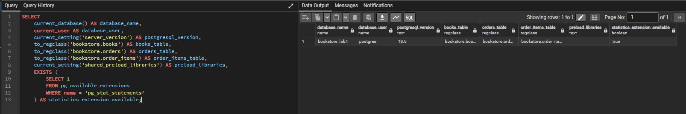

**Створення й відновлення початкового архіву**

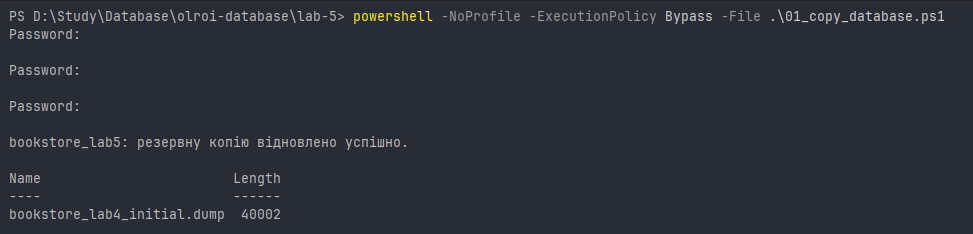

**Кількості після копіювання**

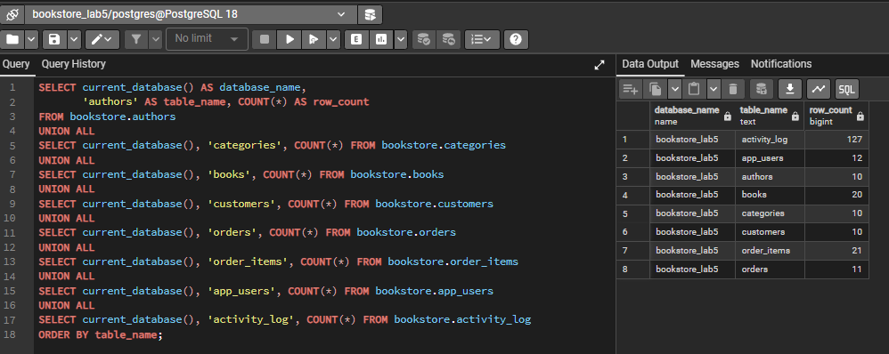

**Налаштування завантаження модуля**

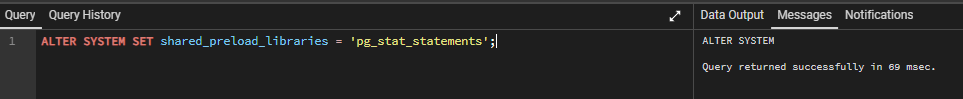

**Створення розширення**

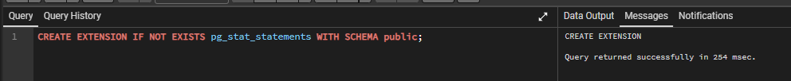

**Перевірка версії та збору статистики**

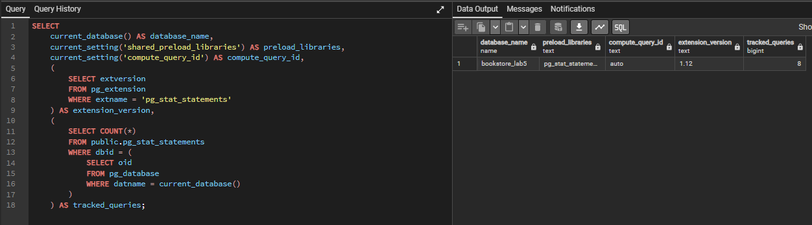

**Початок наповнення та перевірка цільової бази**

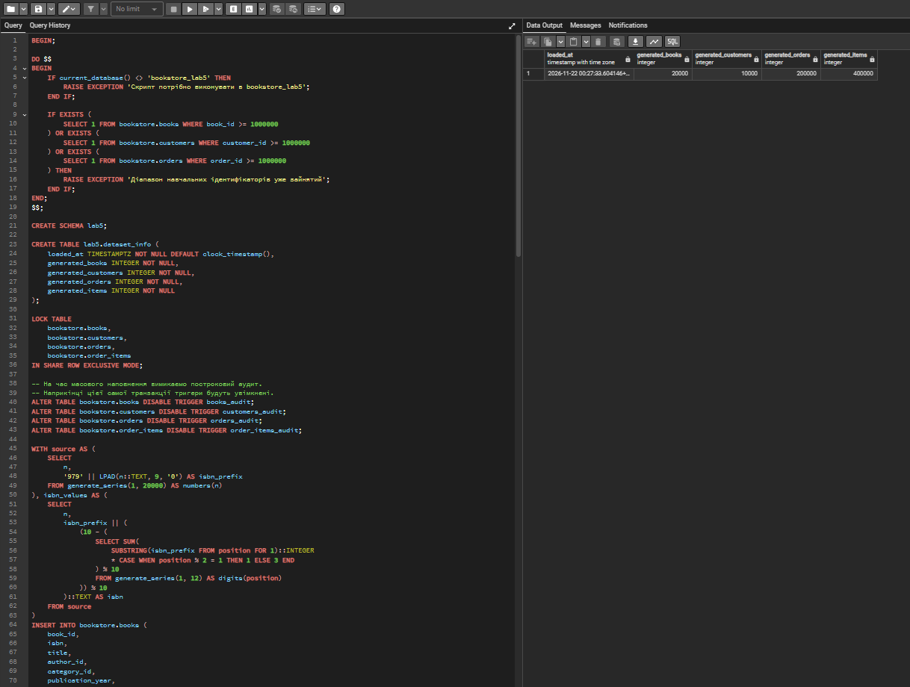

**Генерація книг, покупців і замовлень**

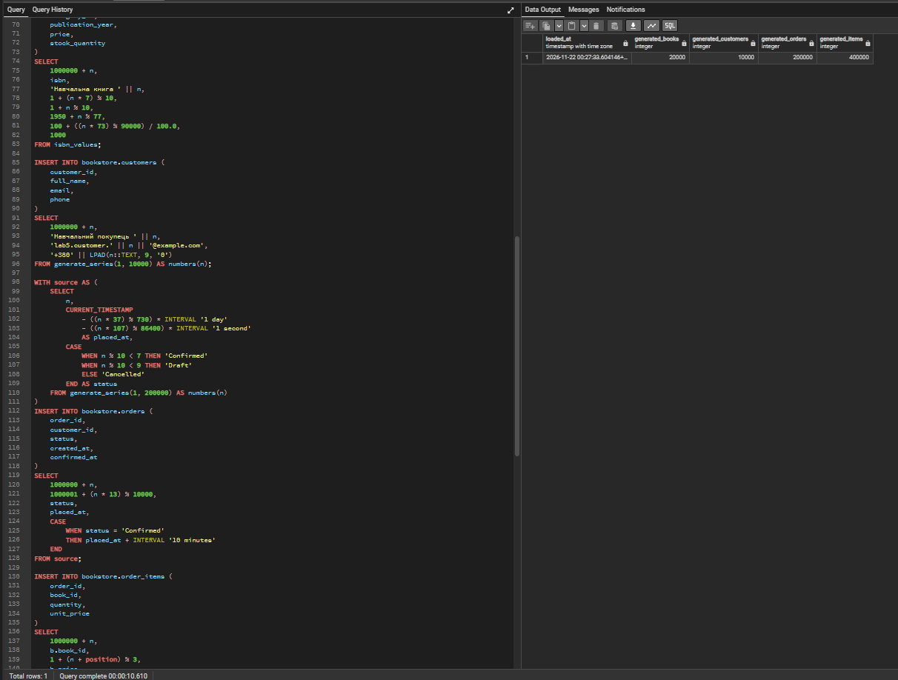

**Позиції, залишки та повернення аудиту**

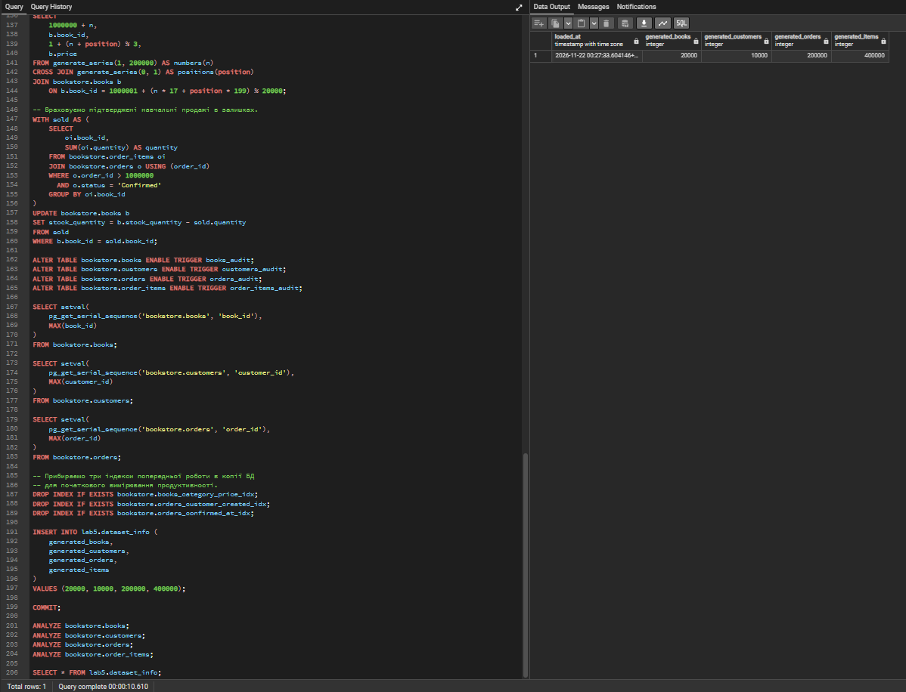

**Фактичні кількості навчальних записів**

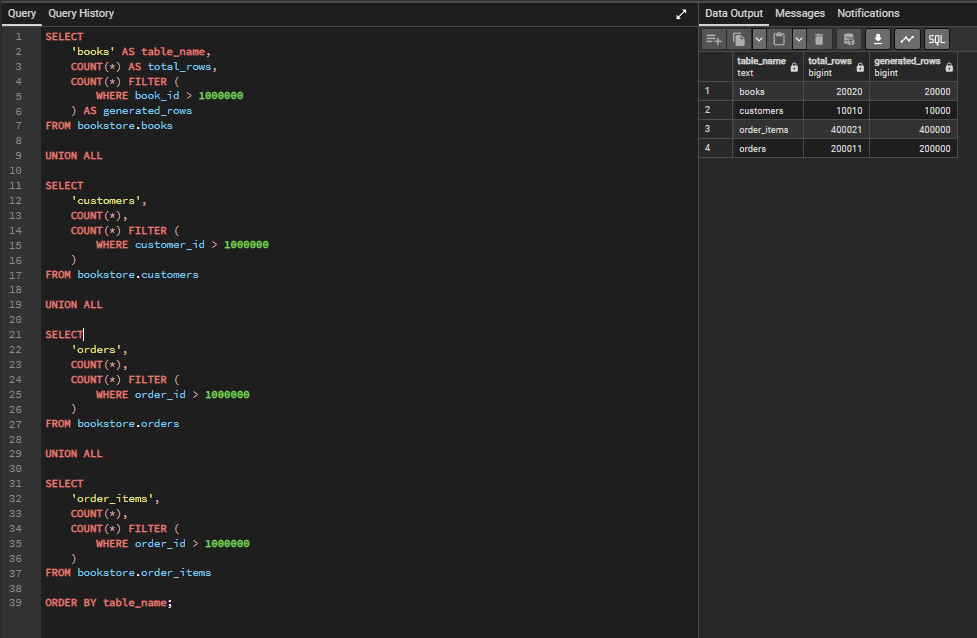

## Рівень 1. Аналіз продуктивності, індекси й представлення

### 1.1. Оптимізація запитів

Кожен запит запускався тричі з `EXPLAIN (ANALYZE, BUFFERS)` до й після індексації. У таблиці наведено час третього запуску. Часові межі прив’язано до моменту завантаження даних. Скорочення обчислено за формулою `(до - після) / до × 100%`.

| Запит | До, мс | Після, мс | Скорочення | Плани |
|---|---:|---:|---:|---|
| [Замовлення покупця](queries/01_customer_orders.sql) | 38,162 | 0,265 | 99,31% | [до](images/img_10.png), [після](images/img_15.png) |
| [Продажі за добу](queries/02_recent_sales.sql) | 38,306 | 1,690 | 95,59% | [до](images/img_11.png), [після](images/img_17.png) |
| [Каталог категорії](queries/03_category_catalog.sql) | 3,153 | 0,162 | 94,86% | [до](images/img_12.png), [після](images/img_16.png) |

- `lab5_orders_customer_created_idx` підтримує пошук за покупцем і діапазоном дат. Стовпець `status` включено для покриття вибірки. План перейшов з паралельного послідовного сканування замовлень на `Index Only Scan` без звернень до рядків таблиці.
- `lab5_orders_confirmed_date_idx` індексує дати підтверджених замовлень. План використовує `Index Only Scan` для 273 замовлень за добу. Основна частина роботи після оптимізації припадає на читання їхніх позицій.
- `lab5_books_available_category_price_idx` індексує книги з додатним залишком за категорією, ціною й ID. Після переходу на `Index Scan` PostgreSQL одразу читає рядки у потрібному порядку та зупиняється на 20 результатах.

[SQL створення індексів](database/06_create_indexes.sql)

**Початковий план замовлень покупця**

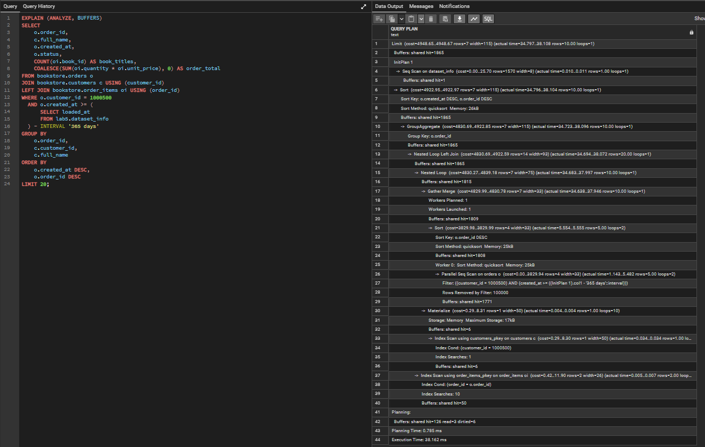

**Початковий план продажів за добу**

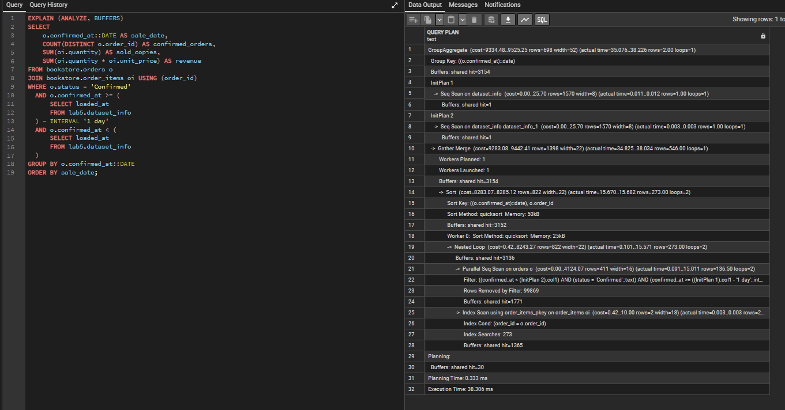

**Початковий план каталогу**

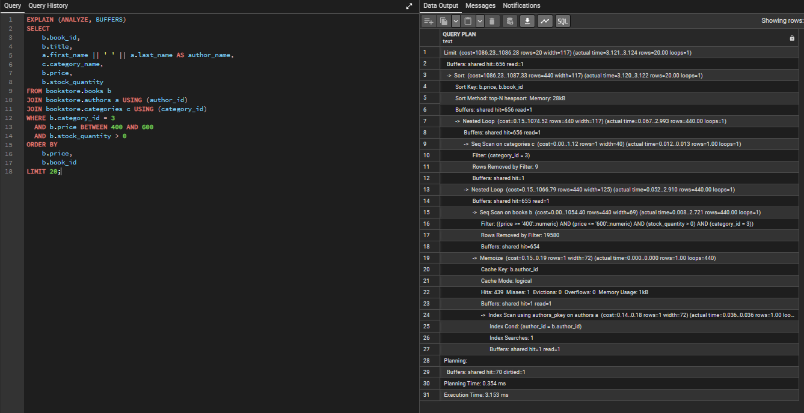

**Створення трьох індексів і ANALYZE**

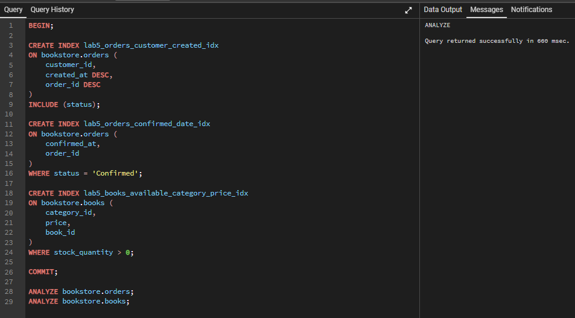

**Визначення індексів у каталозі PostgreSQL**

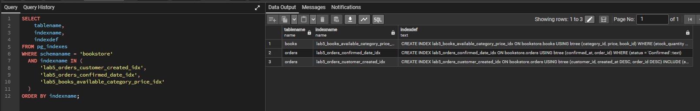

**План замовлень після індексації**

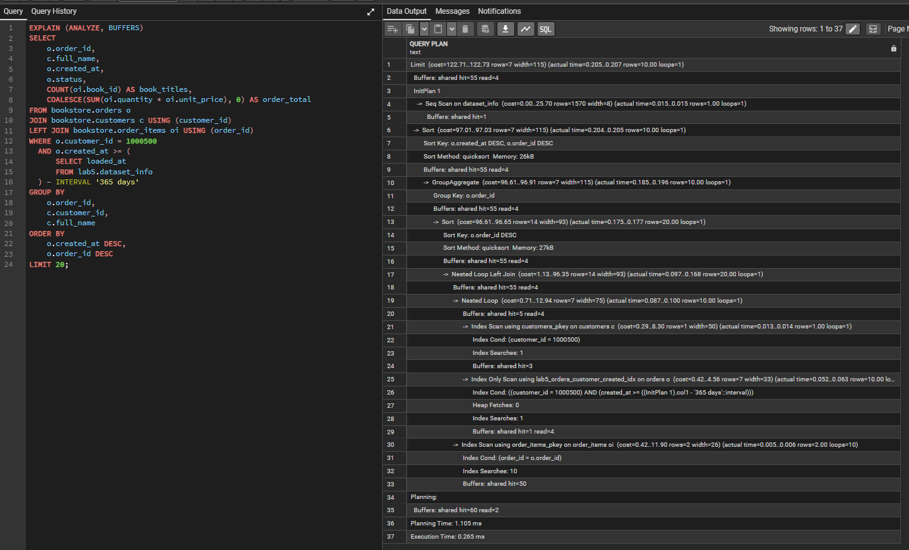

**План каталогу після індексації**

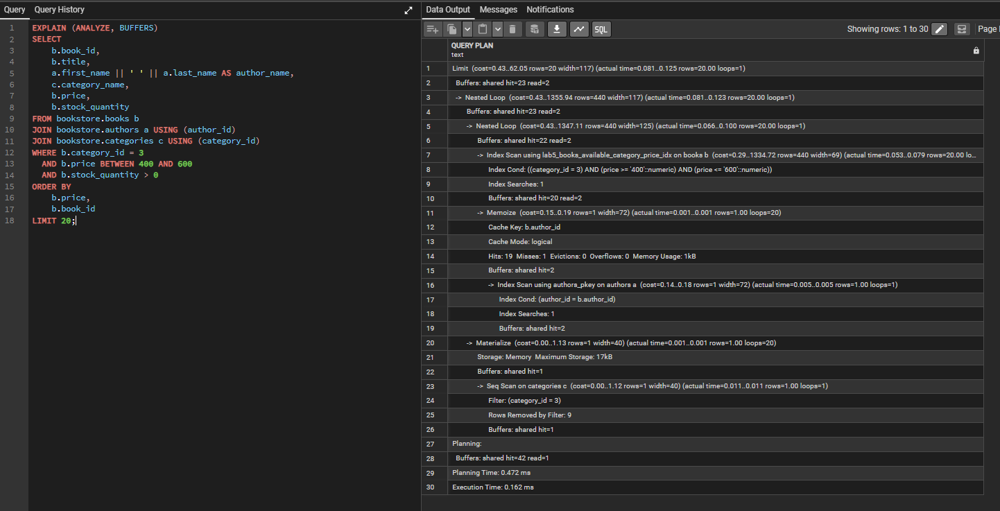

**План продажів після індексації**

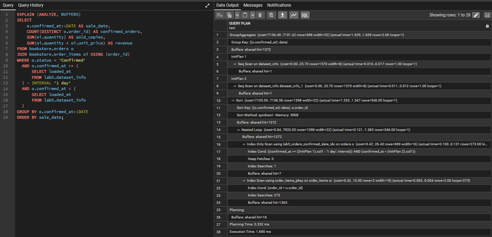

### 1.2. Представлення для каталогу та продажів

`lab5.available_books` об’єднує книги, авторів і категорії та повертає лише доступні книги. `lab5.customer_sales` агрегує підтверджені покупки, зокрема кількість замовлень і примірників, витрати й дату останнього придбання. Повні визначення містяться у [скрипті представлень](database/07_create_views.sql).

SQL з файлу `07_create_views.sql`.

```sql
BEGIN;

CREATE VIEW lab5.available_books AS
SELECT
    b.book_id,
    b.isbn,
    b.title,
    a.first_name || ' ' || a.last_name AS author_name,
    c.category_name,
    b.price,
    b.stock_quantity
FROM bookstore.books b
JOIN bookstore.authors a USING (author_id)
JOIN bookstore.categories c USING (category_id)
WHERE b.stock_quantity > 0;

CREATE VIEW lab5.customer_sales AS
SELECT
    c.customer_id,
    c.full_name,
    COUNT(DISTINCT o.order_id) AS confirmed_orders,
    COALESCE(SUM(oi.quantity), 0) AS purchased_copies,
    COALESCE(SUM(oi.quantity * oi.unit_price), 0) AS total_spent,
    MAX(o.confirmed_at) AS last_purchase_at
FROM bookstore.customers c
LEFT JOIN bookstore.orders o
    ON o.customer_id = c.customer_id
   AND o.status = 'Confirmed'
LEFT JOIN bookstore.order_items oi USING (order_id)
GROUP BY c.customer_id, c.full_name;

COMMIT;
```

**Створення двох представлень**

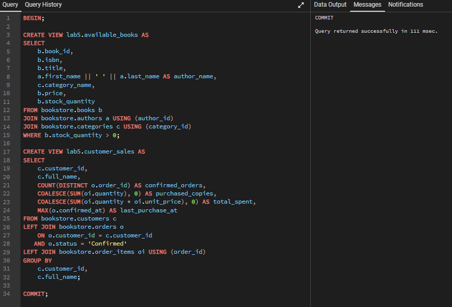

**Вибірка доступних книг**

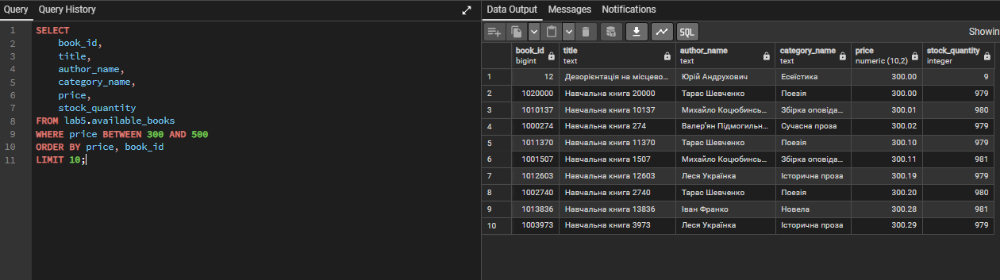

**Рейтинг покупців**

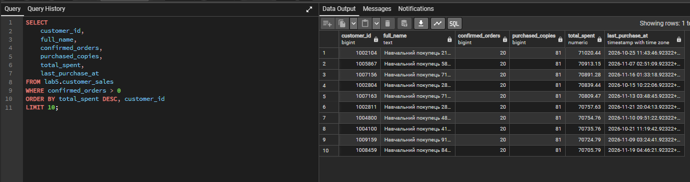

## Рівень 2. Валідація, правила та резервне відновлення

### 2.1. Валідація та аудит

Тригер BEFORE перевіряє формат і контрольну цифру ISBN-13, ціну та залишок. Коректна книга додалася, а зміни на неправильний ISBN та від’ємну ціну відхилено. [SQL валідації](database/09_validate_books.sql)


Сім рядкових тригерів записують INSERT, UPDATE і DELETE в `lab5.audit_log`. Зберігаються об’єкт, ключ, час, логін з’єднання, активна роль і знімки JSONB. Хеші паролів і токенів вилучаються. Для оновлення зберігаються обидва стани, для вставки лише новий, для видалення лише старий. Запис аудиту відкочується разом зі зміною. [SQL журналу й тригерів](database/08_create_audit.sql)

SQL з файлу `08_create_audit.sql`.

```sql
BEGIN;

CREATE TABLE lab5.audit_log (
    audit_id BIGINT GENERATED ALWAYS AS IDENTITY PRIMARY KEY,
    operation TEXT NOT NULL CHECK (operation IN ('INSERT', 'UPDATE', 'DELETE')),
    table_name TEXT NOT NULL,
    record_key JSONB NOT NULL,
    old_values JSONB,
    new_values JSONB,
    changed_at TIMESTAMPTZ NOT NULL DEFAULT clock_timestamp(),
    login_user TEXT NOT NULL,
    changed_by TEXT NOT NULL
);

CREATE INDEX lab5_audit_table_time_idx
ON lab5.audit_log (table_name, changed_at DESC);

CREATE FUNCTION lab5.log_data_change()
RETURNS TRIGGER
LANGUAGE plpgsql
SECURITY DEFINER
SET search_path = pg_catalog
AS $$
DECLARE
    v_old JSONB;
    v_new JSONB;
    v_key JSONB := '{}'::JSONB;
    v_column TEXT;
    v_actor TEXT;
BEGIN
    -- Хеші паролів і токенів вилучаються до запису історичних знімків.
    IF TG_OP <> 'INSERT' THEN
        v_old := to_jsonb(OLD) - 'password_hash' - 'api_token_hash' - 'api_key_hash';
    END IF;

    IF TG_OP <> 'DELETE' THEN
        v_new := to_jsonb(NEW) - 'password_hash' - 'api_token_hash' - 'api_key_hash';
    END IF;

    FOREACH v_column IN ARRAY TG_ARGV LOOP
        v_key := v_key || jsonb_build_object(
            v_column, COALESCE(v_new -> v_column, v_old -> v_column)
        );
    END LOOP;

    -- Усередині SECURITY DEFINER current_user є власником функції.
    -- Зберігаємо окремо логін з’єднання та роль, обрану через SET ROLE.
    v_actor := COALESCE(
        NULLIF(current_setting('role', TRUE), 'none'), session_user
    );

    INSERT INTO lab5.audit_log (
        operation, table_name, record_key, old_values, new_values,
        login_user, changed_by
    )
    VALUES (
        TG_OP, TG_TABLE_SCHEMA || '.' || TG_TABLE_NAME,
        v_key, v_old, v_new, session_user, v_actor
    );

    RETURN NULL;
END;
$$;

REVOKE ALL ON FUNCTION lab5.log_data_change() FROM PUBLIC;

CREATE TRIGGER lab5_books_audit
AFTER INSERT OR UPDATE OR DELETE ON bookstore.books
FOR EACH ROW EXECUTE FUNCTION lab5.log_data_change('book_id');

CREATE TRIGGER lab5_authors_audit
AFTER INSERT OR UPDATE OR DELETE ON bookstore.authors
FOR EACH ROW EXECUTE FUNCTION lab5.log_data_change('author_id');

CREATE TRIGGER lab5_categories_audit
AFTER INSERT OR UPDATE OR DELETE ON bookstore.categories
FOR EACH ROW EXECUTE FUNCTION lab5.log_data_change('category_id');

CREATE TRIGGER lab5_customers_audit
AFTER INSERT OR UPDATE OR DELETE ON bookstore.customers
FOR EACH ROW EXECUTE FUNCTION lab5.log_data_change('customer_id');

CREATE TRIGGER lab5_orders_audit
AFTER INSERT OR UPDATE OR DELETE ON bookstore.orders
FOR EACH ROW EXECUTE FUNCTION lab5.log_data_change('order_id');

CREATE TRIGGER lab5_items_audit
AFTER INSERT OR UPDATE OR DELETE ON bookstore.order_items
FOR EACH ROW EXECUTE FUNCTION lab5.log_data_change('order_id', 'book_id');

CREATE TRIGGER lab5_users_audit
AFTER INSERT OR UPDATE OR DELETE ON bookstore.app_users
FOR EACH ROW EXECUTE FUNCTION lab5.log_data_change('user_id');

COMMIT;
```

SQL з файлу `09_validate_books.sql`.

```sql
BEGIN;

CREATE FUNCTION lab5.validate_book()
RETURNS TRIGGER
LANGUAGE plpgsql
AS $$
DECLARE
    v_checksum INTEGER := 0;
    v_position INTEGER;
BEGIN
    IF NEW.isbn IS NULL OR NEW.isbn !~ '^[0-9]{13}$' THEN
        RAISE EXCEPTION 'ISBN має містити рівно 13 цифр';
    END IF;

    FOR v_position IN 1..13 LOOP
        v_checksum := v_checksum
            + SUBSTRING(NEW.isbn FROM v_position FOR 1)::INTEGER
            * CASE WHEN v_position % 2 = 1 THEN 1 ELSE 3 END;
    END LOOP;

    IF v_checksum % 10 <> 0 THEN
        RAISE EXCEPTION 'Неправильна контрольна цифра ISBN-13';
    END IF;

    IF NEW.price IS NULL OR NEW.price < 0 THEN
        RAISE EXCEPTION 'Ціна має бути невід’ємною';
    END IF;

    IF NEW.stock_quantity IS NULL OR NEW.stock_quantity < 0 THEN
        RAISE EXCEPTION 'Залишок має бути невід’ємним';
    END IF;

    RETURN NEW;
END;
$$;

CREATE TRIGGER lab5_books_validate
BEFORE INSERT OR UPDATE OF isbn, price, stock_quantity ON bookstore.books
FOR EACH ROW EXECUTE FUNCTION lab5.validate_book();

COMMIT;
```

**Створення журналу та функції аудиту**

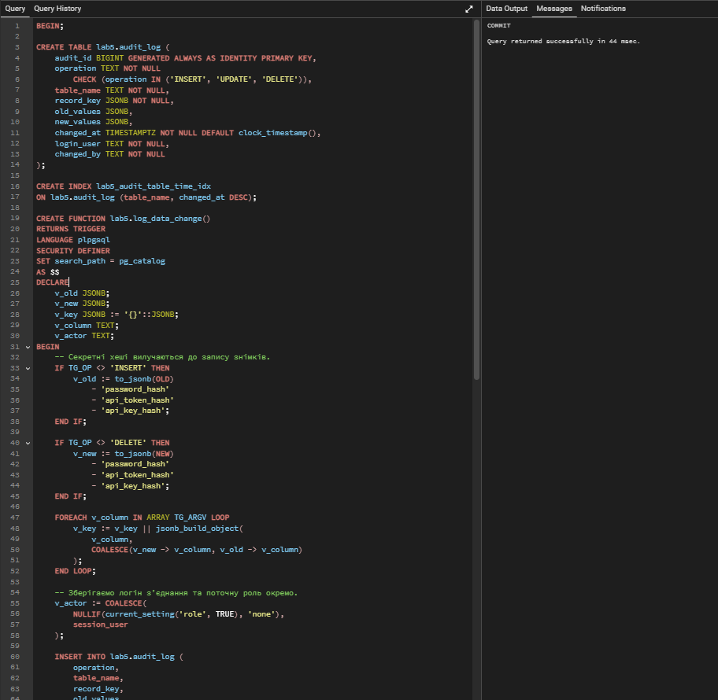

**Прив’язка семи тригерів**

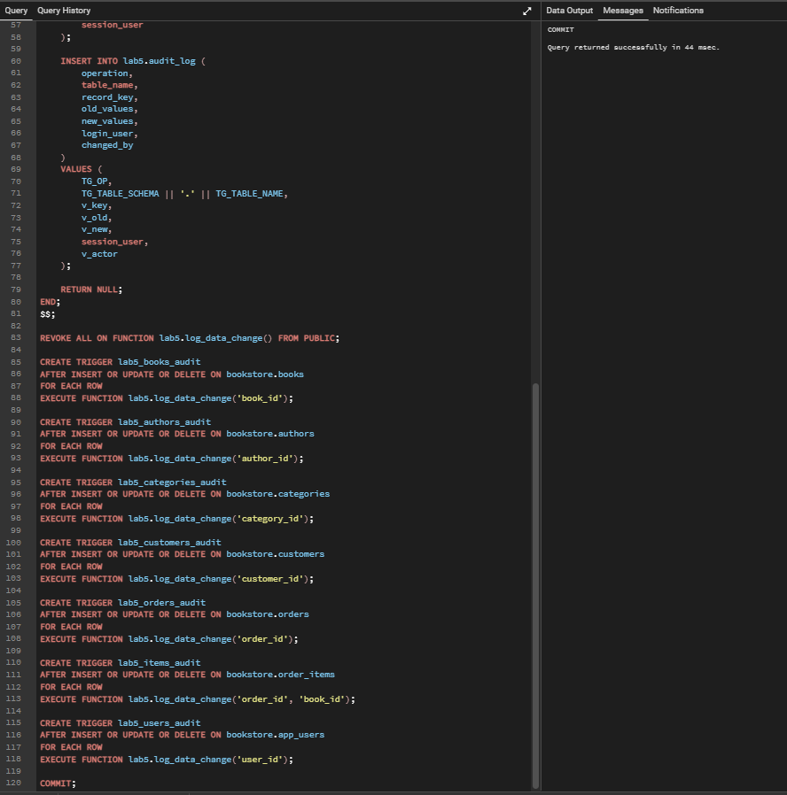

**Перелік тригерів і подій**

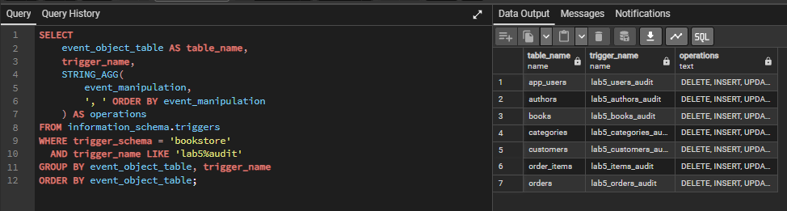

**Вставлення тестової категорії**

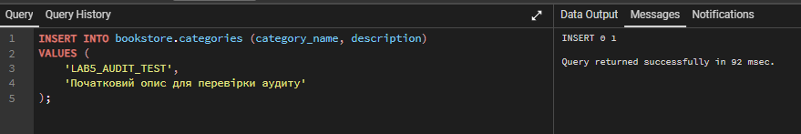

**Зміна опису категорії**

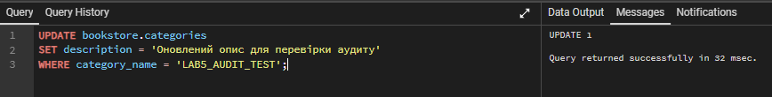

**Видалення категорії**

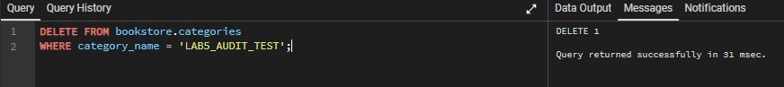

**Три події аудиту категорії**

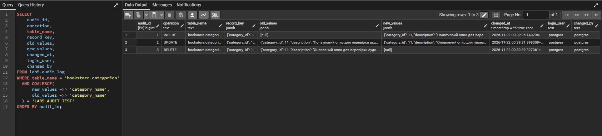

**Створення функції та тригера ISBN**

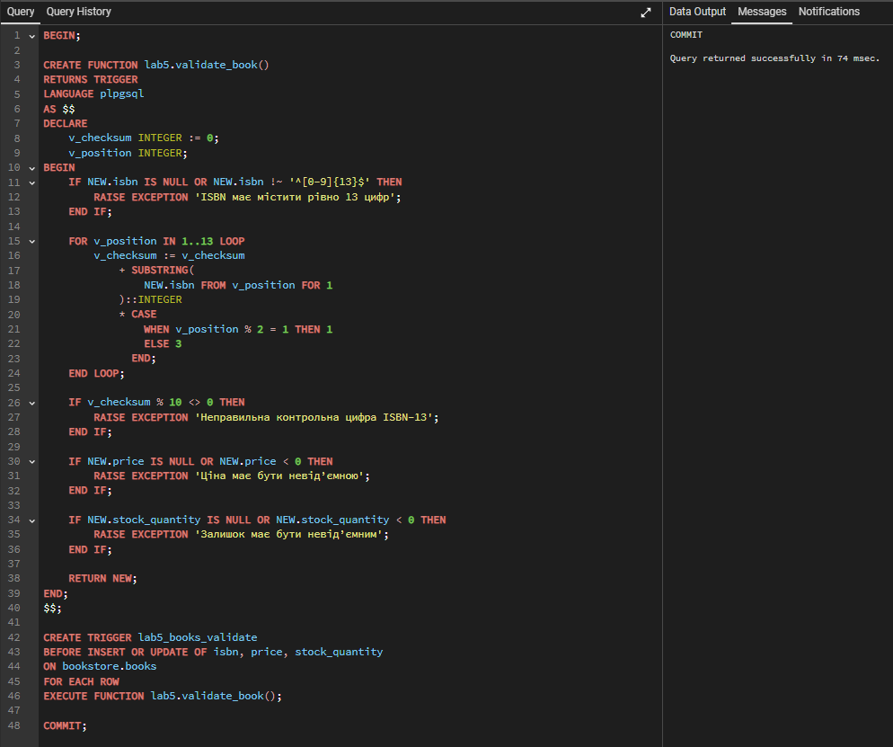

**Визначення тригера в каталозі**

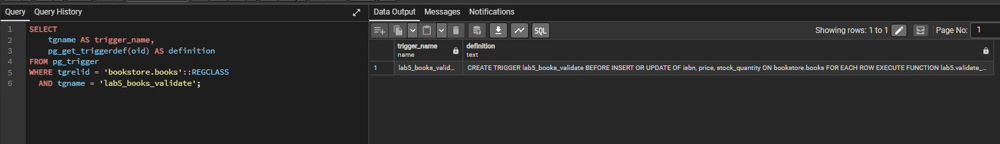

**Відхилення некоректного ISBN**

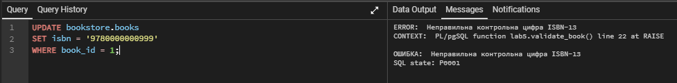

**Відхилення від’ємної ціни**

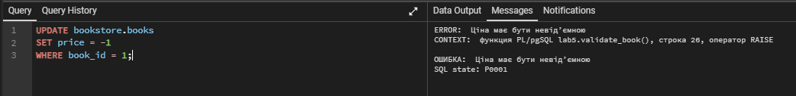

**Стан книги після вставлення**

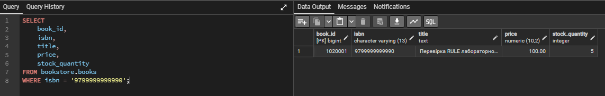

### 2.2. Оновлення через RULE

Для складного `lab5.book_editor` правило `DO INSTEAD` переписує UPDATE на зміну ціни й залишку в базовій таблиці. Після оновлення обидва джерела показали 175 грн і 8 примірників. Спроба задати -1 спрацювала як перевірка тригера та була відхилена. [SQL представлення та правила](database/10_updatable_view.sql)

SQL з файлу `10_updatable_view.sql`.

```sql
BEGIN;

CREATE VIEW lab5.book_editor AS
SELECT
    b.book_id,
    b.isbn,
    b.title,
    a.first_name || ' ' || a.last_name AS author_name,
    c.category_name,
    b.price,
    b.stock_quantity
FROM bookstore.books b
JOIN bookstore.authors a USING (author_id)
JOIN bookstore.categories c USING (category_id);

-- Через представлення редагуються ціна та залишок базової таблиці.
CREATE RULE lab5_book_editor_update AS
ON UPDATE TO lab5.book_editor
DO INSTEAD
    UPDATE bookstore.books
    SET price = NEW.price,
        stock_quantity = NEW.stock_quantity
    WHERE book_id = OLD.book_id;

COMMIT;
```

**Створення представлення і правила**

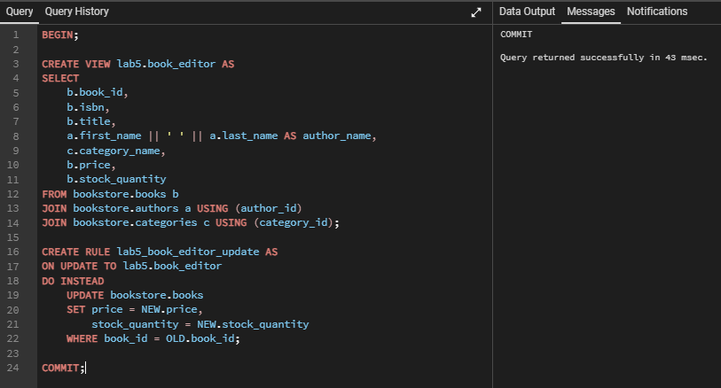

**Правило в pg_rules**

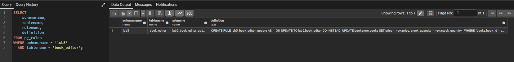

**Виконання UPDATE через представлення**

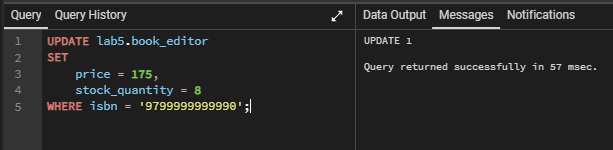

**Збіг ціни й залишку**

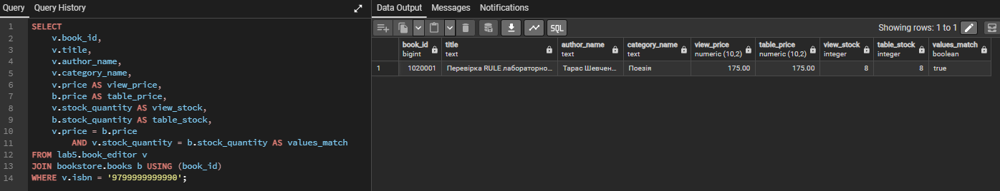

**Відхилення від’ємного залишку через RULE**

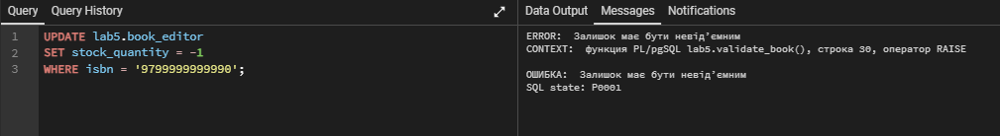

**Стан книги після помилки**

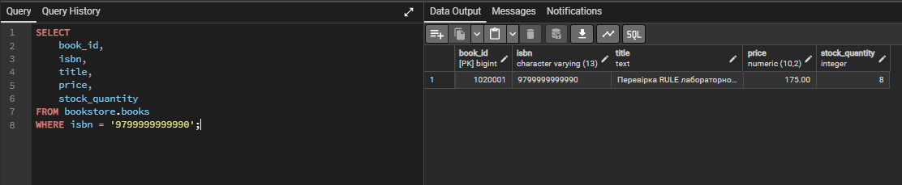

**Видалення тестової книги**

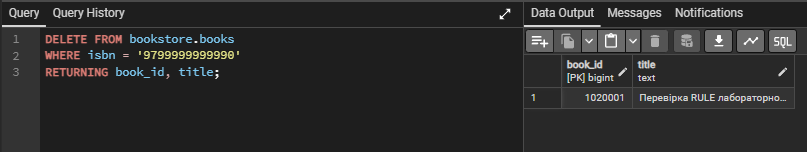

**Історія цін і залишків**

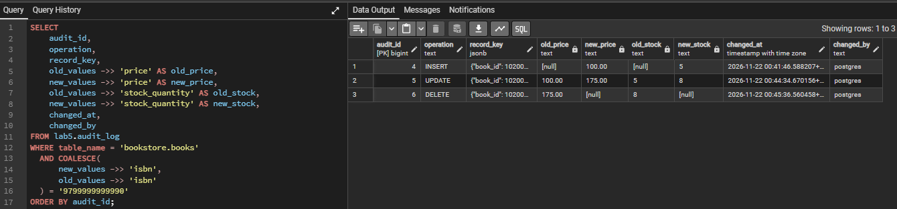

### 2.3. Резервне копіювання й відновлення

Командою `pg_dump -Fc` створено фінальний архів розміром 7 714 296 байтів. `pg_restore --exit-on-error` відновив його в `bookstore_lab5_restore` із кодом 0. Запит порівняння показав збіг кількостей за всіма 13 об’єктами, зокрема 20 020 книг, 200 012 замовлень, 400 022 позиції, 21 подію аудиту, 24 записи обслуговування й 10 рядків матеріалізованого представлення. [SQL перевірки кількостей](database/15_verify_backup.sql)

**Створення фінального архіву**

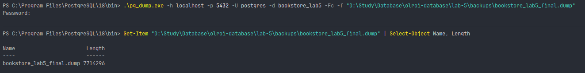

**Відновлення з кодом 0**

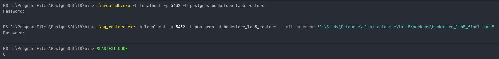

**Кількості у вихідній базі**

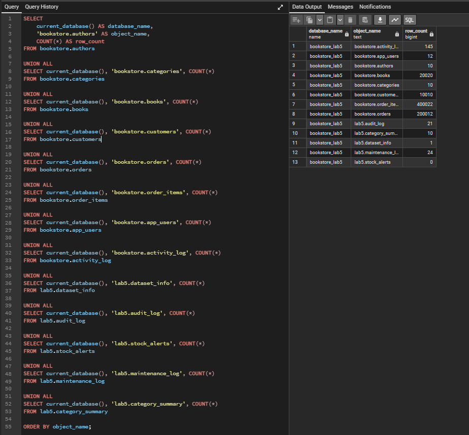

**Кількості у відновленій базі**

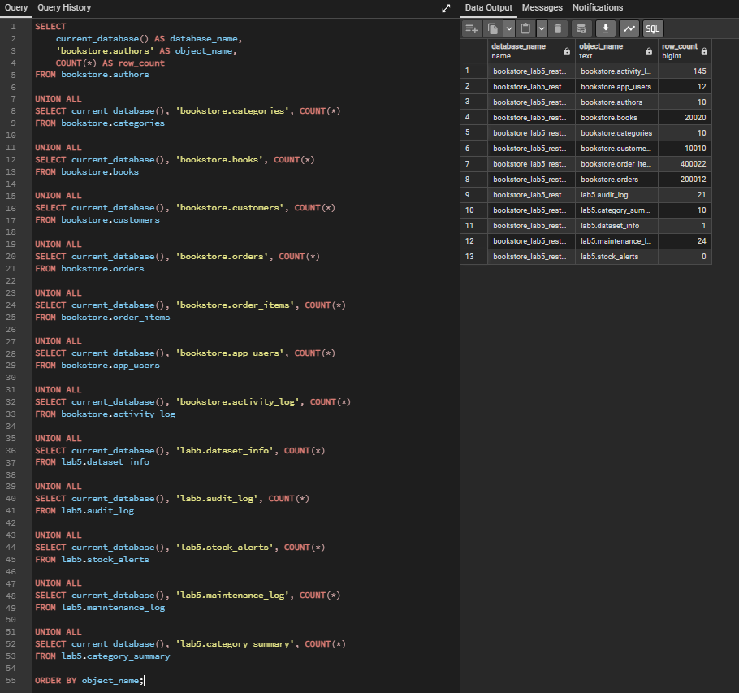

## Рівень 3. Автоматизація та ієрархія ролей

### 3.1. Ієрархія прав і перевірка доступу

Групові ролі утворюють ієрархію `lab5_reader → lab5_moderator → lab5_admin`. Окремі облікові записи успадковують відповідні права. [SQL налаштування ролей](database/11_create_roles.sql)

| Обліковий запис | Права в межах завдання |
|---|---|
| `lab5_viewer` | Читання вибраних таблиць каталогу й представлень |
| `lab5_editor` | Додатково вставлення й редагування дозволених довідників, читання замовлень, виклик процедур замовлень |
| `lab5_administrator` | Додатково видалення, доступ до журналів і запуск обслуговування |

Під читачем перевірено окремий вхід через `psql` і відмову в UPDATE. Модератор додав і відредагував категорію, але отримав відмову у видаленні та читанні облікових записів. Адміністратор видалив категорію. Журнал зафіксував активні ролі виконавців.


На знімку `img_42.png` видно паролі навчальних ролей. Створення ролей підтверджено знімками каталогу й перевірок доступу.

**Створення групових ролей та призначення прав**

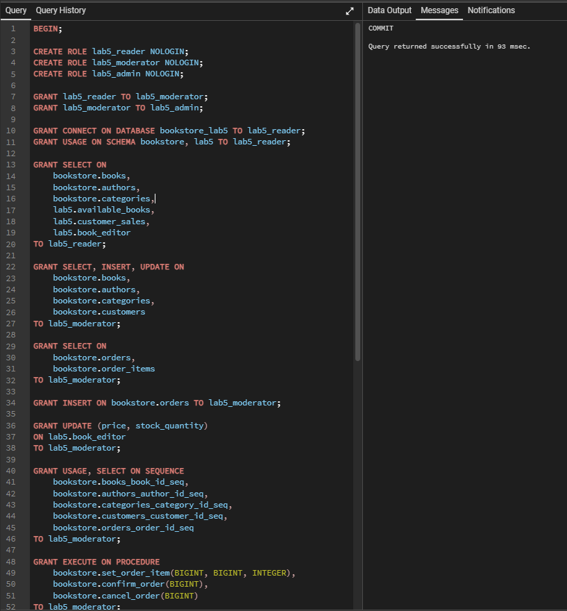

**Властивості шести ролей**

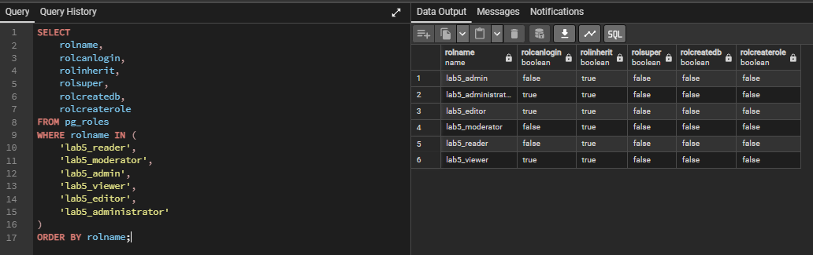

**П’ять зв’язків успадкування**

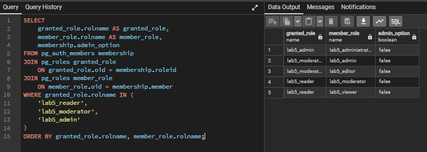

**Матриця фактичних прав**

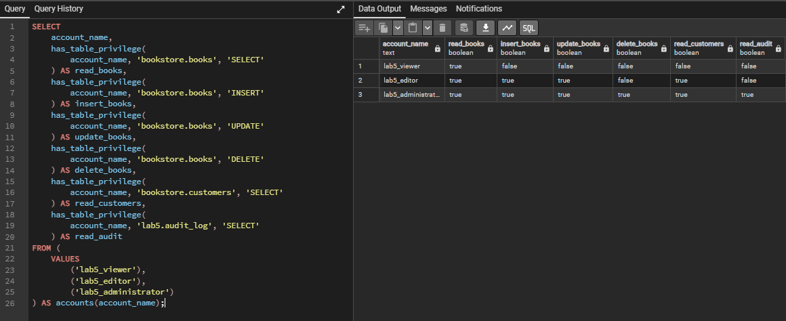

**Перемикання на читача**

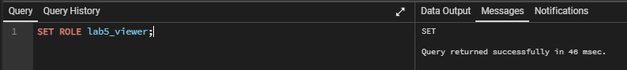

**Читання під читачем**


**Заборона UPDATE**


**Повернення початкової ролі**


**Перемикання на модератора**


**Вставлення категорії**


**Редагування категорії**


**Результат під роллю модератора**


**Заборона DELETE**


**Заборона читання облікових записів**


**Скидання ролі модератора**


**Перемикання на адміністратора**


**Дозволене видалення**


**Виконавці в аудиті**


**Скидання ролі адміністратора**


**Окремий вхід читача в psql**


### 3.2. Матеріалізовані підсумки й каскад

`lab5.category_summary` зберігає підсумки запасів і підтверджених продажів за категоріями. Склад і продажі агрегуються окремо. Чотири тригери рівня оператора оновлюють представлення після змін у книгах, замовленнях, позиціях і категоріях. [SQL представлення й оновлення](database/12_materialized_summary.sql)

Після підтвердження контрольного замовлення виручка зросла на 960 грн, продано три примірники, залишок зменшився на три, а число замовлень зросло на одне. Після скасування всі десять категорій повернулися до початкових підсумків.


Зміна запасу книги запускає тригер, який створює або оновлює `lab5.stock_alerts` при залишку від 0 до 5 та видаляє попередження при більшому запасі. Наступний тригер журналює зміну попередження. Для книги 1000001 перевірено перехід 960 → 3 → 2 → 960. [SQL каскаду](database/13_cascade_alerts.sql)

SQL з файлу `12_materialized_summary.sql`.

```sql
BEGIN;

CREATE MATERIALIZED VIEW lab5.category_summary AS
WITH stock AS (
    SELECT
        b.category_id,
        COUNT(*) AS book_titles,
        SUM(b.stock_quantity) AS available_copies,
        SUM(b.price * b.stock_quantity) AS inventory_value
    FROM bookstore.books b
    GROUP BY b.category_id
), sales AS (
    SELECT
        b.category_id,
        COUNT(DISTINCT o.order_id) AS confirmed_orders,
        SUM(oi.quantity) AS sold_copies,
        SUM(oi.quantity * oi.unit_price) AS revenue
    FROM bookstore.orders o
    JOIN bookstore.order_items oi USING (order_id)
    JOIN bookstore.books b USING (book_id)
    WHERE o.status = 'Confirmed'
    GROUP BY b.category_id
)
SELECT
    c.category_id,
    c.category_name,
    COALESCE(s.book_titles, 0) AS book_titles,
    COALESCE(s.available_copies, 0) AS available_copies,
    COALESCE(s.inventory_value, 0) AS inventory_value,
    COALESCE(p.confirmed_orders, 0) AS confirmed_orders,
    COALESCE(p.sold_copies, 0) AS sold_copies,
    COALESCE(p.revenue, 0) AS revenue
FROM bookstore.categories c
LEFT JOIN stock s USING (category_id)
LEFT JOIN sales p USING (category_id);

CREATE UNIQUE INDEX lab5_category_summary_pk
ON lab5.category_summary (category_id);

CREATE FUNCTION lab5.refresh_category_summary()
RETURNS TRIGGER
LANGUAGE plpgsql
SECURITY DEFINER
SET search_path = pg_catalog
AS $$
BEGIN
    -- Повне оновлення виконується один раз після оператора зміни даних.
    REFRESH MATERIALIZED VIEW lab5.category_summary;
    RETURN NULL;
END;
$$;

REVOKE ALL ON FUNCTION lab5.refresh_category_summary() FROM PUBLIC;
GRANT EXECUTE ON FUNCTION lab5.refresh_category_summary() TO lab5_admin;
GRANT SELECT ON lab5.category_summary TO lab5_reader;

CREATE TRIGGER lab5_refresh_books
AFTER INSERT OR UPDATE OR DELETE OR TRUNCATE ON bookstore.books
FOR EACH STATEMENT EXECUTE FUNCTION lab5.refresh_category_summary();

CREATE TRIGGER lab5_refresh_orders
AFTER INSERT OR UPDATE OR DELETE OR TRUNCATE ON bookstore.orders
FOR EACH STATEMENT EXECUTE FUNCTION lab5.refresh_category_summary();

CREATE TRIGGER lab5_refresh_items
AFTER INSERT OR UPDATE OR DELETE OR TRUNCATE ON bookstore.order_items
FOR EACH STATEMENT EXECUTE FUNCTION lab5.refresh_category_summary();

CREATE TRIGGER lab5_refresh_categories
AFTER INSERT OR UPDATE OR DELETE OR TRUNCATE ON bookstore.categories
FOR EACH STATEMENT EXECUTE FUNCTION lab5.refresh_category_summary();

COMMIT;
```

SQL з файлу `13_cascade_alerts.sql`.

```sql
BEGIN;

CREATE TABLE lab5.stock_alerts (
    book_id BIGINT PRIMARY KEY
        REFERENCES bookstore.books (book_id) ON DELETE CASCADE,
    stock_quantity INTEGER NOT NULL CHECK (stock_quantity BETWEEN 0 AND 5),
    updated_at TIMESTAMPTZ NOT NULL DEFAULT clock_timestamp()
);

CREATE FUNCTION lab5.update_stock_alert()
RETURNS TRIGGER
LANGUAGE plpgsql
SECURITY DEFINER
SET search_path = pg_catalog
AS $$
BEGIN
    IF NEW.stock_quantity <= 5 THEN
        INSERT INTO lab5.stock_alerts (book_id, stock_quantity)
        VALUES (NEW.book_id, NEW.stock_quantity)
        ON CONFLICT (book_id) DO UPDATE
        SET stock_quantity = EXCLUDED.stock_quantity,
            updated_at = clock_timestamp();
    ELSE
        DELETE FROM lab5.stock_alerts WHERE book_id = NEW.book_id;
    END IF;

    RETURN NULL;
END;
$$;

REVOKE ALL ON FUNCTION lab5.update_stock_alert() FROM PUBLIC;
GRANT EXECUTE ON FUNCTION lab5.update_stock_alert() TO lab5_admin;
GRANT SELECT ON lab5.stock_alerts TO lab5_moderator;

-- Зміна книги змінює попередження, а його тригер записує окрему подію аудиту.
CREATE TRIGGER lab5_stock_alerts_update
AFTER INSERT OR UPDATE OF stock_quantity ON bookstore.books
FOR EACH ROW EXECUTE FUNCTION lab5.update_stock_alert();

CREATE TRIGGER lab5_stock_alerts_audit
AFTER INSERT OR UPDATE OR DELETE ON lab5.stock_alerts
FOR EACH ROW EXECUTE FUNCTION lab5.log_data_change('book_id');

INSERT INTO lab5.stock_alerts (book_id, stock_quantity)
SELECT book_id, stock_quantity
FROM bookstore.books
WHERE stock_quantity <= 5;

COMMIT;
```

**Визначення матеріалізованого представлення**


**Функція й чотири тригери оновлення**


**Ознаки заповнення й наявності індексу**


**Збереження початкових підсумків**


**Повторна перевірка представлення**


**Агрегати десяти категорій**


**Створення й підтвердження контрольного замовлення**


**Контрольне замовлення на три книги**


**Приріст виручки та зміна запасу**


**Скасування контрольного замовлення**


**Повернення всіх агрегатів**


**Таблиця попереджень і функція каскаду**


**Створення двох каскадних тригерів**


**Визначення тригерів**


**Збереження початкового запасу**


**Зниження запасу до трьох**


**Автоматичне створення попередження**


**Зниження запасу до двох**


**Автоматичне оновлення попередження**


**Повернення початкового запасу**


**Перевірка видалення попередження**


**Каскадні INSERT, UPDATE і DELETE в аудиті**


### 3.3. Обслуговування та моніторинг

Процедура `lab5.maintain_database()` виконує `ANALYZE` та звичайний `REINDEX TABLE` для таблиць і матеріалізованого представлення навчальних схем, крім самого журналу обслуговування. Під роллю `lab5_administrator` отримано 24 події для 12 об’єктів. Для `dataset_info` сервер повідомив про відсутність індексів. [SQL процедури](database/14_maintenance.sql)


Скрипт зчитує статистику індексів із `pg_stat_user_indexes`, а десять найповільніших за середнім часом запитів поточної бази бере з `pg_stat_statements`. На демонстрації зібрано три знімки з інтервалом п’ять секунд. Найдовша операція у вибірці була масовим додаванням позицій, близько 5 679 мс за один виклик. Нульовий лічильник сканувань характеризує лише спостережуваний період. [Скрипт моніторингу](monitor.py)

**Журнал та початок процедури**


**Перебудова індексів і права виконання**


**Виклик під адміністратором**


**Записи обслуговування**


**Лічильники індексів**


**Найповільніші запити в pgAdmin**


**Третій знімок Python моніторингу**


## Відповідність критеріям рівнів 1-3

| Рівень | Реалізація | Перевірка |
|---|---|---|
| 1 | Три плани до й після, три індекси, два VIEW, тригер аудиту, обмежений користувач | Плани й час виконання, вибірки з VIEW, події INSERT та UPDATE, окремий вхід читача |
| 2 | UPDATE через RULE, BEFORE-тригер, повний аудит, два часткові індекси, pg_dump та pg_restore | Зміна базового рядка через VIEW, відхилені некоректні UPDATE, історія INSERT/UPDATE/DELETE, використання індексів у планах, збіг кількостей у 13 об’єктах |
| 3 | Матеріалізоване VIEW з автоматичним оновленням, каскад, ієрархія ролей, процедура обслуговування, скрипт моніторингу | Зміна агрегатів і повернення після скасування, три каскадні події, матриця прав, 24 події обслуговування, три знімки статистики |

Тригер зареєстровано для BEFORE INSERT та UPDATE. У звіті показано успішний INSERT і відмови на некоректних UPDATE. Окремої демонстрації відхиленого INSERT немає.

## Відповіді на контрольні запитання

1. **EXPLAIN і EXPLAIN ANALYZE.** Перший показує оцінений план, другий виконує запит і додає фактичний час, кількість рядків і цикли. Для змінювальних запитів вимірювання можна виконати в транзакції з відкатом.
2. **Типи індексів.** B-tree підходить для рівності, діапазонів і сортування. Hash підтримує рівність. GIN використовують для масивів, JSONB і повнотекстового пошуку. GiST і SP-GiST застосовують для просторових, інтервальних та інших типів за відповідними класами операторів. BRIN ефективний для великих таблиць із фізично впорядкованими даними.
3. **Частковий індекс.** Містить рядки за предикатом. Дає виграш, коли важлива підмножина рядків і умова запиту дозволяє планувальнику вивести цей предикат.
4. **Звичайне й матеріалізоване представлення.** Звичайне зберігає визначення запиту, матеріалізоване зберігає його результат і потребує оновлення. Приклади в роботі є каталог доступних книг та підсумки категорій.
5. **Життєвий цикл тригера.** BEFORE спрацьовує перед зміною й може відхилити або змінити рядок. AFTER спрацьовує після зміни. INSTEAD OF підміняє операцію над представленням.
6. **Обмеження доступу.** Мінімальні права зменшують наслідки помилок та стороннього доступу. PostgreSQL дозволяє задавати привілеї на рівні бази, схеми, таблиці, стовпця й процедури, а політики RLS обмежують рядки.
7. **Логічна й фізична копії.** Логічна переносить об’єкти та дані у форматі, придатному для вибіркового відновлення. Фізична копіює файли кластера й використовується разом із WAL для відновлення стану сервера.
8. **Каскадні тригери.** Дія першого тригера змінює іншу таблицю, через що спрацьовує наступний. Прикладом є зміна запасу, зміна попередження та запис аудиту.
9. **Вартість індексів при записі.** INSERT додає записи індексів, UPDATE може вимагати нових записів, а видалені та старі версії згодом очищає VACUUM. Зайві індекси збільшують розмір БД і роботу під час запису.
10. **Відновлення на момент часу.** Потрібні фізична базова копія, безперервний архів WAL та параметри відновлення із цільовим часом. PostgreSQL відтворює WAL до заданої точки.

## Висновки

У цій роботі я перевірив, як індекси впливають на швидкість запитів у PostgreSQL. Після додавання індексів усі три запити виконувалися швидше. Наприклад, пошук замовлень покупця займав 38,162 мс, а після додавання індексу - 0,265 мс.

Я налаштував перевірку даних, журнал змін і права для різних користувачів. Також перевірив, що підсумки продажів і попередження про малий залишок оновлюються автоматично. Наприкінці я запустив скрипт моніторингу, зробив резервну копію та відновив її в окремій базі. Кількість рядків збіглася в усіх 13 перевірених таблицях і представленнях.
