# Лабораторна робота 6. Робота з MongoDB та реалізація операцій

## Загальна інформація

**Здобувач освіти:** Якимов Ілля  
**Група:** ІПЗ-32  
**Обраний рівень складності:** 3  
**Предметна область:** бібліотека  
**СУБД:** MongoDB Community Server 9.0  
**Інструменти:** MongoDB Compass, вбудована оболонка mongosh, PowerShell, MongoDB Database Tools  
**База даних:** `library`

## Мета роботи

Навчитися зберігати документи в MongoDB, виконувати пошук і зміни, працювати з індексами та порівняти цей підхід із PostgreSQL. Перевірити схему документів, геопошук, історію змін, резервне копіювання та реплікацію.

## Рівень 1. Колекції, CRUD та індекси

### 1.1. Підключення й наповнення

До локального сервера підключився через Compass за адресою `mongodb://localhost:27017`. Через `insertMany` додав по 10 документів у `books`, `authors` та `users`. Книга посилається на автора полем `authorId`. Залишки зберігаються у вкладеному об’єкті `copies`, а теги та ідентифікатори позичених книг у масивах.

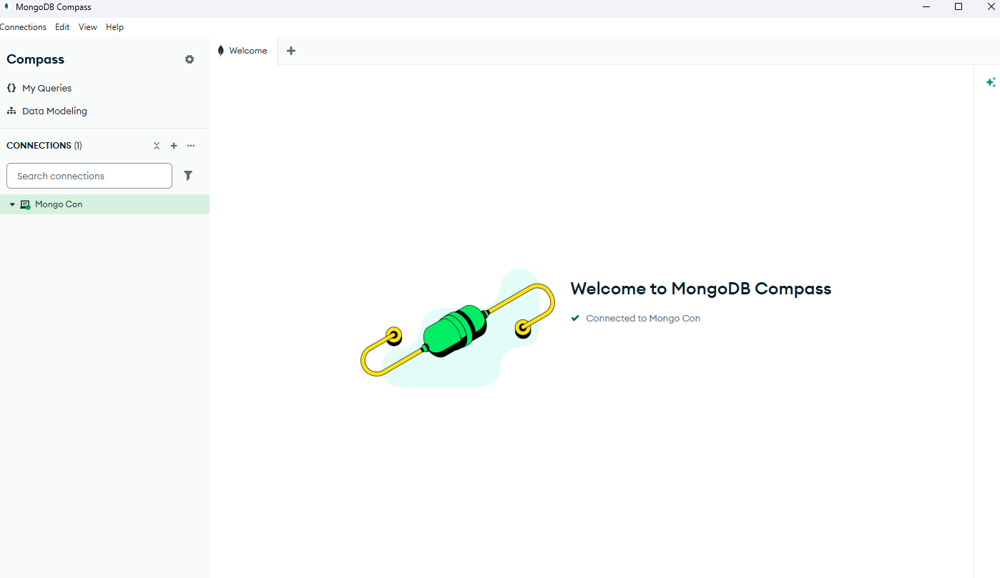

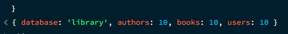

### 1.2. Створення, читання, оновлення та видалення

Через `insertOne` додав книгу з ID 1001, знайшов її через `findOne`, змінив залишок із 5 на 4 через `updateOne`, а потім видалив через `deleteOne`. Після перевірки в колекції залишилося 10 книг.

Тим самим блоком перевірив складний пошук. Умова нижче знаходить книги від 1900 року, які мають один із двох жанрів або назву на «М». Отримано 7 книг.

```javascript
db.books.find({
    $and: [
        { year: { $gte: 1900 } },
        {
            $or: [
                { genre: { $in: ["Драма", "Повість"] } },
                { title: { $regex: "^М" } }
            ]
        }
    ]
}).sort({ year: 1, title: 1 });
```

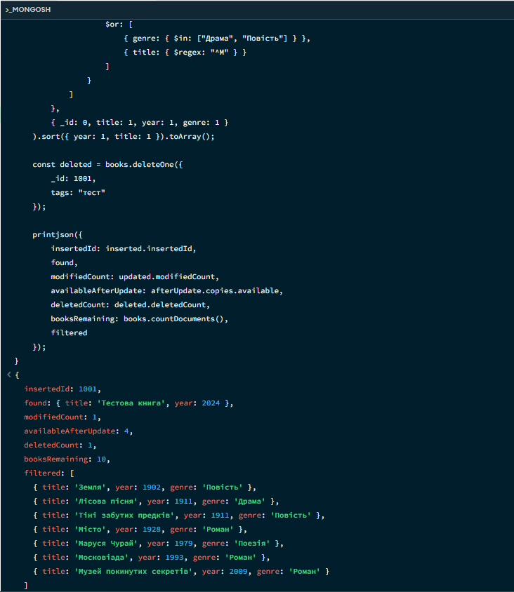

### 1.3. Три індекси та порівняння

| Індекс | Тип | Для чого |
|---|---|---|
| `author_idx` | Простий, `authorId: 1` | Пошук книг за автором |
| `genre_year_idx` | Складений, `genre: 1, year: 1` | Пошук за жанром і роком |
| `books_text_idx` | Текстовий для `title` і `tags` | Пошук слів через `$text` |

Запит шукав романи від 1990 року з сортуванням за роком. Через `hint` і `explain("executionStats")` порівняв повне сканування з використанням складеного індексу.

| План | Знайдено | Переглянуто документів | Час, мс |
|---|---:|---:|---:|
| Повне сканування | 3 | 10 | 0 |
| Складений індекс | 3 | 3 | 7 |

Індекс скоротив кількість переглянутих документів на 70%. На цьому малому наборі виміряний час не показав прискорення. Пошук через `$text` повернув «Кобзар».

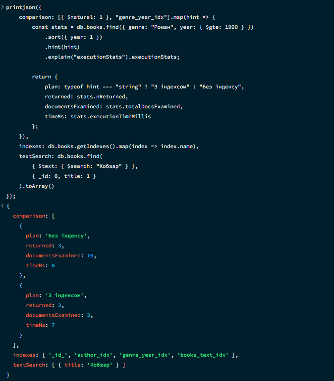

## Рівень 2. Агрегація, об’єднання та представлення

Агрегація через `$group` порахувала книги за жанрами й середній доступний залишок. Етап `$sort` упорядкував жанри за кількістю книг. Найбільша група містить 4 романи із середнім залишком 10,25.

```javascript
db.books.aggregate([
    {
        $group: {
            _id: "$genre",
            books: { $sum: 1 },
            averageAvailable: { $avg: "$copies.available" }
        }
    },
    { $sort: { books: -1, _id: 1 } }
]);
```

У представленні `books_with_authors` етап `$lookup` з’єднує `books.authorId` з `authors._id`, `$unwind` розгортає знайденого автора, а `$project` залишає назву, рік та ім’я автора. Перевірив результат на «Кобзарі» й «Захарі Беркуті». Складений індекс, текстовий пошук і складні логічні умови показані в розділах 1.2 і 1.3.

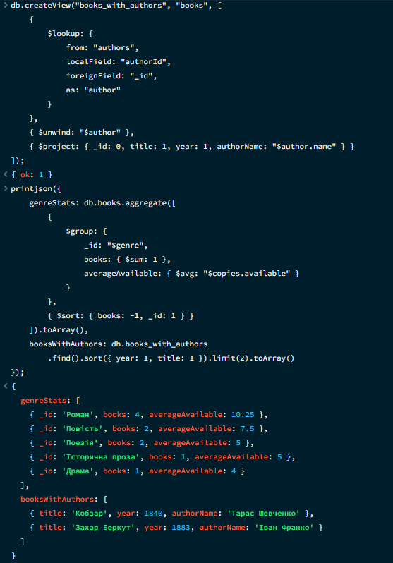

## Рівень 3. Перевірка даних, пошук і обслуговування

### 3.1. Валідація документів

Через `collMod` додав `$jsonSchema` до `books`. Схема вимагає назву, автора, рік, жанр і залишки. Рік має бути цілим числом від 1450 до 2100, а кількість примірників має бути цілою та невід’ємною. Вставку з роком `"2024"` як рядком сервер відхилив.

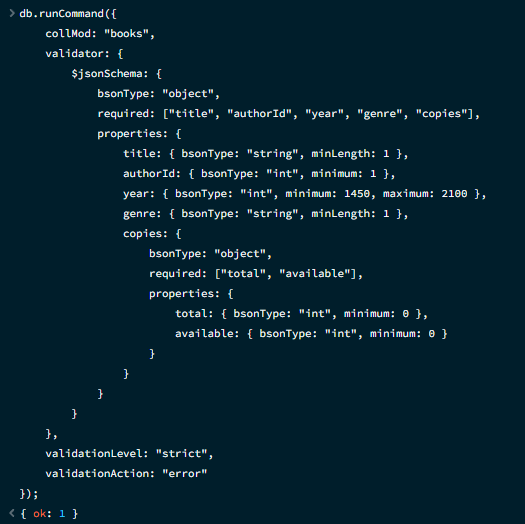

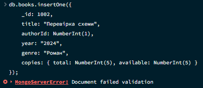

### 3.2. Геопошук

Для двох читачів додав координати GeoJSON у порядку довгота, широта. Створив індекс `2dsphere` на `users.location`. Запит із `$near` у межах 10 км від Луцька повернув читача з Луцька.

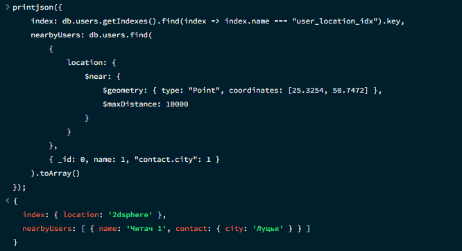

### 3.3. Історія змін книги

Одним оновленням документа «Кобзаря» зберіг старий об’єкт `copies`, номер версії та час у масиві `history`. Поточний залишок змінився з 3 на 2, а номер версії став 2. У версії 1 зберігся залишок 3. Фільтр демонстраційної команди дозволяє виконати цей перехід один раз.

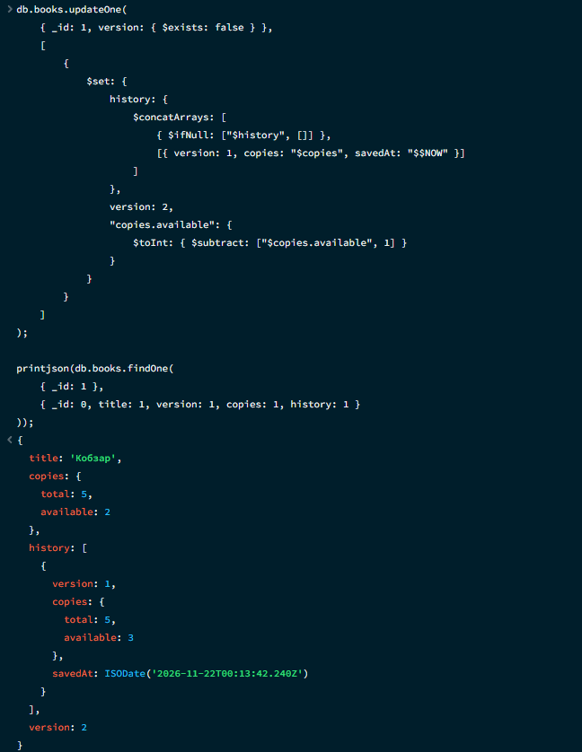

Під час другого оновлення зберіг версію 2 в історії та зменшив залишок ще на один примірник. У поточній версії 3 залишився 1 примірник. У масиві `history` є версії 1 і 2 із залишками 3 і 2 відповідно та часом збереження кожної.

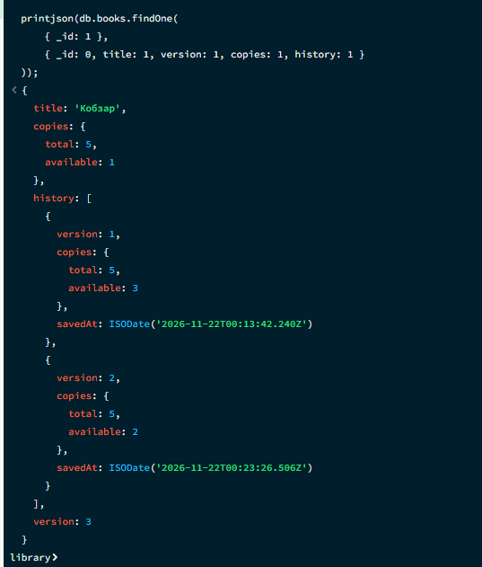

### 3.4. Пошук українською

У колекції використав наявний текстовий індекс із `default_language: "none"`. Форми «кобзар», «кобзаря» та «кобзарем» явно додав до тегів. Усі три форми знайшли ту саму книгу через `$text`. Для інших слів потрібні відповідні теги, оскільки тут використано збіг за проіндексованими формами.

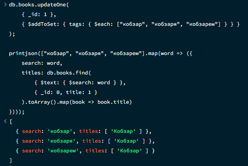

### 3.5. Реплікація

Для демонстрації створив окремий набір реплік `lab6rs`. Вузол `localhost:27018` був PRIMARY, а `localhost:27019` був SECONDARY. На першому записав документ у `library.replication_demo` з підтвердженням `w: "majority"`. Пряме підключення до другого вузла повернуло той самий документ.

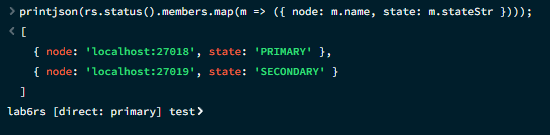

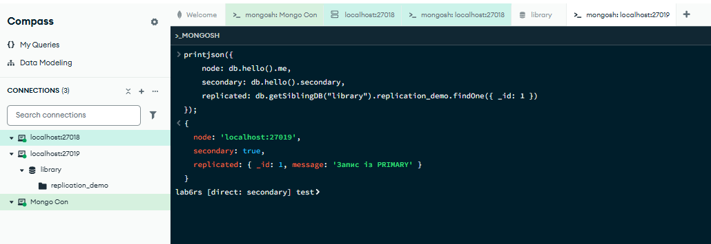

### 3.6. Резервна копія

Скрипт PowerShell викликає `mongodump` для `library`, створює стиснений архів із датою в назві та показує його розмір. Архів із демонстрації мав розмір 2365 байтів. У виводі видно експорт по 10 документів із кожної основної колекції. [Скрипт резервного копіювання](backup.ps1)

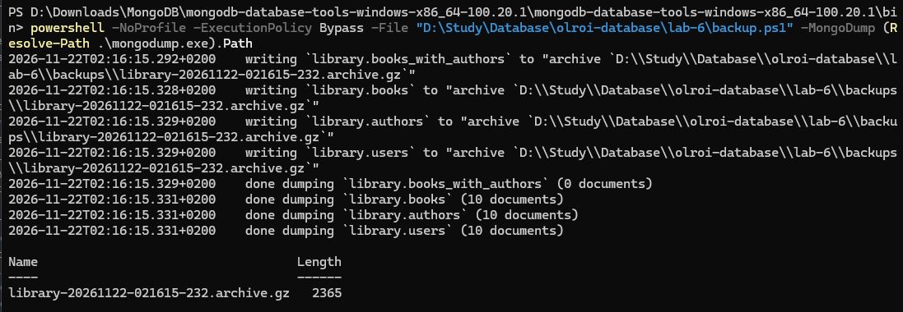

### 3.7. Порівняння з PostgreSQL на прикладі бібліотеки

| Завдання | PostgreSQL | MongoDB у цій роботі |
|---|---|---|
| Книга та її залишок | Стовпці таблиці книг | Вкладений об’єкт `copies` у документі книги |
| Книга й автор | Зовнішній ключ та JOIN | Посилання `authorId` і `$lookup`. Наявність автора треба контролювати окремо |
| Теги та вподобання | Можна винести у зв’язані таблиці | Масиви всередині документа |
| Історія зміни запасу | Зазвичай окрема таблиця історії | Попередній стан можна додати до документа одним оновленням. Для довгої історії доречна окрема колекція |
| Перевірка даних | Типи, CHECK і зовнішні ключі | JSON Schema перевіряє поля документа |

Для бібліотеки з багатьма зв’язками, наприклад між примірниками, читачами й видачами, у PostgreSQL зручно контролювати цілісність через зовнішні ключі. У MongoDB зручно зберігати й отримувати разом опис книги, залишки та теги, якщо ці дані зазвичай читаються одним запитом.

## Відповіді на контрольні запитання

1. **Реляційна та документна БД.** Перша зберігає дані в таблицях і добре підходить для багатьох зв’язків. Друга зберігає дані в документах і зручна, коли пов’язані поля часто читають разом.
2. **BSON і JSON.** BSON є двійковим форматом з додатковими типами, наприклад датою, ObjectId і цілими числами різної довжини. MongoDB використовує його для зберігання документів.
3. **Денормалізація.** Частину пов’язаних даних зберігають разом або дублюють. Це може спростити читання, але дублікати треба узгоджено оновлювати.
4. **Pipeline.** Кожен етап обробляє результат попереднього. `$match` фільтрує, `$group` групує, `$sort` сортує, а `$project` вибирає або обчислює поля.
5. **Індекси.** Індекс допомагає шукати й сортувати з меншим обсягом читання. Він займає місце і потребує оновлення під час запису. Приклади типів є простий, складений, текстовий, геопросторовий і хешований.
6. **Методи оновлення.** `updateOne` змінює один документ, `updateMany` змінює всі відповідні, `replaceOne` замінює один документ цілком зі збереженням його `_id`.
7. **Валідація.** JSON Schema задає обов’язкові поля, типи та межі значень. Для наявної колекції її можна додати командою `collMod`.
8. **Зв’язки.** Вкладення зручне, коли дані належать одному документу й читаються разом. Посилання зручне для даних, спільних для багатьох документів. Прикладом є автор, на якого посилаються кілька книг.
9. **Текстовий індекс.** Він індексує слова з визначених полів. Запит `$text` з `$search` шукає за цими словами.
10. **Масштабування.** Реплікація зберігає копії даних на кількох вузлах. Шардинг розподіляє частини даних між вузлами за ключем шардингу.

## Висновки

У цій роботі я створив базу бібліотеки в MongoDB і навчився додавати, шукати, змінювати та видаляти документи. На прикладі пошуку романів побачив, що з індексом MongoDB перевірила 3 документи замість 10.

Також я перевірив схему книги, пошук за координатами та збереження старого залишку в історії. Наприкінці зробив резервну копію й прочитав тестовий запис із другого вузла.
