# Лабораторна робота 7. Повний цикл розробки NoSQL застосунку з інтеграцією

## Загальна інформація

**Здобувач освіти:** Якимов Ілля  
**Група:** ІПЗ-32  
**Рівень виконання:** 3  
**Предметна область:** блог  
**База:** `blog_lab7`, MongoDB 9.0.8  
**Інструменти:** MongoDB Compass, mongosh, Node.js, PostgreSQL, HTML, CSS і JavaScript

## Мета роботи

Створити блог на MongoDB. Навчитися працювати з вкладеними документами, робити пошук і статистику та підключати базу до вебзастосунку. Порівняти однакові запити в MongoDB та PostgreSQL.

## Рівень 1. Схема, дані та перегляд дописів

| Колекція | Що зберігається |
|---|---|
| `users` | Ім’я та роль `author`, `reader` або `admin` |
| `categories` | Назва категорії та масив тегів |
| `posts` | Назва, текст, посилання на автора й категорію, теги, дата, перегляди, коментарі, голоси та історія версій |

Для трьох колекцій налаштовано `$jsonSchema`. Вона перевіряє обов’язкові поля, ролі та типи значень, зокрема структуру коментарів першого рівня. Дані додано вручну через Compass. На початку було 50 дописів, 200 коментарів, 20 користувачів і 10 категорій. Для відтворення на порожній базі є [seed.js](seed.js).

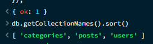

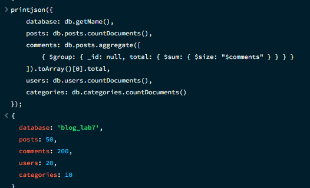

Індекси за автором і датою та за категорією і датою підтримують вибірки дописів. Індекс за датою та `_id` задає порядок, коли дати збігаються. Також створено індекси для тегів, тексту й координат.

Для рейтингу авторів і категорій використано `$group`, `$sort` і `$lookup` для імен. Окремий запит порахував коментарі через `$size`, `$sum` та `$avg`. На початку в середньому було 4 коментарі на допис.

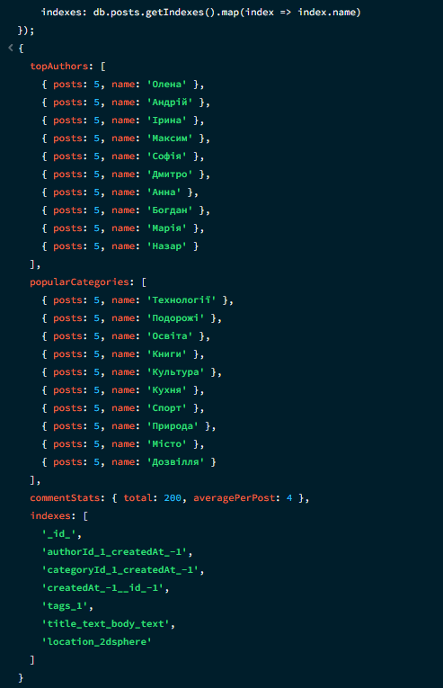

HTML-сторінка показує список, а JavaScript завантажує дані з API. Після відкриття допису видно його текст, автора, категорію та схвалені коментарі.

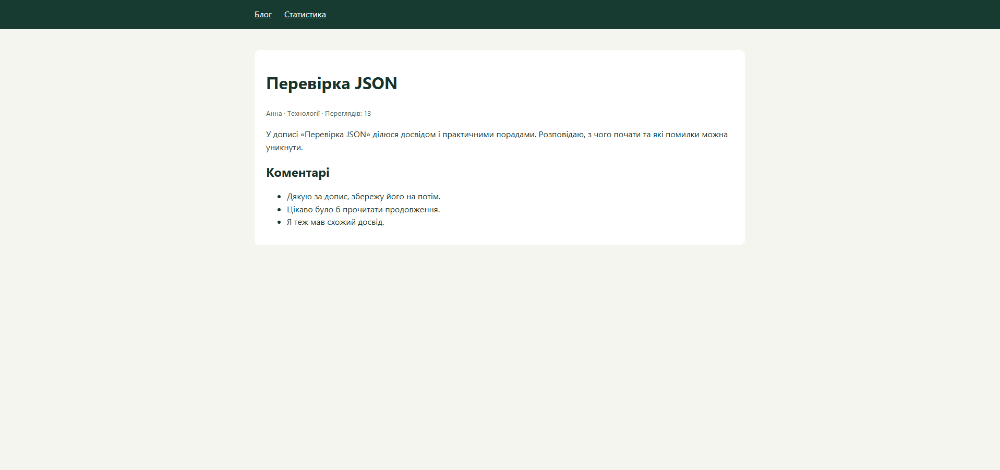

## Рівень 2. Пошук і робота з дописами

Пошук за кількома тегами використовує `$all`. Запит за тегами «код» і «поради» повернув 5 дописів. Повнотекстовий пошук використовує `$text` та індекс на `title` і `body`. Для пагінації використано `$facet`: одна частина рахує всі збіги, інша вибирає 10 дописів через `$skip` і `$limit`.

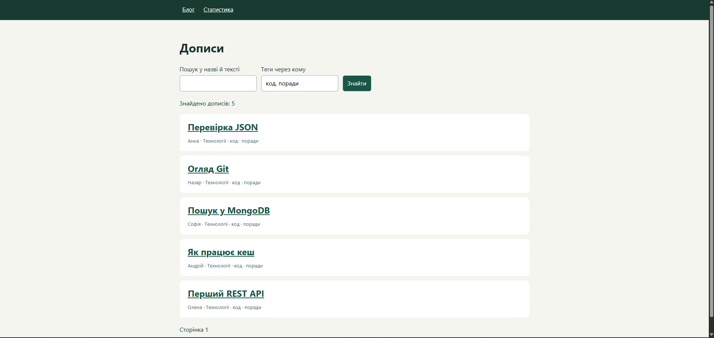

Форма дозволяє додати допис від імені навчального профілю автора. Після відкриття детальної сторінки лічильник переглядів збільшується через `$inc`. Користувач може поставити лайк або дизлайк. Повторне голосування замінює його попередній голос.

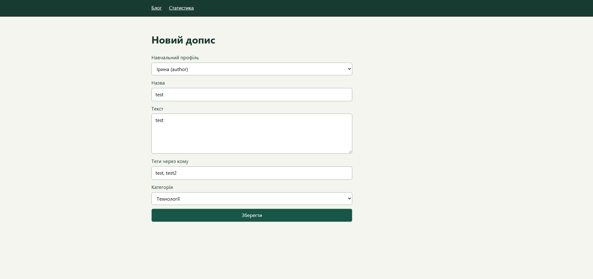

Новий коментар отримує стан `pending`. Адміністратор може змінити його на `approved` або `rejected`. Схвалений коментар з’являється на сторінці допису.

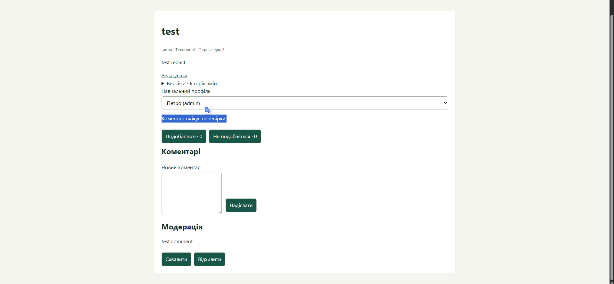

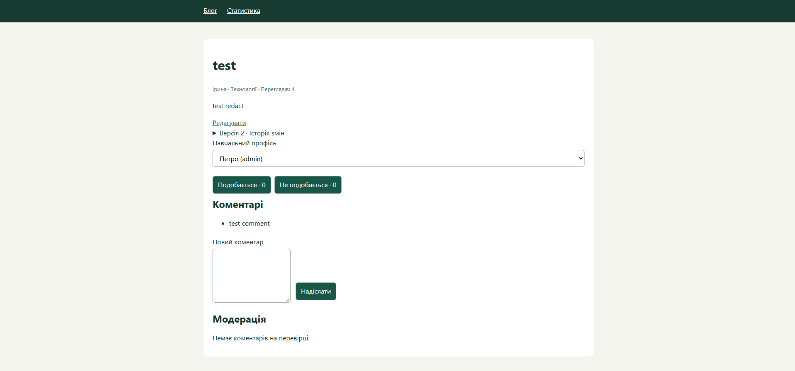

## Рівень 3. Історія, відповіді й аналітика

Під час редагування попередні значення зберігаються в `history`, а номер версії збільшується. У тестовому дописі текст змінився з «test» на «test redact», а номер версії з 1 на 2.

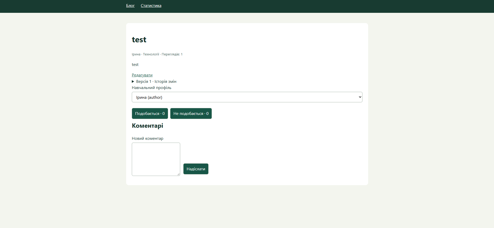

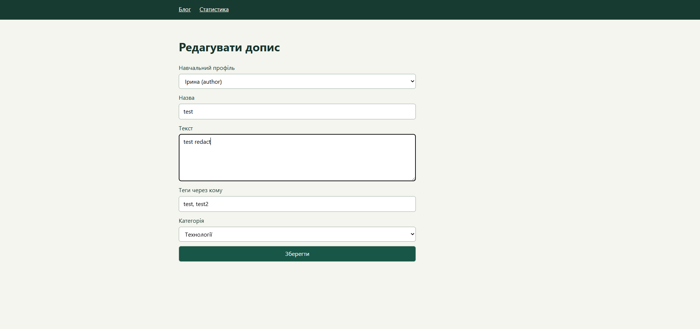

Відповіді зберігаються в масиві `replies` коментаря. Відповідь теж може містити відповіді. Після схвалення інтерфейс показує їх під батьківським коментарем. Сторінка сповіщень показує автору останні коментарі інших користувачів до його дописів.

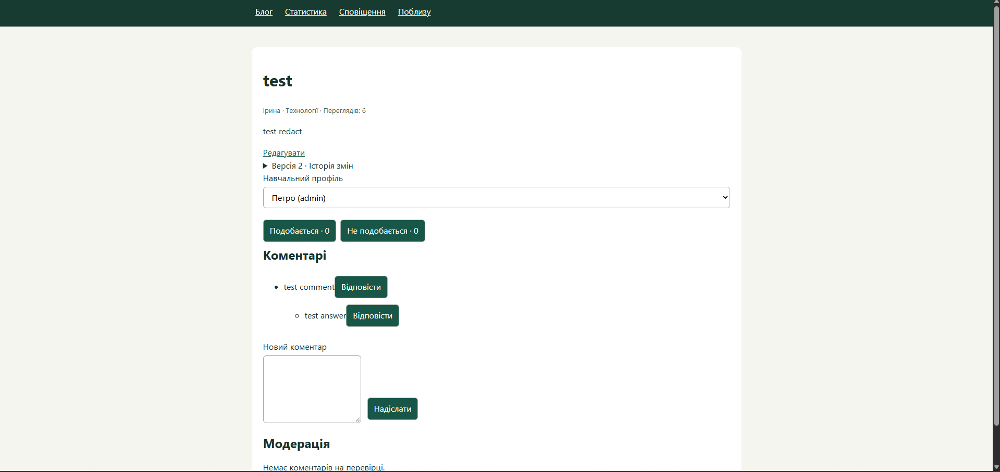

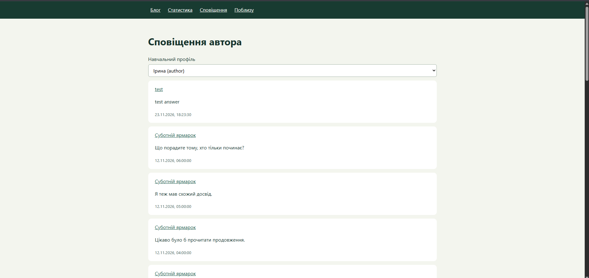

Координати зберігаються як GeoJSON Point у порядку довгота, широта. Індекс `2dsphere` та етап `$geoNear` дозволяють знайти дописи в радіусі 20 км. Тестовий допис за заданими координатами знайдено на відстані 0 м.

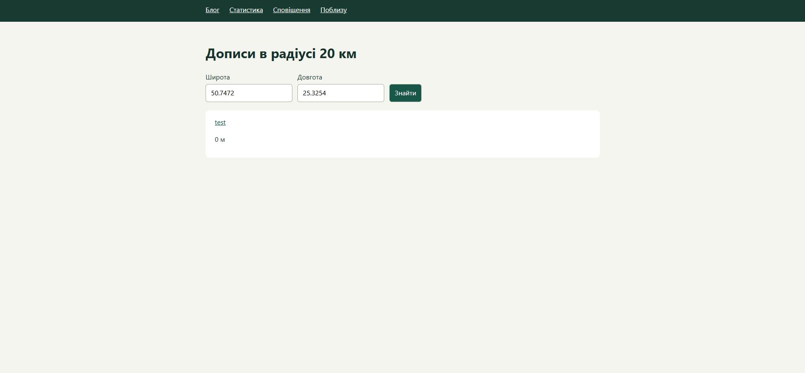

Панель показує кількість дописів, коментарів та переглядів. На двох графіках видно десять авторів і категорії за кількістю дописів. На момент перевірки було 51 допис і 202 коментарі разом із вкладеною відповіддю.

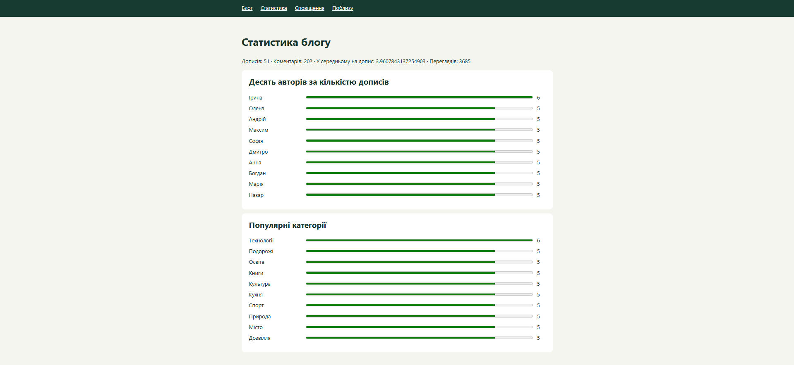

### REST API і кеш

| Запит | Дія |
|---|---|
| `GET /api/posts` | Список із пагінацією та пошуком |
| `GET /api/posts/:id` | Окремий допис та оновлення лічильника переглядів |
| `POST /api/posts` | Створення допису |
| `PATCH /api/posts/:id` | Редагування зі збереженням попередньої версії |
| `POST /api/posts/:id/vote` | Лайк або дизлайк |
| `POST /api/posts/:id/comments` | Коментар або вкладена відповідь |
| `GET /api/posts/:id/review`, `POST /api/posts/:id/moderate` | Перегляд черги та рішення модератора |
| `GET /api/notifications`, `GET /api/nearby`, `GET /api/statistics` | Сповіщення, геопошук, статистика |

Список дописів кешується на 30 секунд за сторінкою, текстом пошуку й тегами. Створення та редагування допису очищають кеш. Два запити на четверту сторінку повернули HTTP 200 та по 10 дописів. Перший мав заголовок `X-Cache: MISS`, другий `X-Cache: HIT`.

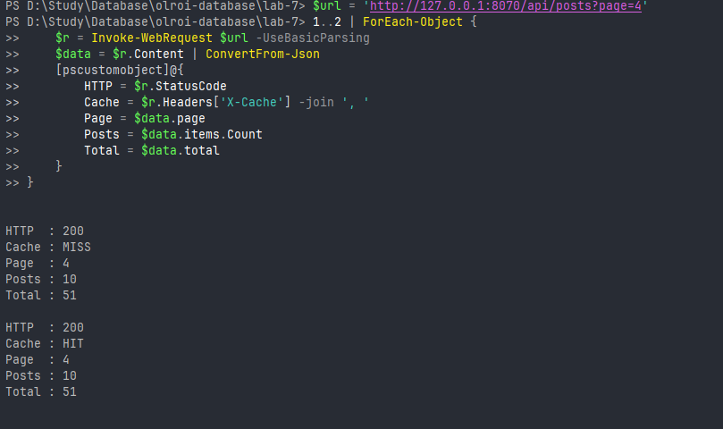

### Порівняння з PostgreSQL

У MongoDB коментарі та відповіді лежать усередині допису. У [схемі PostgreSQL](benchmark.sql) вони лежать в окремій таблиці, де `parent_id` посилається на батьківський коментар того самого допису. Зовнішні ключі зв’язують дописи з авторами та категоріями.

[Скрипт тесту](benchmark.js) переносить той самий набір у тимчасові таблиці, перевіряє збіг результатів та вимірює час отримання відповіді через драйвер. Для кожної пари запитів виконано 25 вимірювань після першого запуску. Використано 51 допис, 202 коментарі, 20 користувачів і 10 категорій.

| Запит | Рядків | MongoDB, мс | PostgreSQL, мс |
|---|---:|---:|---:|
| Дописи автора | 5 | 0,706 | 0,275 |
| Кількість за категоріями | 10 | 0,885 | 0,279 |

У цьому запуску PostgreSQL повернула відповіді швидше. Виміряно два запити на малому наборі, тому ці числа описують лише цей тест.

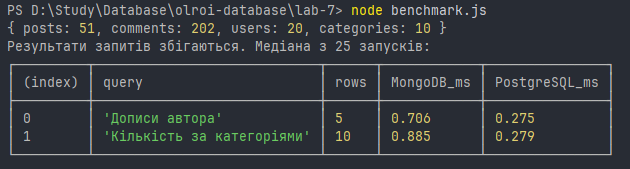

## Запуск

З папки лабораторної виконати `npm.cmd ci`, потім `npm.cmd start`. Відкрити `http://127.0.0.1:8070/`. За замовчуванням сервер використовує `blog_lab7` на локальній MongoDB. Для порівняння запустити `node benchmark.js`. Скрипт бере параметри PostgreSQL з `PGHOST`, `PGPORT`, `PGUSER`, `PGPASSWORD`, `PGDATABASE` або використовує відповідні наявні параметри з `lab-4/.env`. Типова база для тесту PostgreSQL має назву `postgres`. Вибір навчального профілю демонструє ролі без входу за паролем.

## Відповіді на контрольні запитання

1. **Проєктування схеми.** Спочатку визначаю, що користувачі читають і змінюють разом. Також враховую розмір документів, частоту запису та потрібні індекси.
2. **Вкладення й посилання.** Коментарі зручно вкладати в допис, якщо їх читають разом. На автора краще посилатися, бо він спільний для багатьох дописів.
3. **Денормалізація.** Дублювання або вкладення даних може спростити читання. Дублікати займають місце, і після змін їх потрібно узгоджувати.
4. **Пагінація.** Для малих списків підходять `$skip` і `$limit`. Для далеких сторінок краще брати записи після останньої пари `createdAt` та `_id` за відповідним індексом.
5. **Bucket.** Пов’язані записи групують у документи обмеженого розміру. Це підходить для рядів вимірювань, журналів і подій за період.
6. **Узгодженість.** Зміни в одному документі можна виконати атомарно. Для кількох документів можна використати транзакцію або явно синхронізувати копії.
7. **Індекси блогу.** Для стрічки потрібен індекс за датою, для добірок підходять складені індекси за автором чи категорією та датою. Текст, теги й координати потребують відповідних індексів.
8. **Масштабування.** Вертикальне додає ресурси одному серверу. Горизонтальне розподіляє навантаження або дані між серверами.
9. **Транзакції.** Через сесію драйвера можна групувати операції на наборі реплік або в шардованому кластері. Довгі транзакції споживають ресурси й можуть вимагати повтору при конфлікті.
10. **Метрики.** Варто порівнювати час відповіді, пропускну здатність, кількість переглянутих рядків чи документів і ресурси сервера. Для чесного тесту потрібні однакові дані й однаковий зміст запитів.

## Висновки

У цій роботі я створив блог на MongoDB. Перевірив пошук, додавання допису, редагування, модерацію та вкладені відповіді. Також перевірив, що автор бачить новий коментар у сповіщеннях, а повторний запит до списку дописів бере дані з кешу. Під час порівняння двох запитів MongoDB і PostgreSQL повернули однакові результати.
